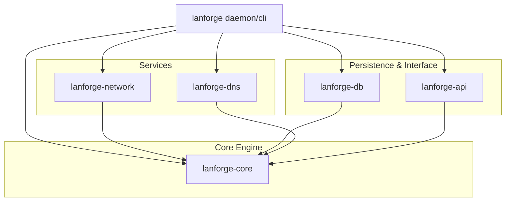
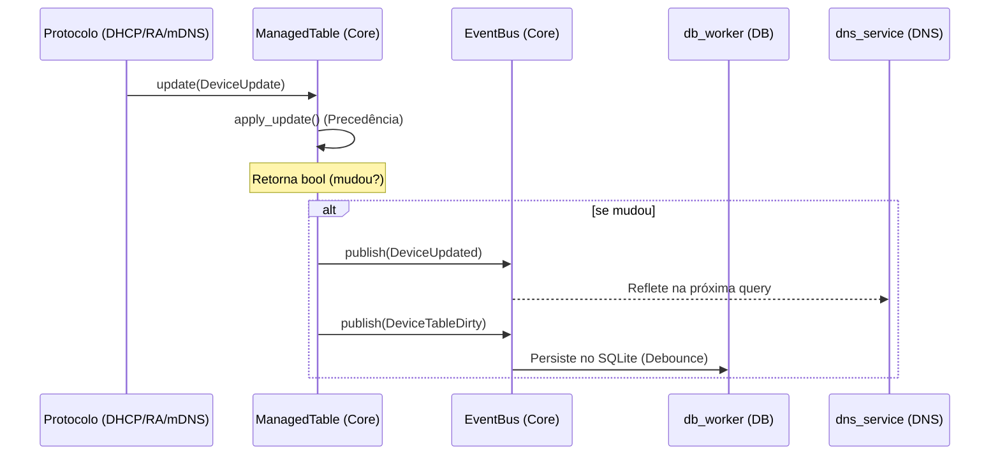

# LANforge — Arquitetura

Daemon unificado de controle de rede IPv4/IPv6 para Raspberry Pi 4B.
O `lanforge` gerencia a identidade de dispositivos na rede local através da integração de múltiplos protocolos, oferecendo um estado único e consistente.

---

## Filosofia Central

O programa nasceu como um tracker de SLAAC (`ipv6_namer`) e evoluiu para um ecossistema **device-first**: o `lanforge` mantém a identidade primária de *quem está na rede* e deriva serviços (IP, DNS, RA) em função dessa identidade.

**Decisões de Design:**
- **Single Process, Multi-Crate**: Organizado como um workspace Rust para separar preocupações (Core, Network, DB, DNS, API).
- **ManagedTable**: Uma autoridade única de estado protegida por `RwLock` e alimentada por um barramento de eventos.
- **Protocolos Reativos**: Serviços não mantêm estado próprio; eles consultam ou atualizam o `ManagedTable`.
- **Precedência de Identidade**: Configurações estáticas (TOML/CLI) sempre superam descobertas dinâmicas (DHCP/mDNS).

---

## Visão Geral do Workspace

O projeto é dividido em crates especializadas para garantir modularidade e facilitar testes.



### Responsabilidades por Crate

| Crate | Responsabilidade |
| :--- | :--- |
| `lanforge-core` | Tipos fundamentais (`Device`, `MacAddr`), `ManagedTable` e `EventBus`. |
| `lanforge-network` | Implementação de protocolos (`DHCPv4`, `DHCPv6`, `RA`, `SLAAC`, `mDNS`) e monitoramento `Netlink`. |
| `lanforge-db` | Persistência em SQLite e motor de logs históricos (`LogEngine`). |
| `lanforge-dns` | Servidor DNS autoritativo e recursivo (cache + upstream forwarding). |
| `lanforge-api` | Servidor JSON-RPC via Unix Domain Socket (UDS) para controle e CLI. |

---

## Fluxo de Estado e Eventos

Nenhum módulo escreve diretamente nos campos de um dispositivo. O caminho único é via `DeviceUpdate`.



### Regras de Precedência (Hostname)
O sistema implementa uma hierarquia rígida de origem para nomes de host:
1. **Static** (Configurado via TOML ou CLI `host --set`)
2. **DHCP** (Informado pelo cliente no pacote DHCP Request)
3. **mDNS** (Descoberto via Probing passivo ou ativo)
4. **None** (Fallback: `host-{mac}`)

---

## Serviços de Rede (`lanforge-network`)

### DHCPv4 & DHCPv6
- **v4**: Escuta via `AF_PACKET` (raw socket) para gerenciar leases antes da interface ter IP.
- **v6**: Stateful DHCPv6 (IA_NA) e Prefix Delegation (IA_PD).
- **Identidade**: Associa DUIDs a endereços MAC dinamicamente via monitoramento de vizinhos.

### mDNS Prober
O mDNS atua de duas formas:
1. **Passivo**: Escuta anúncios mDNS na rede para aprender hostnames.
2. **Ativo**: Ao descobrir um novo IP via Netlink/ARP que não possui hostname, dispara um probe reativo para tentar resolver o nome.

### RA (Router Advertisement)
- Implementa RFC 4861 e 8106.
- Detecta o prefixo **GUA** dinamicamente a partir da interface WAN e propaga para a LAN via `PrefixChanged`.

---

## Persistência (`lanforge-db`)

O sistema utiliza SQLite com duas finalidades distintas:
1. **Lease Database**: Armazena o `DeviceTable` atual para persistência entre reboots.
2. **Log Engine**: Registra eventos históricos (`DeviceDiscovered`, `PrefixChanged`) para auditoria e interface visual.

**Otimização de Escrita**: O `db_worker` utiliza um mecanismo de **debounce** (padrão 3s). Durante um "boot storm" (muitos dispositivos conectando ao mesmo tempo), o sistema realiza apenas uma escrita física no final do processo, protegendo a vida útil do cartão SD do Raspberry Pi.

---

## Controle e API (`lanforge-api`)

O daemon expõe um socket Unix (`/run/lanforge/lanforge.sock`) que aceita comandos JSON-RPC. A CLI oficial utiliza esta interface para:
- Listar dispositivos em tempo real.
- Modificar configurações de host em runtime.
- Visualizar logs e status de serviços.

---

## Estrutura de Arquivos (Workspace)

```text
.
├── lanforge-api/        # JSON-RPC Server & Handlers
├── lanforge-core/       # Shared State, Bus & Identifiers
├── lanforge-db/         # SQLite Engine & db_worker
├── lanforge-dns/        # Authoritative DNS Server
├── lanforge-network/    # DHCP, RA, mDNS, Netlink logic
└── src/
    ├── main.rs          # Daemon Bootstrap & Orchestration
    ├── cli/             # CLI Command Implementation
    ├── config/          # TOML Parsing & Static Overrides
    └── supervisor.rs    # Task supervisor with backoff
```

---

## Roadmap

### ✅ Implementado (v0.9.x)
- Arquitetura multi-crate estável.
- DHCPv4, DHCPv6, RA e SLAAC tracker.
- mDNS Probing (Ativo/Passivo).
- DNS autoritativo integrado ao estado.
- Persistência reativa com debounce.
- CLI modular e socket de controle JSON-RPC.
- Graceful shutdown (SIGTERM/SIGINT).

### 🔜 Próximas Fases
- **Fase 6 — Webview**: Interface visual embutida (Next.js/Axum).
- **Fase 7 — PPPoE monitor**: Melhor integração com status do link WAN.
- **Fase 8 — DHCPv4 Refresh**: Implementar FORCERENEW (RFC 3203) no startup.
- **Fase 9 — Observabilidade**: Exportador de métricas Prometheus integradas.