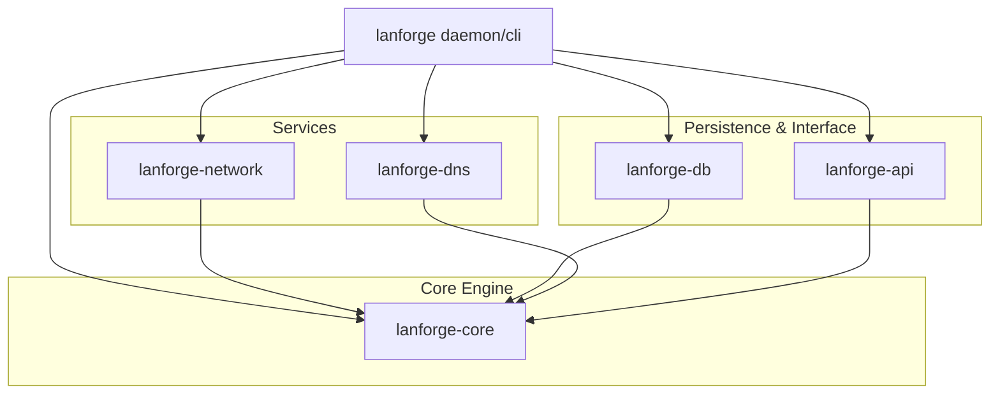
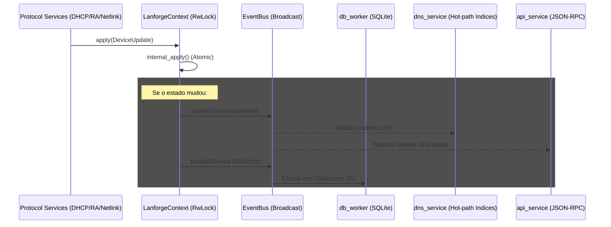
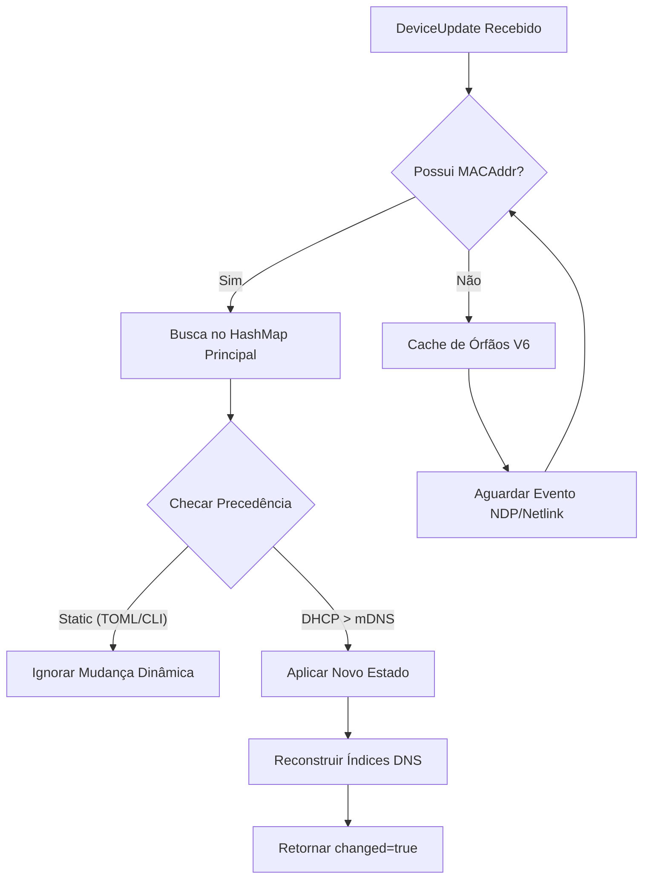
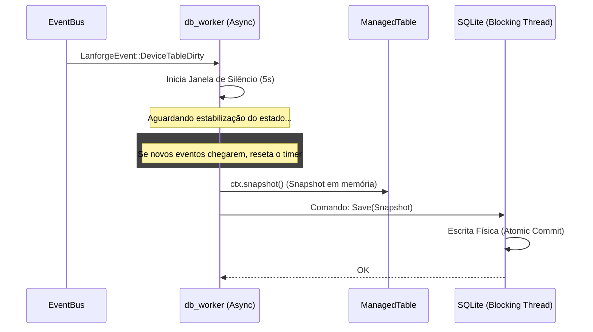

# LANforge — Arquitetura

Daemon unificado de controle de rede IPv4/IPv6 para Raspberry Pi 4B.
O `lanforge` gerencia a identidade de dispositivos na rede local através da integração de múltiplos protocolos, oferecendo um estado único e consistente.

---

## Filosofia Central

O programa nasceu como um tracker de SLAAC (`ipv6_namer`) e evoluiu para um ecossistema **device-first**: o `lanforge` mantém a identidade primária de *quem está na rede* e deriva serviços (IP, DNS, RA) em função dessa identidade.

**Decisões de Design:**
- **Single Process, Multi-Crate**: Organizado como um workspace Rust para separar preocupações (Core, Network, DB, DNS, API).
- **LanforgeContext**: Uma autoridade única de estado protegida por `RwLock` e alimentada por um barramento de eventos.
- **Protocolos Reativos**: Serviços não mantêm estado próprio; eles consultam ou atualizam o `LanforgeContext`.
- **Precedência de Identidade**: Configurações estáticas (TOML/CLI) sempre superam descobertas dinâmicas (DHCP/mDNS).

---

## Visão Geral do Workspace

O projeto é dividido em crates especializadas para garantir modularidade e facilitar testes.

### Responsabilidades por Crate

| Crate | Responsabilidade |
| :--- | :--- |
| `lanforge-core` | Tipos fundamentais (`Device`, `MacAddr`), `LanforgeContext` e `EventBus`. |
| `lanforge-network` | Implementação de protocolos (`DHCPv4`, `DHCPv6`, `RA`, `SLAAC`, `mDNS`) e monitoramento `Netlink`. |
| `lanforge-db` | Persistência em SQLite e motor de logs históricos (`LogEngine`). |
| `lanforge-dns` | Servidor DNS autoritativo e recursivo (cache + upstream forwarding). |
| `lanforge-api` | Servidor JSON-RPC via Unix Domain Socket (UDS) para controle e CLI. |

---

## Core Engine Deep-Dive (`lanforge-core`)

A `lanforge-core` é o coração reativo do sistema. Ela não executa I/O de rede ou disco diretamente, mas orquestra como os dados fluem entre esses módulos usando um modelo de **Barramento de Eventos** e uma **Tabela de Estado Gerenciada** exposta via `LanforgeContext`.

### 1. O Modelo de Mutação Baseado em Intenção
Nenhum módulo escreve diretamente nos campos de um dispositivo. O caminho único para alteração de estado é via o enum `DeviceUpdate`. Isso garante que todas as transações de estado passem pela mesma lógica de validação e precedência.

#### Fluxo de Execução e Orquestração
Este diagrama ilustra como o `ManagedTable` e o `EventBus` conectam todos os serviços do daemon:

### 2. Lógica de Precedência (`apply_update`)
O sistema resolve conflitos de identidade (ex: dois protocolos sugerindo hostnames diferentes) usando uma hierarquia rígida definida em `lanforge-core/src/state/update.rs`.

### 3. Mecanismo de Órfãos IPv6
Como o DHCPv6 usa DUIDs em vez de MACs, e o kernel linux nem sempre associa um IP a um MAC imediatamente, o `lanforge` implementa um cache de órfãos.
- **Processo**: Se um lease DHCPv6 chega sem MAC associado, ele é guardado no `orphaned_v6`.
- **Resolução**: Quando o monitor `Netlink` detecta um evento de vizinhança (Neighbor Discovery) para aquele IP, ele "casa" o MAC com o lease pendente e integra o dispositivo à tabela principal.

### Regras de Precedência (Hostname)
O sistema implementa uma hierarquia rígida de origem para nomes de host:
1. **Static** (Configurado via TOML ou CLI `host --set`)
2. **DHCP** (Informado pelo cliente no pacote DHCP Request)
3. **mDNS** (Descoberto via Probing passivo ou ativo)
4. **None** (Fallback: `host-{mac}`)

---

## Serviços de Rede (`lanforge-network`)

Os serviços de rede são os "sensores" e "atuadores" do sistema. Eles alimentam a `LanforgeContext` com descobertas e reagem a mudanças globais (como a troca de um prefixo ISP).

### 1. DHCPv4 (RFC 2131)
Diferente de implementações padrão, o `lanforge` utiliza **Raw Sockets (`AF_PACKET`)** para a injeção de pacotes na Camada 2.
- **Por que?**: Clientes DHCPv4 em estado `SELECTING/REQUESTING` ainda não possuem IP e não podem responder a ARPs. O `AF_PACKET` permite enviar o `DHCP ACK` mapeado diretamente ao MAC do cliente via interface raw.
- **Sincronização (RFC 3203)**: No startup, o daemon envia pacotes `FORCERENEW` para todos os leases dinâmicos ativos. Isso força os clientes a re-validarem seu estado imediatamente, garantindo que a tabela de dispositivos reflita a realidade da rede logo após o boot.

### 2. DHCPv6 e IA_PD (RFC 3315)
O `lanforge` suporta DHCPv6 Stateful, gerenciando tanto endereços individuais (`IA_NA`) quanto delegação de prefixos (`IA_PD`).
- **IA_PD**: Essencial para roteadores em cascata na rede local que precisam de seus próprios prefixos `/64`.
- **DUID-MAC Binding**: Como o DHCPv6 usa Identificadores Únicos de Dispositivo (DUIDs), o sistema correlaciona esses IDs com MACs físicos através do monitoramento passivo de pacotes Solicit e Advertise.

### 3. Router Advertisement e Derivação de Prefixo (RFC 4861, 8106)
O serviço de RA do `lanforge` é dinâmico e auto-adaptativo.
- **Monitoramento WAN**: O sistema detecta o prefixo **Global Unicast Address (GUA)** atribuído à interface WAN e o propaga para a LAN.
- **Anúncio de DNS**: Implementa a opção **RDNSS**, permitindo que dispositivos IPv6-only (como Android) descubram o servidor DNS local sem necessidade de DHCPv6.

### 4. mDNS Prober (RFC 6762)
O mDNS atua como um sistema de descoberta de hostnames de "melhor esforço".
- **Passivo**: Escuta continuamente o tráfego multicast na porta 5353 para aprender nomes `.local`.
- **Ativo**: Quando um novo dispositivo surge via Netlink/ARP e não possui hostname, o prober dispara uma query PTR unicast direcionada para o IP recém-descoberto, tentando extrair o nome do host sem inundar a rede com multicast desnecessário.

### 5. Netlink Monitor
O sistema escuta o barramento `RTMGRP_NEIGH` do kernel Linux. Isso permite que o `lanforge` saiba instantaneamente quando um dispositivo entra ou sai da rede (mudanças no estado `REACHABLE` / `STALE` / `FAILED` da tabela ARP/Neighbor do kernel).

---

## Persistência (`lanforge-db`)

O sistema utiliza SQLite com uma estratégia de escrita otimizada para dispositivos embarcados (Raspberry Pi), visando minimizar o desgaste do cartão SD.

### 1. Motores de Banco de Dados
- **`LeaseDb`**: Armazena o `DeviceTable` atual. É o banco de "estado" que permite ao daemon recuperar leases e configurações estáticas após um reboot.
- **`LogDb`**: Banco de histórico que registra eventos (`DeviceDiscovered`, `PrefixChanged`). Alimenta a auditoria técnica e a futura interface visual.

### 2. Estratégia de Debounce (SD Card Protection)
Para evitar micro-escritas constantes (ex: durante um "boot storm" de 50 dispositivos), o `db_worker` implementa um mecanismo de **Trailing Edge Debounce**.

- **Silêncio (5s)**: Tempo de espera após a última mudança.
- **Duração Máxima (60s)**: Se o estado nunca parar de mudar, força uma escrita após 1 minuto para evitar perda massiva de dados.

---

## Servidor DNS (`lanforge-dns`)

O componente de DNS é otimizado para latência ultra-baixa em consultas locais, utilizando uma arquitetura de "Hot-Path" e Forwarding.

### 1. Hot-Path e Zero-Allocation Parser
O servidor utiliza um parser de rede customizado (`lanforge-dns/src/wire/`) que analisa o pacote DNS sem realizar alocações de memória ou parsing completo (via strings) para decidir a rota:
- **Consultas Locais**: Se o hostname termina no domínio configurado (ex: `.lan`), a resposta é gerada imediatamente usando os índices da `ManagedTable`.
- **Forwarding (Recursão)**: Consultas externas são encaminhadas via `UpstreamManager` para resolvers públicos (Google/Cloudflare).

### 2. Índices de Alta Performance (O(1))
Para garantir que as queries DNS não sofram contenção, a `LanforgeContext` reconstrói índices de busca rápida sempre que o estado atômico muda:
- `dns_v4_index`: Mapa `Hostname -> Ipv4Addr`.
- `dns_v6_index`: Mapa `Hostname -> Vec<Ipv6Addr>`.
- `reverse_index`: Mapa `IpAddr -> Hostname`.

Isso permite que o servidor DNS responda em microsegundos, consultando um `HashMap` pré-aquecido em vez de iterar sobre a lista total de dispositivos.

---

## Controle e API (`lanforge-api`)

O daemon expõe uma interface de controle baseada em **JSON-RPC** sobre **Unix Domain Sockets (UDS)**, localizada por padrão em `/run/lanforge/lanforge.sock`.

### 1. Modelo de Segurança e Acesso
Diferente de uma API HTTP, o uso de UDS permite que a segurança seja gerenciada pelas permissões do sistema de arquivos do Linux. O socket é criado com permissões controladas, permitindo que apenas o usuário `root` ou membros de um grupo específico (conforme configurado no systemd) enviem comandos ao daemon.

### 2. Comandos Principais
A interface suporta operações síncronas e streaming de eventos:

| Comando | Descrição | Impacto no Sistema |
| :--- | :--- | :--- |
| `status` | Retorna o uptime, prefixo atual e saúde dos serviços. | Leitura simples. |
| `devices` | Lista a tabela completa de dispositivos com filtros. | Leitura da `LanforgeContext`. |
| `host-set` | Modifica hostname ou reserva IP de um dispositivo. | Dispara `DeviceUpdate::CliHostUpdated`. |
| `watch` | Abre um stream persistente de eventos do `EventBus`. | Mantém conexão UDS aberta. |
| `lease-renew` | Força um `FORCERENEW` (v4) ou `RECONFIGURE` (v6). | Atuação direta na rede. |

### 3. Integração com CLI
A CLI do `lanforge` funciona como um cliente leve que serializa os argumentos da linha de comando em JSON e os envia pelo socket. Isso garante que a lógica de negócio resida inteiramente no daemon, mantendo o estado centralizado e consistente.

---

## Orquestração e Resiliência (`src/`)

O `lanforge` é projetado para ser um "serviço de infraestrutura de missão crítica". Se o DHCP ou DNS caírem, a rede inteira para. Por isso, o daemon implementa estratégias rigorosas de bootstrap e supervisão.

### 1. Ciclo de Bootstrap Hierárquico
O `main.rs` coordena uma sequência de inicialização que garante que as dependências de estado estejam prontas antes dos protocolos começarem a falar na rede:
1. **Carregamento de Configuração**: TOML + Overrides de CLI.
2. **Iniciação do EventBus**: O barramento deve existir antes de qualquer worker.
3. **Hidratação de Estado**: Carrega o último snapshot do SQLite e aplica as regras estáticas do TOML (que têm precedência).
4. **Aquecimento de Índices**: Reconstrói os mapas DNS O(1).
5. **Spawn de Workers**: Dispara os serviços de rede e API.

### 2. Supervisores de Tasks (`supervisor.rs`)
Cada serviço de protocolo (DHCP, RA, DNS) é encapsulado em um **Supervisor**.
- **Monitoramento**: Se uma task de rede falhar (ex: porta ocupada ou erro de socket temporário), o supervisor detecta a queda.
- **Backoff Exponencial**: O sistema tenta reiniciar a task com tempos de espera crescentes (ex: 5s, 10s, 20s...) para evitar loops infinitos de erro que consumam toda a CPU.
- **Criticality**: Serviços marcados como críticos (como o DHCP) podem forçar o encerramento do processo inteiro se esgotarem as tentativas de reinício, permitindo que o `systemd` tente uma recuperação de nível superior.

### 3. Graceful Shutdown
Ao receber um sinal `SIGTERM` ou `SIGINT`, o daemon:
1. Publica `LanforgeEvent::Shutdown` no barramento.
2. Cada worker (DHCP, RA, DNS) capta o sinal e fecha seus sockets de forma limpa.
3. O `db_worker` realiza um **Flush Final**, garantindo que nenhum lease em memória seja perdido antes do processo terminar.

---

## Roadmap

### ✅ Implementado (v0.9.x)
- Arquitetura multi-crate estável.
- DHCPv4, DHCPv6, RA e SLAAC tracker.
- mDNS Probing (Ativo/Passivo).
- DNS autoritativo integrado ao estado.
- Persistência reativa com debounce.
- CLI modular e socket de controle JSON-RPC.
- Graceful shutdown (SIGTERM/SIGINT).
- Envio de FORCERENEW (RFC 3203) no startup para sincronização de clientes.

### 🔜 Próximas Fases
- **Fase 6 — Webview**: Interface visual embutida (Next.js/Axum).
- **Fase 7 — Observabilidade**: Exportador de métricas Prometheus integradas.
- **Fase 8 — PPPoE monitor**: (Adiado) Melhor integração com status do link WAN.