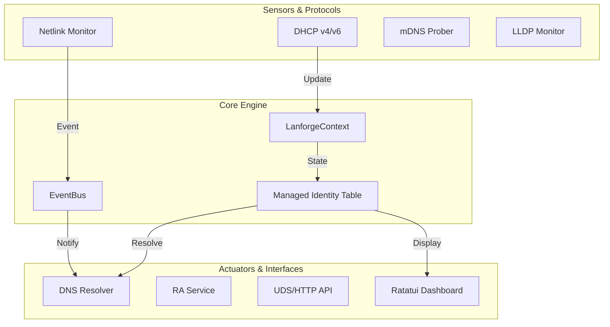

# lanforge 🚀

> **Unified Network Orchestration for Linux Edge Gateways.**

**lanforge** is a modern, single-process network daemon built in Rust. It replaces the fragmented stack of `radvd`, `dnsmasq`, and various custom tracking scripts typically used on Raspberry Pi routers and Linux gateways. 

By maintaining a **unified, reactive identity table** for every device on your network, Lanforge ensures that hostnames, IPv4/IPv6 leases, and SLAAC addresses are always consistent, persistent, and instantly available—even across reboots.

---

## ✨ Key Features

- **🌐 Comprehensive Address Management**
  - **DHCPv4 Server**: High-performance implementation using Layer 2 Raw Sockets for maximum compatibility.
  - **DHCPv6 Server**: Supports Stateful Address Assignment (IA_NA) and Prefix Delegation (IA_PD).
  - **Router Advertisements (RA)**: Dynamic RA with RDNSS and DNSSL support; automatically adapts to WAN prefix changes.
  - **SLAAC Tracking**: Advanced correlation of IPv6 SLAAC addresses to physical devices.

- **🔍 Intelligent Device Discovery**
  - **Passive Monitoring**: Real-time tracking via Netlink (ARP/NDP) and mDNS sniffing.
  - **Active Probing**: Direct mDNS queries and LLDP topology extraction to build a rich map of your network.
  - **Vendor Resolution**: Integrated MAC OUI lookup for easy device identification.

- **🛡️ Modern DNS Stack**
  - **Unified Resolver**: Combines authoritative local resolution with recursive upstream forwarding.
  - **Secure Protocols**: Support for **DNS-over-TLS (DoT)**, **DNS-over-QUIC (DoQ)**, and **DNS-over-HTTPS (DoH)**.
  - **Micro-Adblocker**: Ultra-fast, zero-allocation domain filtering with support for custom blocklists and allowlists.

- **🛠️ Management & Observability**
  - **Interactive TUI**: A real-time dashboard built with `ratatui` for visual network monitoring.
  - **Powerful CLI**: Manage leases, trigger scans, perform "Whois" on devices, and control the adblocker.
  - **Rich APIs**: JSON-RPC over Unix Domain Sockets (UDS) and a feature-gated REST/HTTP API.

- **💾 Resilient Persistence**
  - **Atomic State**: Backed by embedded `redb` (or volatile in-memory/tmpfs).
  - **SD-Card Friendly**: Intelligent write-debounce logic minimizes disk I/O, preserving edge hardware longevity.

---

## 🏗️ Architecture

Lanforge follows a reactive, event-driven architecture centered around a shared `LanforgeContext`.



See [**ARCHITECTURE.md**](docs/ARCHITECTURE.md) for a deep dive into the design decisions and internal mechanics.

---

## 🚀 Quick Start

### 1. Build
Requires Rust 1.75+ and `cap-net-raw` capabilities.
```bash
cargo build --release
```

### 2. Install
The included systemd unit handles the necessary capabilities for raw socket access.
```bash
# Install binary and config
sudo install -Dm755 target/release/lanforge /usr/local/sbin/lanforge
sudo install -Dm644 contrib/lanforge.toml /etc/lanforge/lanforge.toml

# Enable and start
sudo systemctl enable --now lanforge
```

### 3. Configure
A minimal `lanforge.toml` example:
```toml
[system]
iface = "eth0"
search_domains = ["lan", "home.arpa"]

[dhcp.v4]
enabled = true
router = "192.168.1.1"
subnet_mask = "255.255.255.0"
dns = ["192.168.1.1"]

[[dhcp.v4.pools]]
range_start = "192.168.1.100"
range_end = "192.168.1.250"

[dns]
enabled = true
listen = "0.0.0.0:53"
```

---

## ⌨️ CLI & TUI

Lanforge comes with a powerful CLI (`lanforge-cli`) to interact with the running daemon.

```bash
# View the interactive dashboard
lanforge tui

# List all discovered devices with vendor info
lanforge devices --show-vendor

# Monitor the internal event bus in real-time
lanforge log --follow

# Check DNS stats and manage the adblocker
lanforge dns stats
lanforge dns adblock enable
```

---

## 🗺️ Project Status

Lanforge is currently in active development. Major core features (DHCP, RA, DNS, TUI) are stable and used in production home-lab environments.

---

## 📄 License

Mozilla Public License 2.0 © FerrahWolfeh
