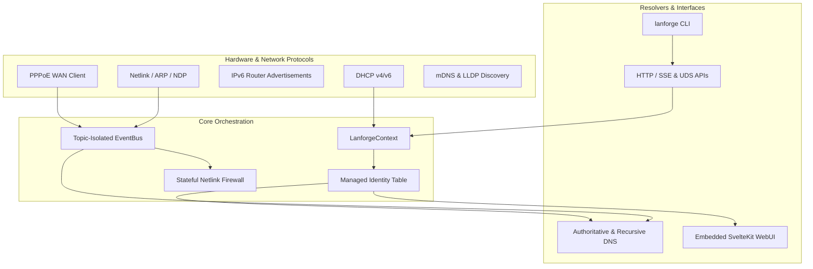

# lanforge 🚀

> **Unified Network Orchestration, Routing, and LAN Gateway for Linux.**

**lanforge** is a high-performance, resource-efficient network daemon built in Rust. Designed for Linux edge gateways, domestic homelabs, and SBC appliances (Raspberry Pi, NanoPi, x86 mini-PCs), it replaces the fragmented combination of `radvd`, `dnsmasq`, `nftables` scripts, and external adblockers with an integrated, single-process platform.

Maintaining a **unified, reactive identity table** for every device on your network, Lanforge keeps hostnames, IPv4/IPv6 leases, and SLAAC addresses persistent, consistent, and instantly available across reboots.

---

## ✨ Key Features

- **🌐 Core LAN & Addressing Engine**
  - **DHCPv4 Server**: High-performance Layer 2 Raw Socket implementation with dynamic pools and static host pinning.
  - **DHCPv6 Server**: Stateful Address Assignment (`IA_NA`) and Prefix Delegation (`IA_PD`).
  - **Router Advertisements (RA)**: Dynamic IPv6 RA with RDNSS and DNSSL, automatically adapting to WAN prefix changes.
  - **SLAAC Tracking**: Real-time correlation of IPv6 SLAAC addresses to physical MAC/DUID identities.

- **🛡️ Stateful Firewall & Traffic Security (`lanforge-nft`)**
  - **Zero-Downtime Compilation**: Stateful Netlink/nftables ruleset compiled and applied in-place (~5ms) without dropping active sockets or reloading services.
  - **Strict WAN Boundary**: Default `DROP` policy on external interfaces (`ppp0`, `wan0`), restricted DNAT verification, and granular port forwarding / IPv6 pinholes.

- **⚡ PPPoE WAN Client (`lanforge-pppoe`)**
  - Native asynchronous PPPoE discovery, session management, and kernel PPP interface binding with automatic link recovery and LCP keepalives.

- **🔍 Network Discovery & Device Tracking (`lanforge-discovery`, `lanforge-wol`)**
  - **Passive & Active Discovery**: Real-time tracking via Netlink (ARP/NDP), mDNS sniffing, active probes, and LLDP topology extraction.
  - **Vendor Resolution**: Integrated MAC OUI lookup for effortless device identification.
  - **Wake-on-LAN (WoL)**: Magic packet injection directly from CLI, WebUI, or API.

- **🔒 High-Performance DNS Stack (`lanforge-dns`, `lanforge-dns-wire`)**
  - **Authoritative & Recursive Resolver**: Blazing fast local resolution combined with encrypted upstream forwarding.
  - **Modern Transports**: Native support for **DNS-over-TLS (DoT)**, **DNS-over-QUIC (DoQ)**, and **DNS-over-HTTPS (DoH)**.
  - **Micro-Adblocker**: Zero-allocation hot-path domain filtering with custom blocklists, allowlists, and real-time query logging.

- **🖥️ Modern WebUI & Rich APIs**
  - **Embedded SvelteKit WebUI**: Full-featured, responsive management dashboard built with SvelteKit, shadcn-svelte, and Tailwind CSS.
  - **Rich APIs**: JSON-RPC over Unix Domain Sockets (UDS) and REST / Server-Sent Events (SSE) over HTTP.
  - **Admin CLI & Lab Testbed**: Complete `lanforge` CLI tool and `lanforge-lab` rootless simulation testbed.

- **💾 Resilient Embedded Persistence (`lanforge-db`)**
  - **Atomic Storage**: Embedded `redb` database with transactional state updates (or volatile in-memory/tmpfs mode).
  - **SD-Card Friendly**: Intelligent batched and debounced write cycles to preserve flash memory longevity.

---

## 🏗️ Architecture

Lanforge follows a reactive, event-driven CQRS architecture centered around `LanforgeContext` and a topic-isolated broadcast `EventBus`:



See [**ARCHITECTURE.md**](docs/ARCHITECTURE.md) and [**NETWORKING_ARCH.md**](docs/NETWORKING_ARCH.md) for deep dives into system internals and invariants.

---

## 🚀 Quick Start

### 1. Build
Requires Rust 1.85+ (Edition 2024), Node.js / pnpm (for WebUI), and standard Linux build tools.

```bash
# Build the WebUI assets
cd web && pnpm install && pnpm build && cd ..

# Build the release binaries (lanforged daemon and lanforge CLI)
cargo build --release
```

### 2. Install
The release binaries and systemd unit can be installed directly:

```bash
# Install binaries
sudo install -Dm755 target/release/lanforge /usr/local/bin/lanforged
sudo install -Dm755 target/release/lanforge-cli /usr/local/bin/lanforge

# Install configuration and systemd service
sudo install -Dm640 contrib/lanforge.toml /etc/lanforge/lanforge.toml
sudo install -Dm644 contrib/lanforge.service /etc/systemd/system/lanforge.service

# Enable and start the service
sudo systemctl daemon-reload
sudo systemctl enable --now lanforge
```

### 3. Minimal Configuration (`/etc/lanforge/lanforge.toml`)
```toml
[system]
iface = "eth0"
search_domains = ["lan", "home.arpa"]

[dhcp.v4]
enabled = true
router = "192.168.1.1"
subnet_mask = "255.255.255.0"
dns = ["192.168.1.1"]

[[dhcp.v4.pools]]
range_start = "192.168.1.100"
range_end = "192.168.1.250"

[dns]
enabled = true
listen = "0.0.0.0:53"

[http]
enabled = true
listen = "0.0.0.0:8096"
webui = true
```

---

## ⌨️ Administration & WebUI

Once running, you can access the WebUI directly at `http://<router-ip>:8096/` or manage the daemon via the `lanforge` CLI:

```bash
# Check system status and service health
lanforge status

# List all discovered devices with MAC/IP/vendor details
lanforge devices --show-vendor

# Monitor real-time system events
lanforge log --follow

# Check DNS metrics and toggle adblocking
lanforge dns stats
lanforge dns adblock enable
```

---

## 📄 License

GPL-3.0-or-later © [Ferrah Aiko](https://github.com/FerrahWolfeh)
