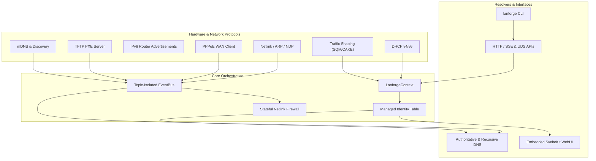

# lanforge

[](https://github.com/FerrahWolfeh/lanforge/actions/workflows/ci.yml)
[](LICENSE)
[-orange.svg)](https://www.rust-lang.org)

> **Unified Network Orchestration, Routing, and LAN Gateway for Linux.**

**lanforge** is a high-performance, resource-efficient network daemon built in Rust. Designed for Linux edge gateways, domestic homelabs, and SBC appliances (Raspberry Pi, NanoPi, x86 mini-PCs), it replaces the fragmented combination of `radvd`, `dnsmasq`, `nftables` scripts, and external adblockers with an integrated, single-process platform.

Maintaining a **unified, reactive identity table** for every device on your network, Lanforge keeps hostnames, IPv4/IPv6 leases, and SLAAC addresses persistent, consistent, and instantly available across reboots.

---

## Key Features

- **Core LAN & Addressing Engine**
  - **DHCPv4 Server**: High-performance Layer 2 Raw Socket implementation with dynamic pools and static host pinning.
  - **DHCPv6 Server**: Stateful Address Assignment (`IA_NA`) and Prefix Delegation (`IA_PD`).
  - **Router Advertisements (RA)**: Dynamic IPv6 RA with RDNSS and DNSSL, automatically adapting to WAN prefix changes.
  - **SLAAC Tracking**: Real-time correlation of IPv6 SLAAC addresses to physical MAC/DUID identities.

- **Stateful Firewall & Traffic Security (`lanforge-nft`)**
  - **Zero-Downtime Compilation**: Stateful Netlink/nftables ruleset compiled and applied in-place (~5ms) without dropping active sockets or reloading services.
  - **Strict WAN Boundary**: Default `DROP` policy on external interfaces (`ppp0`, `wan0`), restricted DNAT verification, and granular port forwarding / IPv6 pinholes.

- **PPPoE WAN Client (`lanforge-pppoe`)**
  - Native asynchronous PPPoE discovery, session management, and kernel PPP interface binding with automatic link recovery and LCP keepalives.

- **Traffic Shaping & Offloading (`lanforge-traffic`)**
  - Integrated SQM (Smart Queue Management) with CAKE and fq_codel queue disciplines for bufferbloat elimination.
  - Granular hardware offloading controls (GRO, GSO, TSO) and per-interface bandwidth telemetry.

- **Network Discovery & Device Tracking (`lanforge-discovery`)**
  - **Passive & Active Discovery**: Real-time tracking via Netlink (ARP/NDP), mDNS hostname probing, and active probes.
  - **Vendor Resolution**: Integrated MAC OUI lookup for effortless device identification.
  - **Wake-on-LAN (WoL)**: Magic packets sent from the CLI, WebUI, or API (implemented in `lanforge-transport`).

- **High-Performance DNS Stack (`lanforge-dns`, `lanforge-dns-wire`)**
  - **Authoritative & Recursive Resolver**: Low-latency local resolution combined with encrypted upstream forwarding.
  - **Modern Transports**: Native support for **DNS-over-TLS (DoT)** and **DNS-over-HTTPS (DoH)**, plus **DNS-over-QUIC (DoQ)** behind the optional `dns-doq` Cargo feature (not in the default build).
  - **Micro-Adblocker**: Zero-allocation hot-path domain filtering with custom blocklists, allowlists, and real-time query logging.

- **Network Booting (`lanforge-tftp`)**
  - Built-in RFC 1350/2347 TFTP server for PXE/iPXE network booting seamlessly coupled with DHCP boot options.

- **Modern WebUI & Rich APIs**
  - **Embedded SvelteKit WebUI**: Full-featured, responsive management dashboard built with SvelteKit, shadcn-svelte, and Tailwind CSS.
  - **Rich APIs**: Binary RPC (postcard) over a Unix Domain Socket (UDS) and REST / Server-Sent Events (SSE) over HTTP.
  - **Admin CLI & Lab Testbed**: Complete `lanforge` CLI tool and `lanforge-lab` rootless simulation testbed.

- **Resilient Embedded Persistence (`lanforge-db`)**
  - **Atomic Storage**: Embedded `redb` database with transactional state updates (or volatile in-memory/tmpfs mode).
  - **SD-Card Friendly**: Intelligent batched and debounced write cycles to preserve flash memory longevity.

---

## Architecture

Lanforge is organized as a modular 25-crate workspace structured across four architectural tiers (L0 to L3). It follows a reactive, event-driven CQRS architecture centered around `LanforgeContext` and a topic-isolated broadcast `EventBus`:



See [**ARCHITECTURE.md**](docs/ARCHITECTURE.md) and [**NETWORKING_ARCH.md**](docs/NETWORKING_ARCH.md) for deep dives into system internals and invariants.

---

## Status

Lanforge is pre-1.0 (`0.x`). It runs 24/7 as the maintainer's home router, but configuration keys,
the HTTP API, and the CLI can still change between minor versions. The CLI and the daemon talk over a
private UDS protocol that is not kept compatible across versions: **always upgrade `lanforge` and
`lanforged` together.**

---

## Requirements

- **Linux** with nftables and the `nft` command (the firewall applies its ruleset through it).
  PPPoE needs the kernel `pppoe` module and `/dev/ppp`; SQM needs the `sch_cake` / `sch_fq_codel` qdiscs.
- **Root, or the capabilities** `CAP_NET_ADMIN`, `CAP_NET_RAW` and `CAP_NET_BIND_SERVICE`
  (the shipped systemd unit runs as root with a restricted capability set).
- **Something else manages the interfaces.** Lanforge never assigns addresses to interfaces: the LAN's
  IPv4 address, ULA and GUA (for example a prefix obtained through DHCPv6-PD) come from whatever manages
  the system's interfaces (systemd-networkd, NetworkManager, ifupdown, dhcpcd, ...). Lanforge detects
  them, advertises and leases from them, and follows them when the ISP renumbers the delegated prefix.
- **SELinux** (Fedora, RHEL): `deploy/install.sh` installs the required policy from `deploy/selinux/`.

### Conflicting services

Lanforge takes over ports and duties that other daemons usually hold. Stop or reconfigure these first:

| Service | Conflict | What to do |
|:--|:--|:--|
| `systemd-resolved` | Stub listener on port 53 | Set `DNSStubListener=no` |
| `dnsmasq`, `unbound`, `pihole-FTL`, ... | DNS (53) and/or DHCP (67) | Disable them on the LAN |
| `dhcpd`, `kea`, networkd `DHCPServer=` | DHCPv4/v6 server (67, 547) | Disable the server part |
| `radvd`, networkd `IPv6SendRA=` | Router Advertisements | Disable them |
| `pppd` / NetworkManager PPPoE | PPPoE session on the WAN | Let only one of them dial |
| `firewalld` or other nftables rules | Rules still apply next to Lanforge's own table | Remove or align them |

---

## Quick Start

### 1. Build

Requires a recent stable Rust toolchain (Edition 2024), Node.js with pnpm (for the WebUI), and standard Linux build tools.

```bash
# Install the WebUI dependencies (once per clone)
pnpm --prefix web install

# Build the release binaries (lanforged daemon and lanforge CLI).
# The lanforge-webui build script runs the WebUI build and embeds the assets.
cargo build --release
```

Every service is a Cargo feature, so small boards can build only what they use:

```bash
# Daemon only, default features: every service, WebUI, DoT/DoH upstreams, adblock
cargo build --release -p lanforge

# Only DNS + DHCP + RA, controlled through the CLI (no HTTP server, no WebUI)
cargo build --release -p lanforge --no-default-features --features dns,dhcp,ra,uds
```

Services: `dhcp`, `dns`, `ra`, `tftp`, `pppoe`, `nft`, `traffic`, `discovery`, `http`, `uds`, `webui`.
Extras: `https`, `dns-dot`, `dns-doq`, `dns-doh`, `doh-server`, `adblock`, and the TLS provider
(`ring` or `aws-lc`). See `[features]` in [`crates/bin/lanforge/Cargo.toml`](crates/bin/lanforge/Cargo.toml).
For aarch64 boards, `cross build --release --target aarch64-unknown-linux-gnu` uses the image in
[`cross/`](cross/) (build the WebUI on the host first).

### 2. Install

On the gateway, from the repository root:

```bash
sudo ./deploy/install.sh
```

The installer creates the `lanforge` group (members can use the CLI without `sudo`), installs the
binaries from the release build, a configuration template, the systemd unit and, when SELinux is active,
its policy. Existing configuration is never overwritten. If you build with `CARGO_TARGET_DIR`, run it as
`sudo --preserve-env=CARGO_TARGET_DIR ./deploy/install.sh` so it finds the binaries. See the [**deployment guide**](deploy/README.md)
for the directory layout, remote deploys, and updates.

### 3. First run

```bash
sudo systemctl enable --now lanforge
```

On a fresh install Lanforge starts in **provisioning mode**: DNS and the WebUI come up, but DHCP, RA and
PPPoE stay dormant so a half-configured router cannot take over the LAN. Open
`http://<router-ip>:8088/`: it lands on the onboarding wizard, which creates the admin account and sets up
the LAN, WAN, DNS and adblock. The same wizard runs in a terminal with `lanforge setup`.

If you configure everything in the file instead, set `auto_provision = true` in `[system]` (or start
the daemon with `--auto-provision`) and create the admin from the shell:

```bash
lanforge user add admin
```

> [!WARNING]
> Until the first user exists the HTTP API asks for no login. Create the admin right away.

### 4. Configuration

`/etc/lanforge/lanforge.toml` is the single source of configuration; the WebUI and CLI write their
changes back to it. A minimal file:

```toml
[system]
iface = "eth0"
search_domains = ["lan", "home.arpa"]

[dhcp.v4]
enabled = true
router = "192.168.1.1"
subnet_mask = "255.255.255.0"
dns = ["192.168.1.1"]

[dhcp.v4.pools.lan]
range = "192.168.1.100-192.168.1.250"

[dns]
enabled = true
listen = "[::]:53"  # binds separate IPv4 and IPv6 sockets

[dns.upstreams.default]
addresses = ["udp://1.1.1.1:53", "udp://9.9.9.9:53"]

[http]
enabled = true
listen = "[::]:8088"
```

Every key is documented in [`contrib/lanforge.toml`](contrib/lanforge.toml); section snippets
live in [`docs/config/`](docs/config/). `lanforge reload` applies edits without a restart. An invalid
entry is skipped and reported (`lanforge status`, WebUI) instead of taking the network down.

### 5. Remote access

On the LAN, the WebUI on port 8088 is fine as is (enable HTTPS in `[http]` if you want it). For access
from outside, use a VPN or Tailscale and reach the router through it. **Never forward the WebUI/API port
from the WAN.** The firewall's `external` zone drops inbound traffic by default, so the WebUI is not
reachable from the WAN unless you add a host rule for it.

---

## Administration & WebUI

Once running, access the embedded WebUI directly at `http://<router-ip>:8088/` or manage the daemon via the `lanforge` CLI:

```bash
# Check system status and service health
lanforge status

# Inspect connected and discovered network devices
lanforge devices --online

# Stream live system events in real-time
lanforge watch

# Inspect DNS resolver metrics and control adblocking
lanforge dns status
lanforge dns adblock pause 10m
lanforge dns adblock resume
```

See [**CLI.md**](docs/CLI.md) for full CLI command references and [**WEBUI.md**](docs/WEBUI.md) for the WebUI architecture overview.

---

## Documentation

| Topic | Document |
|:--|:--|
| Deployment, systemd, updates | [deploy/README.md](deploy/README.md) |
| Configuration reference | [contrib/lanforge.toml](contrib/lanforge.toml), [docs/config/](docs/config/) |
| CLI | [docs/CLI.md](docs/CLI.md) |
| WebUI | [docs/WEBUI.md](docs/WEBUI.md) |
| HTTP API | [docs/HTTP_API.md](docs/HTTP_API.md) |
| RPC API and types | [docs/API.md](docs/API.md), [docs/API_TYPES.md](docs/API_TYPES.md) |
| Architecture | [docs/ARCHITECTURE.md](docs/ARCHITECTURE.md), [docs/NETWORKING_ARCH.md](docs/NETWORKING_ARCH.md) |
| DNS internals and rewrites | [docs/DNS_LIBRARY_ARCH.md](docs/DNS_LIBRARY_ARCH.md), [docs/dns_rewrites.md](docs/dns_rewrites.md) |
| Contributing | [CONTRIBUTING.md](CONTRIBUTING.md) |
| Reporting security issues | [SECURITY.md](SECURITY.md) |

---

## Background & Development

Lanforge is a personal router project built to power my own homelab. It has been running 24/7 on a dedicated x86 mini-PC (though originally on a Frankenstein RPi 4B setup), handling daily router and adblocking duties with a simple enough interface to manage stuff without having to deal with 4 to 5 different programs just to make the network work acceptably.

Because it was designed around my specific home network and hardware first, the default behaviors and design choices naturally reflect that setup. I've added extra tooling and modular services over time to make it adaptable to similar homelabs, but you might still encounter rough edges or assumptions shaped by my environment.

A quick note on how it was built: this project made extensive use of AI coding assistants throughout development, paired with close hands-on guidance. It isn't blind "vibe coding" — every architectural choice, kernel interaction (Netlink, nftables, raw sockets), and protocol detail was designed, debugged, and validated against compiler diagnostics, comprehensive test suites, and live hardware. Still, with AI heavily involved in writing code, you will likely find spots that could be cleaner, more idiomatic, or refined.

Feedback, bug reports, and contributions are very welcome!

---

## License

GPL-3.0-or-later © [Ferrah Aiko](https://github.com/FerrahWolfeh)
