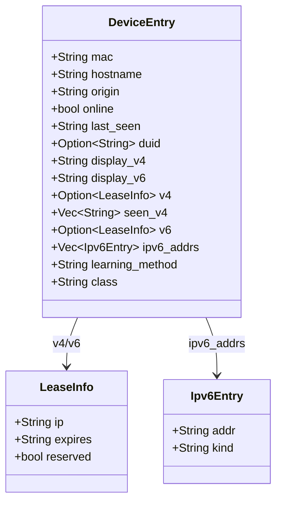
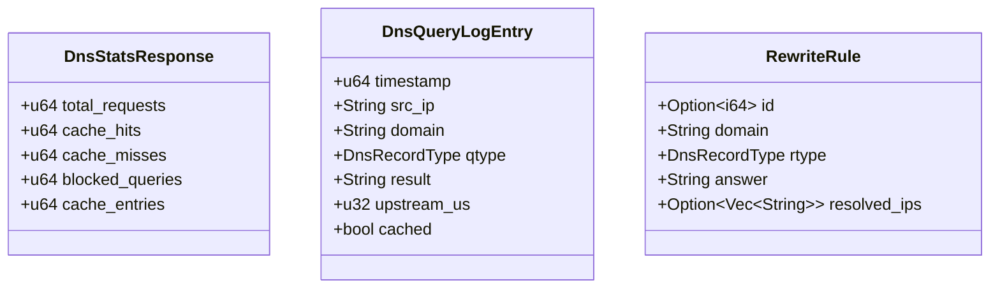

# Lanforge API & Type Specification

This document provides a comprehensive overview of the Lanforge API data structures, schemas, and native types. Lanforge uses an RPC-based communication model (via Unix Domain Sockets or HTTP) defined in the `LanforgeRpc` trait.

## API Architecture

Lanforge's API is built on a request-response pattern where every call returns a structured `Response` or an `RpcCallError`.

- **L1 (Contracts):** `lanforge-api` defines the trait and the data structures.
- **L2 (Dispatch):** `lanforge-api-dispatch` implements the server-side logic.
- **Transport:** Exposed via UDS (`lanforge-uds`) or HTTP (`lanforge-http`).

---

## HybridStream Pattern

Several endpoints share a unified streaming contract. When an endpoint is marked **HybridStream**, it accepts the following parameters:

| Parameter | Type | Description |
| :--- | :--- | :--- |
| `n` | `Option<usize>` | Number of historical entries to replay before streaming. `None` or `0` means no replay. |
| `follow` | `bool` | If `false`, emits up to `n` entries and closes. If `true`, emits `n` historical entries then streams live events indefinitely. |
| `filter` | `Option<Vec<EventKind>>` | (log only) Server-side event kind filter. Absent or empty = pass all events. |

Entries are always emitted **oldest-first** so the stream reads chronologically. Endpoints that add their own filters (e.g., `client` in `dns_query_log`) do so in addition to the base HybridStream parameters.

---

## Core Data Structures

### Device Management



### DNS & Adblocking



> **`RewriteRule.answer`** accepts the special prefix `dev:<hostname>`. This creates a dynamic rewrite: `lanforge-dns` resolves it against the current known addresses of the named device and updates automatically via event bus propagation whenever the device's IP changes. A `purge` event for the device causes the rewrite to be removed. For `dev:` entries, the daemon populates `resolved_ips` with the live IP addresses of the target device.

---

## API Endpoints Reference

### 1. System & Status

| Method | Parameters | Return Type | Notes |
| :--- | :--- | :--- | :--- |
| `status` | None | `StatusResponse` | Full system status including service health, resource usage, and network info. |
| `reload` | None | `SimpleSuccess` | Reloads configuration from `lanforge.toml`. |
| `scan` | None | `SimpleSuccess` | Triggers an immediate network scan (ARP/NDP/mDNS). |
| `log` | `follow: bool`, `n: Option<usize>`, `filter: Option<Vec<EventKind>>` | `HybridStream<Event>` | **HybridStream.** Retrieves system event log history and optionally streams live events. Backing endpoint for the CLI `watch` command. Server-side filtering by `EventKind`. |
| `shutdown` | None | `SimpleSuccess` | Gracefully shuts down the daemon. |
| `context_dump` | `only_devices: bool`, `only_orphans: bool` | `JSON Value` | Internal diagnostic endpoint. Dumps the entire state for simulation and debugging. |

### 2. Device & Host Management

| Method | Parameters | Return Type | Notes |
| :--- | :--- | :--- | :--- |
| `list_devices` | `filter`, `vendor`, `method`, `format`, `limit`, `offset` (all optional) | `DevicesResponse` | Lists all discovered devices with optional filtering and pagination. |
| `whois` | `target: String` (MAC, IP, or Hostname) | `WhoisResponse` | Detailed information and history for a specific device. |
| `host_add` | `entry: HostConfigEntry` | `SimpleSuccess` | Full upsert of a static host configuration. Promotes device to `Static` origin. |
| `host_set` | `mac: String`, `field: String`, `value: String` | `SimpleSuccess` | Partial update of a single field (`hostname`, `v4`, `v6_suffix`). Promotes device to `Static` origin. |
| `host_remove` | `mac: String` | `SimpleSuccess` | Removes a host configuration. Device reverts to `Dynamic` if still present. |
| `host_list` | None | `HostsResponse` | Lists all manual host configurations. |
| `host_import` | `entries: Vec<HostConfigEntry>` | `SimpleSuccess` | Bulk import of static host configurations. |
| `host_export` | None | `HostsResponse` | Bulk export of all static host configurations. |
| `purge` | `target: String` (MAC or Hostname) | `SimpleSuccess` | Completely removes a device from memory and database. Propagates deletion via event bus to all subsystems, including removal of any `dev:` DNS rewrites for that device. |
| `wol` | `target: String` (MAC or Hostname) | `SimpleSuccess` | Sends a Wake-on-LAN magic packet. |
| `topology` | None | `TopologyResponse` | Returns the discovered physical network topology. |

### 3. DHCP & Leases

| Method | Parameters | Return Type | Notes |
| :--- | :--- | :--- | :--- |
| `leases` | `count: bool` | `LeasesResponse` | Returns all active DHCP leases. |
| `dhcp_pools` | None | `DhcpPoolsResponse` | Shows utilization for all configured DHCP pools. |
| `lease_renew` | `mac: String`, `target: Option<LeaseTarget>` | `SimpleSuccess` | Extends an existing lease. `LeaseTarget`: `V4`, `V6`, or `Both`. |
| `lease_release` | `mac: String`, `target: Option<LeaseTarget>` | `SimpleSuccess` | Releases an active lease. `LeaseTarget`: `V4`, `V6`, or `Both`. |

### 4. DNS & Adblocking

| Method | Parameters | Return Type | Notes |
| :--- | :--- | :--- | :--- |
| `dns_stats` | None | `DnsStatsResponse` | High-level resolver performance statistics. |
| `dns_analytics` | `limit: Option<usize>` | `DnsAnalyticsResponse` | Top domains, top clients, and query rate trends. |
| `dns_query` | `name: String`, `record_type: Option<String>` | `DnsQueryResponse` | Diagnostic DNS lookup through the resolver. Supports automatic PTR reverse lookup formatting when an IP address is provided. |
| `dns_query_log` | `follow: bool`, `n: Option<usize>`, `client: Option<String>`, `offset: Option<usize>` | `HybridStream<DnsQueryLogEntry>` | **HybridStream.** DNS query history with optional client IP filter and pagination. |
| `dns_upstreams` | None | `Vec<DnsUpstreamEntry>` | Health and performance stats for all configured upstream resolvers. |
| `dns_cache_dump` | `limit: Option<usize>`, `offset: Option<usize>`, `q: Option<String>`, `kind: Option<DnsRecordType>` | `DnsCacheResponse` | Dumps the current contents of the DNS cache with optional search filter and pagination. |
| `dns_cache_flush` | None | `SimpleSuccess` | Clears the DNS cache. |
| `dns_cache_stats_ext` | None | `DnsCacheStatsResponse` | In-depth cache statistics and memory usage. |
| `dns_adblock_status` | None | `DnsAdblockStatusResponse` | Current adblocker state, list sizes, and active timer if any. |
| `dns_adblock_set` | `enabled: bool`, `duration_secs: Option<u64>` | `SimpleSuccess` | Enables or disables adblocking. See timer semantics below. |
| `dns_adblock_config_set` | `blocking_mode: Option<BlockingMode>`, `blocking_ip_v4: Option<Ipv4Addr>`, `blocking_ip_v6: Option<Ipv6Addr>` | `SimpleSuccess` | Updates the adblock config. |
| `dns_adblock_reload` | None | `SimpleSuccess` | Re-downloads and reloads all blocklist/allowlist sources. |
| `dns_adblock_urls` | None | `Vec<DnsAdblockUrlEntry>` | Lists all configured source URLs. |
| `dns_adblock_url_add` | `entry: DnsAdblockUrlEntry` | `SimpleSuccess` | Adds a blocklist or allowlist source URL. |
| `dns_adblock_url_remove` | `entry: DnsAdblockUrlEntry` | `SimpleSuccess` | Removes a source URL. |
| `dns_adblock_allowlist` | None | `Vec<AllowlistEntry>` | Lists all domains currently in the allowlist (id + domain). |
| `dns_rewrite_list` | None | `DnsRewritesResponse` | Lists all active DNS rewrite rules. For `dev:` entries, the returned `RewriteRule` objects are enriched by the daemon with their currently resolved IP addresses (`resolved_ips`). |
| `dns_rewrite_add` | `rule: RewriteRule` | `SimpleSuccess` | Adds or updates a DNS rewrite rule. `answer` accepts `dev:<hostname>` for dynamic rewrites. |
| `dns_rewrite_remove` | `id: i64` | `SimpleSuccess` | Removes a rewrite rule by ID. |
| `dns_rewrite_clear` | None | `SimpleSuccess` | Removes all DNS rewrite rules. |
| `dns_rewrite_import` | `rules: Vec<RewriteRule>` | `SimpleSuccess` | Bulk import, additively merging with existing rules. |
| `dns_rewrite_export` | None | `DnsRewritesResponse` | Bulk export of all rewrite rules. |
| `dns_block` | `domain: String` | `SimpleSuccess` | Adds a domain to the local blocklist (rewrite to `0.0.0.0`). |
| `dns_allow` | `domain: String` | `SimpleSuccess` | Adds a domain to the local allowlist. |
| `dns_unallow` | `domain: String \| id` | `SimpleSuccess` | Removes a domain from the allowlist by name or entry ID. |

> **`dns_adblock_set` timer semantics:**
> - `enabled: true` — immediately enables adblocking and cancels any active disable timer.
> - `enabled: false` with `duration_secs: Some(n)` — disables adblocking and starts a fresh countdown to `n` seconds, overwriting any existing timer.
> - `enabled: false` with `duration_secs: None` — disables adblocking permanently (no timer).

### 5. Database

| Method | Parameters | Return Type | Notes |
| :--- | :--- | :--- | :--- |
| `db_prune` | None | `SimpleSuccess` | Removes old history and log entries per retention policy. |
| `db_log_clean` | None | `SimpleSuccess` | Clears the transient system event log from the database. |
| `db_reset` | None | `SimpleSuccess` | **DANGEROUS.** Wipes the entire database. |

### 6. Authentication & API Tokens

All write operations (`ak_generate`, `ak_delete`, `ak_renew`) are **UDS-only** — API key management must originate from a local session to prevent external RPC-based attacks. `ak_list` and `ak_validate` are available over HTTP.

| Method | Parameters | Return Type | Notes |
| :--- | :--- | :--- | :--- |
| `ak_generate` | `name: String`, `scopes: Option<ApiScopes>`, `expires_at: Option<i64>` | `AuthTokenResponse` | **UDS-only.** Generates a new API token. Secret is returned once. |
| `ak_list` | None | `AuthTokensResponse` | Lists all active API tokens (metadata only — no secrets). |
| `ak_delete` | `id_or_name: String` | `SimpleSuccess` | **UDS-only.** Revokes an API token. |
| `ak_renew` | `id_or_name: String` | `AuthTokenResponse` | **UDS-only.** Regenerates an API token. New secret returned once. |
| `ak_validate` | `token: String` | `bool` | Validates a token string. Used by the CLI `login` flow over HTTP. |

---

## Response Envelopes

All responses are wrapped in a `Response` enum tagged with `type`.

### Successful Response
```json
{
  "type": "Devices",
  "devices": [...],
  "meta": {
    "total": 10,
    "online": 5,
    "last_scan_secs_ago": 120
  }
}
```

### Error Response
```json
{
  "type": "Error",
  "error": "Device not found: 00:11:22:33:44:55"
}
```

---

## Detailed Type Definitions

### StatusResponse
- `uptime_secs`: Seconds since daemon start.
- `services`: Status (`online`, `offline`, `starting`) for DHCP, DNS, RA, and core monitors.
- `network`: Current LAN IP addresses (v4/v6) and prefixes (GUA/ULA).
- `db`: Database size and last flush time.
- `resources`: Memory usage (RSS/VMS).

### DeviceEntry
- `origin`: `Dynamic` (discovered), `Static` (manual config), or `System` (internal).
- `display_v4` / `display_v6`: Friendly IP strings.
- `class`: Discovered device category (`computer`, `mobile`, `media`, `iot`, `network`).
- `online`: Whether the device responded to probes within the last 5 minutes.

### Native Identifier Types

#### MacAddr
- **Format:** `aa:bb:cc:dd:ee:ff` (lowercase hex).
- **Usage:** Primary key for devices and hosts.

#### Duid
- **Format:** Colon-separated hex bytes.
- **Types supported:** LLT (Link-layer + time), EN (Enterprise), LL (Link-layer), UUID.

### LeaseTarget
Enum used by `lease_renew` and `lease_release` to specify which address family to target.

| Variant | Description |
| :--- | :--- |
| `V4` | Target the DHCPv4 lease only. |
| `V6` | Target the DHCPv6 lease only. |
| `Both` | Target both leases. |

### DnsUpstreamEntry
Returned by `dns_upstreams`. One entry per configured upstream resolver.

| Field | Type | Description |
| :--- | :--- | :--- |
| `url` | `String` | Upstream address (e.g., `udp://9.9.9.9:53`, `tls://1.1.1.1`). |
| `protocol` | `String` | Transport protocol (`udp`, `tcp`, `tls`, `https`). |
| `rtt_ms` | `Option<u32>` | Last measured round-trip time in milliseconds. `None` if never probed. |
| `success_rate_pct` | `f32` | Rolling success rate (0.0–100.0). |
| `status` | `String` | `healthy`, `degraded`, or `unreachable`. |

### AllowlistEntry
Returned by `dns_adblock_allowlist`.

| Field | Type | Description |
| :--- | :--- | :--- |
| `id` | `i64` | Entry ID (used by `dns_unallow`). |
| `domain` | `String` | The allowlisted domain. |

### RewriteRule
Returned by `dns_rewrite_list`. Represents a configured DNS rewrite rule.

| Field | Type | Description |
| :--- | :--- | :--- |
| `id` | `Option<i64>` | Unique rule ID (assigned by database upon creation). |
| `domain` | `String` | The target domain name to match. |
| `rtype` | `DnsRecordType` | The DNS record type (e.g., `A`, `AAAA`, `CNAME`). |
| `answer` | `String` | The resolved answer or `dev:<hostname>` prefix for dynamic tracking. |
| `resolved_ips` | `Option<Vec<String>>` | For `dev:` entries, populated by the daemon with the currently resolved live IP addresses of the target device. `None` for standard static rules. |

### Status Sub-Types

| Type | Fields | Description |
| :--- | :--- | :--- |
| `ServiceRa` | `state`, `uptime_secs`, `gua`, `ula` | NDP Router Advertisement status. |
| `ServiceDhcpV4` | `state`, `uptime_secs`, `leases_active`, `pool_free` | IPv4 DHCP server metrics. |
| `ServiceDhcpV6` | `state`, `uptime_secs`, `leases_active`, `pool_free`, `gua`, `ula` | IPv6 DHCP server metrics. |
| `ServiceNdp` | `state`, `uptime_secs`, `addrs_tracked`, `last_scan_secs_ago` | NDP/Neighbor discovery monitor. |
| `NetworkStatus` | `lan_iface`, `lan_ipv4`, `lan_ipv6`, `gua`, `ula` | Host interface configuration. |
| `DbStatus` | `path`, `size_bytes`, `last_flush_secs_ago` | Persistent storage statistics. |

### DNS Analytics Types

- **TopDomainEntry:** `domain` (String), `count` (u64).
- **TopClientEntry:** `ip` (String), `hostname` (Option\<String\>), `count` (u64).
- **QueryTypeEntry:** `qtype` (String), `count` (u64).
- **ProtocolStatEntry:** `protocol` (String), `count` (u64), `percentage` (f32).

### DnsCacheResponse & DnsQueryLogResponse
Both responses include `entries` (the list of items) and `total` (usize, representing the total number of records available before pagination).

### DnsRecordType
Supported DNS record types: `A`, `AAAA`, `CNAME`, `NS`, `PTR`, `MX`, `TXT`, `SOA`, `SRV`, `HTTPS`, `SVCB`, `ANY`.

### EventKind
Used as the `filter` parameter in the `log` HybridStream endpoint. Represents the category of a system event.

Examples (non-exhaustive — extend as new subsystems are added):
`DeviceOnline`, `DeviceOffline`, `DeviceUpdated`, `DevicePurged`, `DhcpLeaseGranted`, `DhcpLeaseReleased`, `DnsQuery`, `DnsBlocked`, `DnsRewriteUpdated`, `AdblockToggled`, `ScanCompleted`, `ConfigReloaded`.

### ServerCapabilities & Cap
Represents the compiled feature flags and runtime enabled capabilities of the daemon.

```json
{
  "compiled": ["dns", "upstream_udp_tcp", "upstream_dot", "upstream_doq", "upstream_doh", "doh_downstream", "dhcp_v4", "dhcp_v6", "ra", "ndp_discovery", "mdns_probe", "lldp_probe", "uds", "http", "zstd", "redb", "pppoe"],
  "enabled": ["dns", "upstream_dot", "dhcp_v4", "ra", "uds", "http", "redb"]
}
```

- **Cap Enum:** `dns`, `upstream_udp_tcp`, `upstream_dot`, `upstream_doq`, `upstream_doh`, `doh_downstream`, `dhcp_v4`, `dhcp_v6`, `ra`, `ndp_discovery`, `mdns_probe`, `lldp_probe`, `uds`, `http`, `zstd`, `redb`, `pppoe`.

### ServiceState
Represents the operating state of a managed background service:
`offline`, `starting`, `online`, `active`, `inactive`, `degraded`, `error` (wire `"failed"`), `waiting`, `paused`.

### StateDetail
Optional human- and machine-readable details attached to a `ServiceBanner`:
- `waiting_for`: ID of blocking dependency.
- `dormant`: Reason condition was false (`disabled` or `not_applicable`).
- `dependency_dormant`: ID of dormant dependency.
- `degraded`: `upstream_unreachable`, `interface_flapping`, `transport_errors`, or custom string.
- `paused`: ID of paused dependency.
- `failed`: Object with `attempts` and `last_error`.
- `exited`: Clean intentional exit.
- `admin_stopped`: Stopped explicitly by administrator.

### ServiceBanner & StatusProvider
Model for decoupled system monitoring. Each service implements `StatusProvider` to export its current health and metrics.

```json
{
  "id": "dhcpv4",
  "name": "DHCPv4 Server",
  "state": "online",
  "uptime_secs": 3600,
  "stats": {
    "leases_active": "15",
    "pool_free": "185"
  },
  "detail": null
}
```

### AuthToken
Representations of API authentication tokens.

```json
{
  "token": "ak_1234567890abcdef",
  "name": "cli-admin",
  "created_at": 1715000000,
  "last_used": 1715003600,
  "scopes": ["admin", "monitoring", "upstream_write"],
  "expires_at": 1746536000
}
```

### User Accounts & Auth Types
Representations of database-backed user accounts and authorization roles.

- **`UserRole`**: Enum values `admin`, `operator`, `viewer`.
- **`UserInfo`**: User object metadata: `id` (i64), `username` (String), `role` (UserRole), `created_at` (i64), `updated_at` (i64), `last_login` (Option\<i64\>).
- **`LoginRequest`**: `username` (Option\<String\>), `password` (Option\<String\>), `token` (Option\<String\>), `remember_me` (Option\<bool\>). When `remember_me` is `true`, session duration is extended to 30 days.

```json
{
  "id": 1,
  "username": "admin",
  "role": "admin",
  "created_at": 1715000000,
  "updated_at": 1715000000,
  "last_login": 1715003600
}
```


### UpstreamConfigPayload
Payload for adding runtime DNS upstreams to the database.

```json
{
  "addr": "8.8.8.8:853",
  "protocol": "tls",
  "domain": "dns.google"
}
```

### SystemConfigExport
Aggregated backup configuration containing all database tables and settings.

- `hosts`: List of `HostConfigEntry` objects.
- `dns_rewrites`: List of `RewriteRule` objects.
- `dns_upstreams`: List of `DnsUpstreamConfig` objects.
- `dns_adblock_config`: `AdblockDbConfig` object.
- `dns_adblock_urls`: List of `AdblockUrlEntry` objects.
- `dns_allowlist`: List of `AllowlistEntry` objects.
- `api_tokens`: Optional list of `ExportedApiToken` objects.
- `dhcp_v4_pools`: Optional list of `Dhcpv4Pool` objects.
- `dhcp_v6_pools`: Optional list of `Dhcpv6Pool` objects.
- `ra_prefixes`: Optional list of `RAPrefix` objects.
- `ra_rdnss`: Optional list of `RdnssConfig` objects.
- `ra_dnssl`: Optional list of `DnsslConfig` objects.
- `overwrite`: Boolean to indicate whether to overwrite existing database configurations.


