# Lanforge — Architecture

**Unified Network Orchestration for Linux Edge Gateways.**

Lanforge is a reactive, event-driven network daemon designed to manage the identity and connectivity of every device on a local network. It moves away from the fragmented "multiple processes communicating via files" model to a unified, high-performance architecture built in Rust.

---

## Design Philosophy

The system is built on a **device-first** philosophy. Lanforge maintains the primary identity of "who is on the network" and derives all services—IP assignment, DNS resolution, routing advertisements—from this single source of truth.

### Key Design Decisions:
- **Reactive State Machine**: Services are stateless actors that react to events or query a central context.
- **CoW (Copy-on-Write) State**: The global state uses `Arc::make_mut` to allow lock-free reads for most services while maintaining safe, atomic updates.
- **Intent-Based Mutations**: State changes are never direct; they are requested via a `DeviceUpdate` protocol.
- **Service Supervision**: Every background task is supervised with exponential backoff and health monitoring.

---

## Workspace Overview

The project is organized as a modular Rust workspace consisting of 26 crates structured by architectural layers (L0 to L3).

```mermaid
graph TD
    Main["lanforge daemon (L3)"] --> Core["lanforge-core (L1)"]
    CLI["lanforge-cli (L3)"] --> API["lanforge-api (L1)"]
    Lab["lanforge-lab (L3)"] --> Core
    
    subgraph "Interface & API Layer (L1/L2)"
        API
        Dispatch["lanforge-api-dispatch (L2)"]
        UDS["lanforge-uds (L2)"]
        HTTP["lanforge-http (L2)"]
        WebUI["lanforge-webui (L2)"]
    end

    subgraph "Core Engine (L0/L1)"
        Core
        Crypto["lanforge-crypto (L1)"]
        Macros["lanforge-macros (L0)"]
        Types["lanforge-types (L0)"]
    end

    subgraph "Transport & Services Layer (L1/L2)"
        Transport["lanforge-transport (L1)"]
        DHCP["lanforge-dhcp (L2)"]
        RA["lanforge-ra (L2)"]
        DNS["lanforge-dns (L2)"]
        DNSWire["lanforge-dns-wire (L2)"]
        NFT["lanforge-nft (L2)"]
        PPPoE["lanforge-pppoe (L2)"]
        Discovery["lanforge-discovery (L2)"]
        Traffic["lanforge-traffic (L2)"]
        TFTP["lanforge-tftp (L2)"]
        WOL["lanforge-wol (L2)"]
    end

    subgraph "Persistence Layer (L2)"
        DBCore["lanforge-db-core"]
        DBRedb["lanforge-db-redb"]
        DB["lanforge-db"]
    end

    Transport --> Core
    DHCP --> Transport
    RA --> Transport
    DNS --> Transport
    NFT --> Core
    PPPoE --> Core
    Discovery --> Core
    Traffic --> Core
    TFTP --> Core
    WOL --> Core
    DB --> Core
    DBRedb --> DBCore
    DB --> DBRedb
    HTTP --> WebUI
    HTTP --> Dispatch
    UDS --> Dispatch
    Dispatch --> Core
```

### Crate Responsibilities

| Crate | Layer | Responsibility |
| :--- | :---: | :--- |
| `lanforge-types` | L0 | Fundamental domain types (`Device`, `MacAddr`, `Duid`), shared events, and update protocols. No workspace dependencies. |
| `lanforge-macros` | L0 | Procedural macros for service registration (`#[lanforge_service]`) and internal boilerplate. |
| `lanforge-core` | L1 | The "Brain". Manages the `LanforgeContext`, Copy-on-Write state, and the topic-isolated `EventBus`. |
| `lanforge-crypto` | L1 | Foundational security: Argon2id password hashing, key derivation, and token utilities. |
| `lanforge-transport` | L1 | Dual-stack Y-architecture transports (`UdpTransport`, `DualTcpListener`, `Icmp6Transport`), lock-free rate limiting, atomic metrics, and pure DI (`InertHandle`). |
| `lanforge-api` | L1 | Shared API definitions, DTOs, and RPC trait contracts used by CLI and daemon. |
| `lanforge-api-dispatch` | L2 | Server-side RPC protocol handlers decoupled from DB persistence via event-driven CQRS. |
| `lanforge-uds` | L2 | High-throughput Unix Domain Socket API server for local CLI administration. |
| `lanforge-http` | L2 | REST API, SSE event streaming, Prometheus metrics, and embedded WebUI HTTP server (`axum`). |
| `lanforge-webui` | L2 | Embedded WebUI asset distribution crate serving the pre-built SvelteKit production static bundle. |
| `lanforge-dhcp` | L2 | Protocol implementations: DHCPv4 (L2 Raw Sockets) and DHCPv6 (`IA_NA`/`IA_PD`) servers. |
| `lanforge-ra` | L2 | ICMPv6 Router Advertisement daemon supporting dynamic SLAAC, RDNSS, DNSSL, and WAN prefix absorption. |
| `lanforge-pppoe` | L2 | Native PPPoE WAN client with discovery, LCP/IPCP negotiation, kernel PPP binding, and LCP keepalives. |
| `lanforge-nft` | L2 | Stateful Netlink/nftables firewall engine with zero-downtime atomic rule updates (~5ms). |
| `lanforge-traffic` | L2 | SQM bufferbloat control (CAKE / fq_codel), hardware offloading tuning, and real-time telemetry. |
| `lanforge-discovery` | L2 | Real-time discovery consolidating Netlink neighbor tracking (ARP/NDP), active probing, and mDNS scraping. |
| `lanforge-dns` | L2 | Authoritative/recursive DNS resolver with micro-adblocker, DoT, DoQ, and DoH. |
| `lanforge-dns-wire` | L2 | Zero-allocation DNS wire parser and encoder for hot-path queries. |
| `lanforge-tftp` | L2 | RFC 1350/2347 TFTP server for network bootstrapping (PXE/iPXE). |
| `lanforge-wol` | L2 | Wake-on-LAN magic packet injection. |
| `lanforge-db-core` | L2 | Abstract traits, key-value contracts, and transaction models for persistent storage. |
| `lanforge-db-redb` | L2 | Embedded key-value persistence backend powered by `redb`. |
| `lanforge-db` | L2 | High-level database orchestrator with out-of-band batched writing (`DbWorker`) and volatile fallback. |
| `lanforge` | L3 | Main daemon binary (`lanforged`). Handles system bootstrap, supervisor lifecycle, and signal handling. |
| `lanforge-cli` | L3 | Comprehensive administrative CLI tool (`lanforge`). |
| `lanforge-lab` | L3 | Rootless simulation engine and interactive testbed for automated testing. |

---

## Core Engine Architecture (`lanforge-core`)

The core engine is the reactive heart of the system. It orchestrates data flow between modules without performing direct I/O.

### 1. The CoW State Model
To ensure that high-frequency services (like DNS) are never blocked by slow updates (like DB writes), Lanforge uses a **Copy-on-Write** state model.
- **Reads**: Most services hold an `Arc<State>`. Reading is a pointer dereference—virtually zero cost and no lock contention.
- **Writes**: When an update is applied, `Arc::make_mut` clones the state only if there are other active readers. This ensures that a "snapshot" of the network is always consistent for any given task.

### 2. The Service Model
Services are managed by a central `Registry`. Every service implements the `AsyncService` trait:
- **Supervision**: If a service fails, the supervisor restarts it with exponential backoff.
- **Readiness**: Services signal when they are ready (e.g., socket bound), allowing for ordered bootstrapping.

### 3. Event Bus & Aggregation
A `tokio::sync::broadcast` bus carries events between tasks. To prevent "event storms," the core implements aggregation for high-frequency events like neighbor discoveries.

---

## Networking & Services

### 1. DHCPv4 & Layer 2 Injection (`lanforge-dhcp`)
Lanforge uses **Raw Sockets (`AF_PACKET`)** to communicate with DHCPv4 clients that don't yet have an IP address, bypassing the kernel's standard IP stack for these packets.

### 2. IPv6 Orchestration (`lanforge-ra`, `lanforge-dhcp`)
- **RA (Router Advertisement)**: Dynamically generates RAs based on the upstream WAN prefix (`lanforge-ra`).
- **SLAAC & Address Tracking**: Correlates EUI-64 and randomized IPv6 addresses to physical MAC addresses using active NDP probing and Netlink hints (`lanforge-discovery`).
- **DHCPv6**: Supports both address assignment (`IA_NA`) and Prefix Delegation (`IA_PD`) for sub-routers (`lanforge-dhcp`).

### 3. Network Discovery & Topology (`lanforge-discovery`)
Consolidates passive mDNS sniffing, Netlink neighbor tables (ARP/NDP), and LLDP topology queries into a unified device discovery pipeline.

### 4. Traffic Shaping & Hardware Offloads (`lanforge-traffic`)
Applies Linux tc queue disciplines (CAKE or fq_codel) dynamically per interface to resolve bufferbloat issues on bandwidth-constrained uplinks while querying and adjusting NIC offloading features.

---

## DNS Engine Architecture (`lanforge-dns`)

The DNS service is a high-performance resolver optimized for both privacy and speed.

### 1. Secure Transports
- **DoT (DNS-over-TLS)**: Standard secure DNS on port 853.
- **DoQ (DNS-over-QUIC)**: Low-latency secure DNS using QUIC streams.
- **DoH (DNS-over-HTTPS)**: Integrated into the HTTP engine for firewall traversal.

### 2. Upstream Health & Strategies
The `UpstreamManager` monitors the latency and reliability of configured upstream resolvers.
- **Strategies**: Supports `Parallel` (fastest wins), `Sequential` (failover), and `Random` load balancing.
- **Passive Health**: Tracks timeouts and errors to temporarily deprioritize "flapping" upstreams.

### 3. Zero-Allocation Adblocker
The adblocker uses an efficient FST (Finite State Transducer) and in-memory Bloom filter to evaluate domains at the hot-path before recursion occurs, ensuring zero allocation in the lookup path.

---

## API & Security Architecture

### 1. Multi-Protocol Access
- **UDS (Unix Domain Sockets)**: Primary control path for the local CLI. Security is managed via filesystem permissions.
- **HTTP/REST**: For remote management and the embedded WebUI. Protected by **Bearer Token** authentication or signed JWT session cookies.

### 2. Credential Management
Passwords are never stored in plain text. Lanforge uses **Argon2id** for password hashing. Credentials can be set via the CLI or WebUI setup wizard over an authenticated channel and are persisted securely in the database.

---

## Observability

### 1. Command-Line Interface (`lanforge-cli`)
The CLI provides high-performance non-blocking administrative workflows:
- Formatted tables and diagnostic views (`comfy-table`, `colored`).
- Live event streaming (`lanforge watch`).
- Full system status, service lifecycle control, and interactive configuration wizards (`inquire`).

### 2. Simulation Testbed (`lanforge-lab`)
An interactive terminal environment built with **Ratatui** for simulating network behaviors, injecting client traffic, testing DHCP and DNS responses, and benchmarking subsystems without root privileges.

### 3. Prometheus Integration & Metrics
When enabled, Lanforge exposes a `/metrics` Prometheus endpoint, enabling integration with Grafana for long-term telemetry.

---

## Architectural Status

- **Operational / Production-Ready**:
  - DHCPv4 (L2 raw sockets) & DHCPv6 (IA_NA & IA_PD).
  - Dynamic IPv6 Router Advertisements (RA / SLAAC / RDNSS / DNSSL).
  - Authoritative & Recursive DNS (DoT, DoQ, DoH, zero-allocation micro-adblocker).
  - Native PPPoE WAN client with kernel PPP binding & LCP echo keepalives.
  - Stateful Netlink/nftables firewall with in-place zero-downtime ruleset reloads.
  - Traffic shaping (SQM / CAKE) and interface hardware offloading tuning.
  - Network discovery (Netlink ARP/NDP, mDNS passive/active, LLDP topology).
  - TFTP PXE network boot server.
  - Embedded SvelteKit WebUI with real-time SSE streaming.
  - Unix Domain Socket & HTTP REST JSON-RPC APIs.
  - Embedded `redb` ACID storage with batched write debouncing.
  - `lanforge-lab` rootless network testbed and simulation harness.
- **Active Evolutions**:
  - Enhanced multi-WAN failover and route metrics.
  - Granular flow-level Netflow/IPFIX accounting.