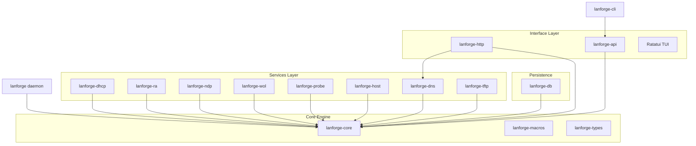

# LANforge — Architecture

**Unified Network Orchestration for Linux Edge Gateways.**

Lanforge is a reactive, event-driven network daemon designed to manage the identity and connectivity of every device on a local network. It moves away from the fragmented "multiple processes communicating via files" model to a unified, high-performance architecture built in Rust.

---

## 🧭 Design Philosophy

The system is built on a **device-first** philosophy. Lanforge maintains the primary identity of "who is on the network" and derives all services—IP assignment, DNS resolution, routing advertisements—from this single source of truth.

### Key Design Decisions:
- **Reactive State Machine**: Services are stateless actors that react to events or query a central context.
- **CoW (Copy-on-Write) State**: The global state uses `Arc::make_mut` to allow lock-free reads for most services while maintaining safe, atomic updates.
- **Intent-Based Mutations**: State changes are never direct; they are requested via a `DeviceUpdate` protocol.
- **Service Supervision**: Every background task is supervised with exponential backoff and health monitoring.

---

## 📦 Workspace Overview

The project is organized as a modular Rust workspace consisting of 13 crates.

### Crate Responsibilities

| Crate | Responsibility |
| :--- | :--- |
| `lanforge-types` (L0) | Fundamental domain types (`Device`, `MacAddr`, `Duid`), shared events, and update protocols. |
| `lanforge-macros` (L0) | Procedural macros for service registration (`#[lanforge_service]`) and CLI boilerplate. |
| `lanforge-core` (L1) | The "Brain". Manages the `LanforgeContext`, `ManagedTable`, and the broadcast `EventBus`. |
| `lanforge-dhcp` (L2) | Protocol implementations: DHCPv4 and DHCPv6 servers with stateful pools and L2 injection. |
| `lanforge-ra` (L2) | ICMPv6 Router Advertisement daemon supporting RDNSS, DNSSL, and dynamic prefixes. |
| `lanforge-ndp` (L2) | Netlink neighbor tracking, active ARP/NDP probing, and subnet scanning. |
| `lanforge-wol` (L2) | Wake-on-LAN magic packet injection. |
| `lanforge-probe` (L2) | Active and passive discovery probers: mDNS scraping and LLDP topology monitoring. |
| `lanforge-host` (L2) | Netlink interface address monitoring (`IFA_CACHEINFO`, link-local, GUA, ULA). |
| `lanforge-dns` (L2) | Recursive/Authoritative resolver. Supports DoT, DoQ, Adblocking, and Upstream Health management. |
| `lanforge-api` (L2) | Shared API definitions and JSON-RPC over Unix Domain Sockets (UDS). |
| `lanforge-http` (L2) | REST API, Prometheus exporter, and DNS-over-HTTPS (DoH) entry point. |
| `lanforge-db` (L2) | Embedded pure-Rust persistence (`redb` / volatile tmpfs) with SD-card friendly write debouncing. |
| `lanforge-tftp` (L2) | Minimal TFTP server for network bootstrapping (PXE). |
| `lanforge` (L3) | The main daemon binary. Handles bootstrapping and service orchestration. |
| `lanforge-cli` (L3) | Comprehensive administrative tool and TUI dashboard. |

---

## 🧠 Core Engine Deep-Dive (`lanforge-core`)

The core engine is the reactive heart of the system. It orchestrates data flow between modules without performing direct I/O.

### 1. The CoW State Model
To ensure that high-frequency services (like DNS) are never blocked by slow updates (like DB writes), Lanforge uses a **Copy-on-Write** state model.
- **Reads**: Most services hold an `Arc<State>`. Reading is a pointer dereference—virtually zero cost and no lock contention.
- **Writes**: When an update is applied, `Arc::make_mut` clones the state only if there are other active readers. This ensures that a "snapshot" of the network is always consistent for any given task.

### 2. The Service Model
Services are managed by a central `Registry`. Every service implements the `AsyncService` trait:
- **Supervision**: If a service fails, the supervisor restarts it with exponential backoff.
- **Readiness**: Services signal when they are ready (e.g., socket bound), allowing for ordered bootstrapping.

### 3. Event Bus & Aggregation
A `tokio::sync::broadcast` bus carries events between tasks. To prevent "event storms," the core implements aggregation for high-frequency events like neighbor discoveries.

---

## 🌐 Networking & Discovery (`lanforge-dhcp`, `lanforge-ra`, `lanforge-ndp`, `lanforge-wol`, `lanforge-probe`, `lanforge-host`)

### 1. DHCPv4 & Layer 2 Injection (`lanforge-dhcp`)
Lanforge uses **Raw Sockets (`AF_PACKET`)** to communicate with DHCPv4 clients that don't yet have an IP address, bypassing the kernel's standard IP stack for these packets.

### 2. IPv6 Orchestration (`lanforge-ra`, `lanforge-dhcp`, `lanforge-ndp`, `lanforge-host`)
- **RA (Router Advertisement)**: Dynamically generates RAs based on the upstream WAN prefix (`lanforge-ra`).
- **SLAAC & Address Tracking**: Correlates EUI-64 and randomized IPv6 addresses to physical MAC addresses using active NDP probing and Netlink hints (`lanforge-ndp`, `lanforge-host`).
- **DHCPv6**: Supports both address assignment (`IA_NA`) and Prefix Delegation (`IA_PD`) for sub-routers (`lanforge-dhcp`).

### 3. Topology Awareness (`lanforge-probe`)
The LLDP monitor extracts chassis and port information from neighboring switches, allowing Lanforge to map which device is connected to which physical port.

---

## 🛡️ Modern DNS Engine (`lanforge-dns`)

The DNS service is a high-performance resolver optimized for both privacy and speed.

### 1. Secure Transports
- **DoT (DNS-over-TLS)**: Standard secure DNS on port 853.
- **DoQ (DNS-over-QUIC)**: Low-latency secure DNS using QUIC streams.
- **DoH (DNS-over-HTTPS)**: Integrated into the HTTP engine for firewall traversal.

### 2. Upstream Health & Strategies
The `UpstreamManager` monitors the latency and reliability of configured upstream resolvers.
- **Strategies**: Supports `Parallel` (fastest wins), `Sequential` (failover), and `Random` load balancing.
- **Passive Health**: Tracks timeouts and errors to temporarily deprioritize "flapping" upstreams.

### 3. Zero-Allocation Adblocker
The adblocker uses a high-performance bit-set or hash-set (depending on list size) to filter queries at the "hot-path" before any recursion occurs, ensuring minimal impact on latency.

---

## 🔐 API & Security

### 1. Multi-Protocol Access
- **UDS (Unix Domain Sockets)**: Primary control path for the local CLI. Security is managed via filesystem permissions.
- **HTTP/REST**: For remote management. Protected by **Bearer Token** authentication.

### 2. Credential Management
Passwords are never stored in plain text. Lanforge uses **Argon2** for password hashing. Credentials can be set via the CLI over a secure UDS connection and are persisted in the encrypted state or static config.

---

## 📊 Observability

### 1. Interactive TUI
The `lanforge-cli` includes a full-screen dashboard built with **Ratatui**. It provides:
- Real-time event log.
- Live device table with status indicators.
- DNS and DHCP performance metrics.

### 2. Prometheus Integration
If the `http` feature is enabled, Lanforge exposes a `/metrics` endpoint, allowing for deep integration with Grafana and long-term trend analysis of network health.

---

## 🗺️ Roadmap Recap

- **Stable**: DHCPv4/v6, RA, DNS (DoT/DoQ), UDS API, Embedded redb Persistence, TUI.
- **In Progress**: Advanced Topology Mapping, Enhanced mDNS Scraping.
- **Planned**: Integrated Web UI, Active Probing Engine.
- **Phase 6 — Webview**: Embedded visual interface (Next.js/Axum).
- **Phase 7 — Observability**: Integrated Prometheus metrics exporter.
- **Phase 8 — PPPoE monitor**: (Postponed) Better integration with WAN link status.