# Lanforge — Architecture

**Unified Network Orchestration for Linux Edge Gateways.**

Lanforge is a reactive, event-driven network daemon designed to manage the identity and connectivity of every device on a local network. It moves away from the fragmented "multiple processes communicating via files" model to a unified, high-performance architecture built in Rust.

---

## Design Philosophy

The system is built on a **device-first** philosophy. Lanforge maintains the primary identity of "who is on the network" and derives all services—IP assignment, DNS resolution, routing advertisements—from this single source of truth.

### Key Design Decisions:
- **Reactive State Machine**: Services are actors that react to events or query a central context.
- **CoW (Copy-on-Write) State**: The global state uses `Arc::make_mut` to allow lock-free reads for most services while maintaining safe, atomic updates.
- **Intent-Based Mutations**: State changes are never direct; they are requested via a `DeviceUpdate` protocol.
- **Files are config, redb is state**: `/etc/lanforge/lanforge.toml` (plus line-oriented bulk files such as `adblock/*.rules`) is the only source of configuration. The embedded database holds state only: devices, leases, users, tokens, statistics, the last known LAN prefix.
- **Bad config never takes the network down**: an invalid entry is skipped and reported as a config issue; a section that cannot be read is set aside and the live value stays as it was.
- **Service Supervision**: Every background service runs under a dependency-graph supervisor with backoff, conditions and admin control.

---

## Workspace Overview

The project is organized as a modular Rust workspace of 25 crates structured by architectural layers (L0 to L3).

```mermaid
graph TD
    Main["lanforge daemon (L3)"] --> Core["lanforge-core (L1)"]
    CLI["lanforge-cli (L3)"] --> API["lanforge-api (L1)"]
    Lab["lanforge-lab (L3)"] --> Core

    subgraph "Interface & API Layer (L1/L2)"
        API
        Dispatch["lanforge-api-dispatch (L2)"]
        UDS["lanforge-uds (L2)"]
        HTTP["lanforge-http (L2)"]
        WebUI["lanforge-webui (L2)"]
    end

    subgraph "Core Engine (L0/L1)"
        Core
        Crypto["lanforge-crypto (L1)"]
        Macros["lanforge-macros (L0)"]
        Types["lanforge-types (L0)"]
    end

    subgraph "Transport & Services Layer (L1/L2)"
        Transport["lanforge-transport (L1)"]
        DHCP["lanforge-dhcp (L2)"]
        RA["lanforge-ra (L2)"]
        DNS["lanforge-dns (L2)"]
        DNSWire["lanforge-dns-wire (L2)"]
        NFT["lanforge-nft (L2)"]
        PPPoE["lanforge-pppoe (L2)"]
        Discovery["lanforge-discovery (L2)"]
        Traffic["lanforge-traffic (L2)"]
        TFTP["lanforge-tftp (L2)"]
    end

    subgraph "Persistence Layer (L2)"
        DBCore["lanforge-db-core"]
        DBRedb["lanforge-db-redb"]
        DB["lanforge-db"]
    end

    Transport --> Core
    DHCP --> Transport
    RA --> Transport
    DNS --> Transport
    DNS --> DNSWire
    NFT --> Core
    PPPoE --> Core
    Discovery --> Core
    Traffic --> Core
    TFTP --> Core
    DB --> Core
    DBRedb --> DBCore
    DB --> DBRedb
    HTTP --> WebUI
    HTTP --> Dispatch
    UDS --> Dispatch
    Dispatch --> Core
```

### Crate Responsibilities

| Crate | Layer | Responsibility |
| :--- | :---: | :--- |
| `lanforge-types` | L0 | Fundamental domain types (`Device`, `MacAddr`, `Duid`), shared events, and update protocols. No workspace dependencies. |
| `lanforge-macros` | L0 | Procedural macros for service registration (`#[lanforge_service]`) and internal boilerplate. |
| `lanforge-core` | L1 | The "Brain". Manages the `LanforgeContext`, Copy-on-Write state, the configuration store and the topic-isolated `EventBus`. |
| `lanforge-crypto` | L1 | Foundational security: Argon2id password hashing, key derivation, token utilities and the shared TLS loader. |
| `lanforge-transport` | L1 | Dual-stack Y-architecture transports (`UdpTransport`, `DualTcpListener`, `Icmp6Transport`), lock-free rate limiting, atomic metrics, pure DI (`InertHandle`), and Wake-on-LAN. |
| `lanforge-api` | L1 | Shared API definitions, DTOs, RPC contracts, and the config file forms (`config_file/`) used by CLI and daemon. |
| `lanforge-api-dispatch` | L2 | Server-side RPC handlers. Config writes go through `change_*` methods: normalize through the file form, persist the file, apply in place. |
| `lanforge-uds` | L2 | Unix Domain Socket API server for local CLI administration (postcard framing). |
| `lanforge-http` | L2 | REST API, SSE event streaming, Prometheus metrics, DoH server and embedded WebUI HTTP server (`axum`). |
| `lanforge-webui` | L2 | Embedded WebUI asset distribution crate serving the pre-built SvelteKit production static bundle. |
| `lanforge-dhcp` | L2 | DHCPv4 (L2 raw sockets) and DHCPv6 (`IA_NA`/`IA_PD`) servers. |
| `lanforge-ra` | L2 | ICMPv6 Router Advertisement daemon: SLAAC prefixes, RDNSS, DNSSL, prefix deprecation on renumbering. |
| `lanforge-pppoe` | L2 | Native PPPoE WAN client with discovery, LCP/IPCP negotiation, kernel PPP binding, LCP keepalives and optional eBPF dataplane. |
| `lanforge-nft` | L2 | Stateful Netlink/nftables firewall engine with atomic in-place rule updates (~5 ms) and lockdown on stop. |
| `lanforge-traffic` | L2 | SQM bufferbloat control (CAKE / fq_codel), flow offload, NIC offloading tuning, and real-time telemetry. |
| `lanforge-discovery` | L2 | Device discovery: Netlink neighbor tracking (ARP/NDP), interface address monitoring, active probing and mDNS hostname probing. |
| `lanforge-dns` | L2 | Authoritative/recursive DNS resolver with adblocking, DoT, DoQ and DoH (upstream and listener). |
| `lanforge-dns-wire` | L2 | Zero-allocation DNS wire parser and encoder for hot-path queries. |
| `lanforge-tftp` | L2 | RFC 1350/2347 TFTP server for network bootstrapping (PXE/iPXE). |
| `lanforge-db-core` | L2 | Abstract traits, key-value contracts, and transaction models for persistent storage. |
| `lanforge-db-redb` | L2 | Embedded key-value persistence backend powered by `redb`. |
| `lanforge-db` | L2 | High-level database orchestrator with out-of-band batched writing (`DbWorker`) and volatile fallback. |
| `lanforge` | L3 | Main daemon binary (`lanforged`). Handles system bootstrap, the supervisor, and signal handling. |
| `lanforge-cli` | L3 | Administrative CLI (`lanforge`), local over UDS or remote over HTTP with a saved login. |
| `lanforge-lab` | L3 | Rootless simulation engine and interactive testbed for automated testing. |

---

## Core Engine Architecture (`lanforge-core`)

The core engine is the reactive heart of the system. It orchestrates data flow between modules without performing direct I/O.

### 1. The CoW State Model
To ensure that high-frequency services (like DNS) are never blocked by slow updates (like DB writes), Lanforge uses a **Copy-on-Write** state model.
- **Reads**: services read through scoped closures (`ctx.with_state`, `ctx.with_config`). Reading is a pointer dereference—virtually zero cost and no lock contention.
- **Writes**: every change is a `ctx.apply(DeviceUpdate::...)`. `Arc::make_mut` clones the state only if other readers still hold it, so a snapshot stays consistent for any given task.
- `DeviceUpdate::InterfaceIpsChanged` carries a full snapshot of an interface's addresses; when an interface holds several addresses of a class, the best one is kept (not deprecated, not temporary, DAD finished, fixed over dynamic).

### 2. Live Configuration
`ctx.apply_config(ConfigPatch)` diffs each section against the stored one and wakes only the subscribers of the sections that changed. Services read configuration exclusively through `ctx.config_subscription::<T>()` and absorb changes in place (hot) or rebind only what needs it. Each change publishes exactly one `SystemEvent::ConfigChanged { sections }` for observers (event log, WebUI, `lanforge watch`); the firewall and traffic shaper also receive their `RulesetChanged` trigger.

`lanforge reload` re-reads the file-owned sections and applies them through the same path: no service restarts, no daemon restart.

### 3. The Service Model & Supervisor
Services implement `AsyncService` (or `SyncService`) and declare a `ServiceSpec`:
- **Dependency graph**: typed edges `Requires` / `Wants` / `After`. Losing a required dependency never restarts the dependent; the edge's `LossPolicy` (`Continue` / `Degrade` / `Pause`) applies and the service receives `DependencyLost` / `DependencyRestored`.
- **Conditions**: re-evaluated on every `ConfigChanged`. A service whose condition turns false is stopped as `Inactive(Dormant)` (disabled, not applicable, waiting for its link) and started again when it becomes true. Settled `Inactive` services never block readiness or trigger backoff.
- **Commands**: admin `stop` / `restart` reach the service as `ServiceCommand`s through its handle; a service that ignores `Stop` is cancelled after its `shutdown_timeout`.
- **Restarts**: failures restart with exponential backoff. A restart builds a fresh instance, so state that must outlive one run (e.g. the RA's deprecated prefixes) lives in the context.
- **Readiness**: the daemon reports `READY=1` to systemd once every service is `Online` or settled `Inactive`.

### 4. Event Bus
A topic-isolated broadcast bus (`subscribe_system`, `subscribe_network`, `subscribe_dns`, ...) carries events between tasks; a service subscribes only to the topics it needs so unrelated events never wake it. High-frequency events such as neighbor sightings are aggregated before they are published.

---

## Networking & Services

### 1. DHCPv4 & Layer 2 Injection (`lanforge-dhcp`)
Lanforge uses **Raw Sockets (`AF_PACKET`)** to talk to DHCPv4 clients that do not yet have an IP address. Leases are recorded only on ACK, with the lease time the client was given; static reservations always win over dynamic requests.

### 2. IPv6 Orchestration (`lanforge-ra`, `lanforge-dhcp`)
- **Addressing**: lanforge never assigns addresses to interfaces. The LAN ULA and GUA are whatever the OS put there (e.g. systemd-networkd with DHCPv6-PD); lanforge detects them.
- **RA (Router Advertisement)**: advertises the LAN interface's own GUA prefix, never the WAN link prefix. When the delegated prefix changes, the withdrawn one is advertised with preferred lifetime 0 and valid lifetime `min(remaining, 2 h)` (RFC 9096), even across RA restarts. Router Solicitations are answered after the RFC 4861 random delay, scheduled without stalling the service.
- **SLAAC & Address Tracking**: correlates EUI-64 and randomized IPv6 addresses to MAC addresses using NDP and Netlink hints (`lanforge-discovery`).
- **DHCPv6**: `IA_NA` and `IA_PD`, Rapid Commit. Recorded lease expiry is the valid lifetime sent. T1 is capped at 5 minutes so clients follow a renumbered prefix on their next Renew; no Reconfigure is sent (clients discard it unauthenticated, RFC 8415 §18.2.11).

### 3. Network Discovery (`lanforge-discovery`)
Consolidates Netlink neighbor tables (ARP/NDP), interface address monitoring, active probing and mDNS hostname probing into one device discovery pipeline.

### 4. WAN (`lanforge-pppoe`)
The PPPoE client owns its session lifecycle: credential or interface changes reconnect only the session (with a PADT to the access concentrator), runtime settings (LCP echo, reconnect delay) apply in place. The firewall and the DNS upstreams absorb `SessionUp` / `SessionDown` in place.

### 5. Firewall (`lanforge-nft`)
The external zone (`ppp0`, `wan0`) drops input and forward by default; WAN ingress is opened only by host rules, port forwards (IPv4 DNAT) or IPv6 pinholes. Rulesets are applied atomically in place. Stopping the firewall applies a minimal lockdown ruleset instead of removing the table (fail closed).

### 6. Traffic Shaping & Hardware Offloads (`lanforge-traffic`)
Applies Linux tc queue disciplines (CAKE or fq_codel) per interface to fight bufferbloat on constrained uplinks, manages flowtable offload, and adjusts NIC offloading features.

---

## DNS Engine Architecture (`lanforge-dns`)

The DNS service is a high-performance resolver optimized for both privacy and speed.

### 1. Secure Transports
- **DoT (DNS-over-TLS)**: listener and upstream client on port 853.
- **DoQ (DNS-over-QUIC)**: RFC 9250 framing on both the listener and the upstream client.
- **DoH (DNS-over-HTTPS)**: upstream client, and a listener integrated into the HTTP engine.

### 2. Upstream Health & Strategies
The `UpstreamManager` monitors the latency and reliability of configured upstream resolvers.
- **Strategies**: `sequential` (failover, default), `parallel`, `fastest`, and `round_robin`.
- **Passive Health**: tracks timeouts and errors to temporarily deprioritize failing upstreams.
- **WAN resolvers**: the ISP's IPv6 resolvers learned on the WAN can be followed as upstreams.

### 3. Adblocker
Each adblock list is compiled to its own memory-mapped FSTs and queried in place (no merged copy); lookups allocate nothing and take no lock. Lists are loaded from disk at boot without a re-download. A per-device bitmask selects which lists apply, so groups can overlay the global policy.

---

## API & Security Architecture

### 1. Multi-Protocol Access
- **UDS (Unix Domain Sockets)**: primary control path for the local CLI. Security is managed via filesystem permissions.
- **HTTP/REST**: remote management and the embedded WebUI. Authenticated by a JWT session cookie or an API token; roles (`admin`, `operator`, `viewer`) and token scopes gate each route, and sensitive actions require re-authentication. Login attempts are rate limited.

### 2. Credential Management
Passwords are never stored in plain text. Lanforge uses **Argon2id** for password hashing. Credentials are set via the CLI or the WebUI setup wizard over an authenticated channel and persisted in the database; changing a password or role ends the user's existing sessions.

---

## Observability

### 1. Command-Line Interface (`lanforge-cli`)
- Formatted tables and diagnostic views (`comfy-table`, `colored`).
- Live event streaming (`lanforge watch`).
- Full system status, service lifecycle control, and interactive configuration wizards (`inquire`).

### 2. Simulation Testbed (`lanforge-lab`)
An interactive terminal environment built with **Ratatui** for simulating network behaviors, injecting client traffic, testing DHCP and DNS responses, and benchmarking subsystems without root privileges.

### 3. Prometheus Integration & Metrics
When enabled, Lanforge exposes a `/metrics` Prometheus endpoint, enabling integration with Grafana for long-term telemetry. Per-service transport telemetry is available in the status view.

---

## Build Profiles

Every service is a Cargo feature of the daemon (`dhcp`, `dns`, `ra`, `tftp`, `pppoe`, `nft`, `traffic`, `discovery`, `http`, `uds`, ...); TLS users need a crypto provider (`ring` or `aws-lc`). Profiles: `profile-minimal` (DNS, DHCP, RA, UDS), `profile-soho`, `profile-enterprise`, `full`, and the default. `scripts/check-daemon-features.sh` (and `scripts/check-dns-features.sh` for the DNS crate) build every service alone, the profiles and no services at all; CI runs both.

---

## Architectural Status

- **Operational / Production-Ready**:
  - DHCPv4 (L2 raw sockets) & DHCPv6 (IA_NA & IA_PD).
  - IPv6 Router Advertisements (SLAAC / RDNSS / DNSSL) with renumbering deprecation.
  - Authoritative & Recursive DNS (DoT, DoQ, DoH, zero-allocation adblocker).
  - Native PPPoE WAN client with kernel PPP binding & LCP echo keepalives.
  - Stateful Netlink/nftables firewall with in-place ruleset reloads and lockdown on stop.
  - Traffic shaping (SQM / CAKE), flow offload and interface offloading tuning.
  - Network discovery (Netlink ARP/NDP, mDNS probing).
  - TFTP PXE network boot server.
  - Embedded SvelteKit WebUI with real-time SSE streaming.
  - Unix Domain Socket & HTTP REST APIs.
  - Embedded `redb` storage with batched write debouncing.
  - `lanforge-lab` rootless network testbed and simulation harness.
- **Active Evolutions**:
  - Enhanced multi-WAN failover and route metrics.
  - Granular flow-level Netflow/IPFIX accounting.
