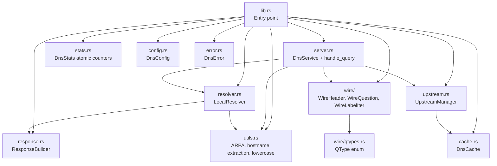
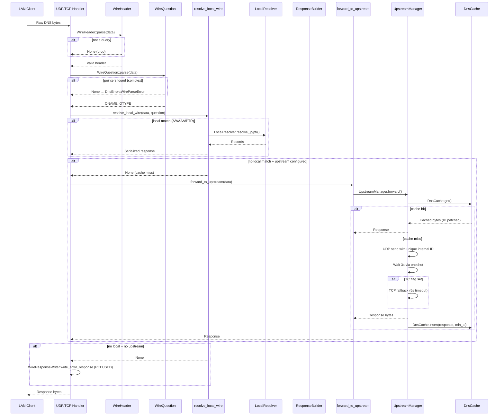
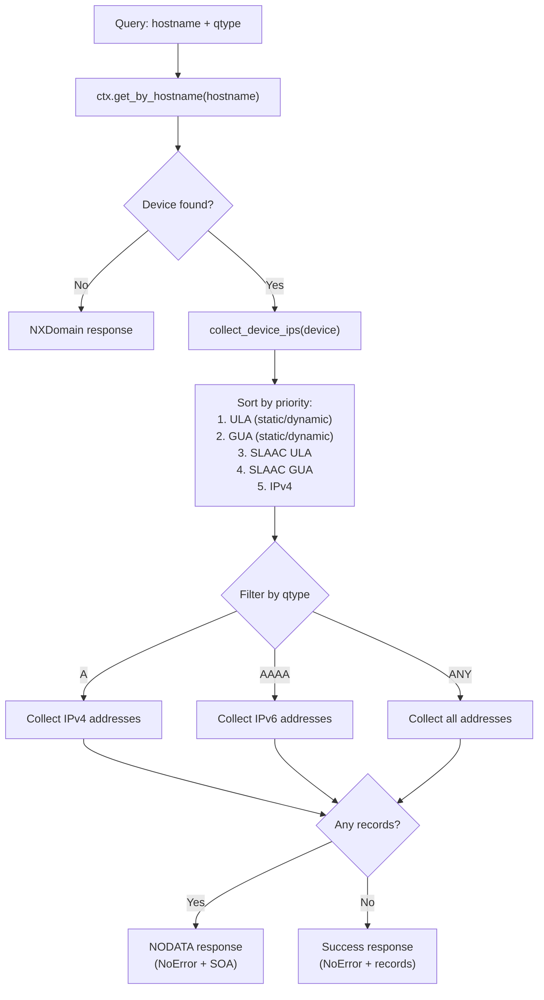
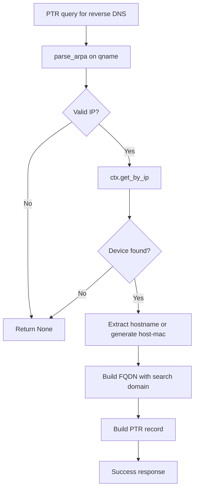
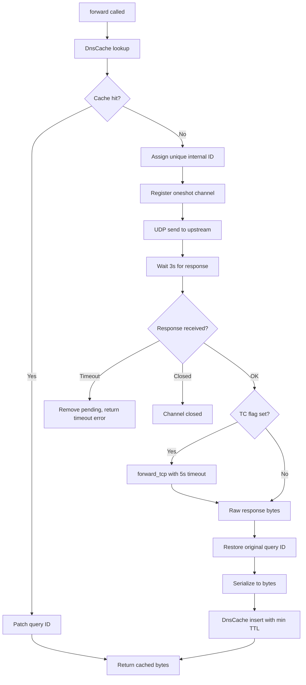
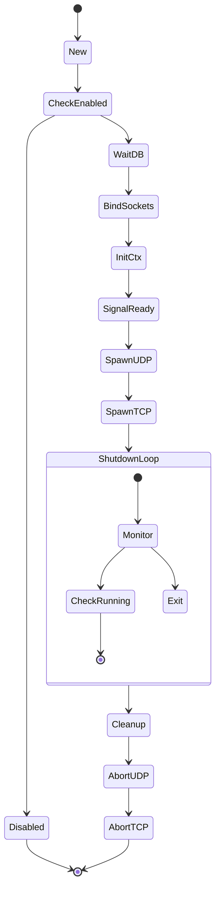

# `lanforge-dns` — Library Architecture

High-performance authoritative LAN DNS server for the Lanforge daemon. Features a custom zero-allocation wire parser for hot-path routing (A/AAAA/PTR) and forwards non-local requests to an upstream resolver with caching.

---

## Overview

`lanforge-dns` resolves local DNS queries by looking up devices in the shared `LanforgeContext`, and recursively forwards everything else to an upstream resolver (e.g., Unbound). It is designed for **ultra-low latency** on local network queries by avoiding heap allocations in the critical path.

### Dependencies

| `lanforge-core` | `LanforgeContext` for device lookup, `EventBus`, service traits |
| `moka` (sync) | Synchronous response cache with TTL-based expiry |
| `tokio` | UDP/TCP listeners, oneshot channels, timeouts |
| `tracing` | Diagnostic logging |
| `thiserror` | `DnsError` |

---

## Module Map



---

## Query Triage Architecture

The DNS server implements a **three-phase triage model** for every inbound query:



---

## Phase 1: Zero-Alloc Wire Parser

The `wire/` module replaces full Hickory Message parsing for initial routing decisions.

### `WireHeader` — 12-Byte Header View

```
 0                   1                   2                   3
 0 1 2 3 4 5 6 7 8 9 0 1 2 3 4 5 6 7 8 9 0 1 2 3 4 5 6 7 8 9 0 1
+-+-+-+-+-+-+-+-+-+-+-+-+-+-+-+-+-+-+-+-+-+-+-+-+-+-+-+-+-+-+-+-+
|                            ID                                 |
+-+-+-+-+-+-+-+-+-+-+-+-+-+-+-+-+-+-+-+-+-+-+-+-+-+-+-+-+-+-+-+-+
|QR|  Opcode   |AA|TC|RD|   Z   |         RCODE                 |
+-+-+-+-+-+-+-+-+-+-+-+-+-+-+-+-+-+-+-+-+-+-+-+-+-+-+-+-+-+-+-+-+
|         QDCOUNT               |         NSCOUNT               |
+-+-+-+-+-+-+-+-+-+-+-+-+-+-+-+-+-+-+-+-+-+-+-+-+-+-+-+-+-+-+-+-+
|         ANCOUNT               |         ARCOUNT               |
+-+-+-+-+-+-+-+-+-+-+-+-+-+-+-+-+-+-+-+-+-+-+-+-+-+-+-+-+-+-+-+-+
```

| Method | Purpose | Complexity |
| :--- | :--- | :--- |
| `parse(data)` | Validates data >= 12 bytes, wraps slice | O(1) |
| `is_query()` | Checks QR bit (byte 2, bit 7 == 0) | O(1) |
| `qdcount()` | Number of questions (bytes 4-5) | O(1) |
| `arcount()` | Number of additional records (bytes 10-11) | O(1) |

Parses the question section by iterating raw labels. If a name compression pointer (`0xC0` prefix) is encountered, it returns `None` — signaling an error or fallback to the full `WireDecoder`.

```
 QNAME: [len4]host[len3]lan[0x00]  →  WireLabelIter → [b"host", b"lan"]
 QTYPE: 2 bytes (1=A, 28=AAAA, 12=PTR, 255=ANY)
 QCLASS: 2 bytes (1=IN)
```

**Why no pointer following?** Name compression is rare in queries (common in responses). Avoiding it lets us skip UTF-8 validation, string allocation, and recursive pointer resolution — keeping the hot path truly zero-alloc.

### `WireOptScanner` — EDNS Detection

Detects OPT records (type 41) without parsing the entire additional section. Optimized for the common case: `qdcount=1`, `arcount=1`.

```
 OPT Record: Name=0 (1B) | Type=41 (2B) | MaxPayload (2B) | TTL (4B) | RDLEN (2B)
```

### `WireResponseWriter` — Minimal Error Responses

Constructs REFUSED/FORMERR responses by copying the query header + question and flipping flags. No full `Message` construction needed.

---

## Phase 2: Local Resolution

### `LocalResolver` — Authoritative Lookup

Resolves A, AAAA, ANY, and PTR queries by consulting the `LanforgeContext`.



### PTR Resolution (`resolve_ptr`)



### Device IP Collection

The `collect_device_ips` method aggregates all known addresses for a device:

| Source | Description |
| :--- | :--- |
| Static V4 reservation | Manually configured IPv4 |
| Dynamic V4 lease | Active DHCPv4 lease |
| Static V6 suffix | Manually configured 64-bit suffix + learned prefix |
| Dynamic V6 lease | Active DHCPv6 IA_NA lease |
| Delegated V6 prefix | IA_PD prefix delegation |
| SLAAC addresses | Autoconfigured via RA/NDP |

Results are sorted by priority (ULA first for stability, then GUA, then IPv4) and deduplicated by `Device::all_addresses_sorted()`.

---

## Phase 3: Recursive Forwarding

### `UpstreamManager` — UDP Forwarding with TCP Fallback



### ID Collision Avoidance

Multiple LAN clients may send queries with the same DNS message ID. The upstream manager rewrites each query's ID to a monotonically increasing `AtomicU16` before forwarding, then restores the original ID in the response. This prevents ID collisions when multiple clients query the same upstream simultaneously.

### TCP Fallback (RFC 1035)

When the upstream UDP response has the TC (truncated) flag set, the manager falls back to TCP:

1. Connect to upstream via TCP (5s timeout)
2. Send query with 2-byte length prefix
3. Read 2-byte response length prefix
4. Read full response body
5. Return raw bytes (no ID rewriting needed — TCP is connection-oriented)

### `DnsCache` — Synchronous Upstream Cache

| Feature | Detail |
| :--- | :--- |
| **Backend** | Moka `sync::Cache` — no `.await` overhead |
| **Key** | `(Name, RecordType, DNSClass)` |
| **Value** | `CachedResponse { data: Vec<u8>, ttl: Duration }` |
| **TTL extraction** | Minimum TTL across all answer/NS/additional records |
| **Negative caching** | RFC 2308 — TTL from SOA MINIMUM field |
| **TTL range** | Clamped to 5-3600 seconds |
| **Cache hit** | Clone bytes, patch query ID (bytes 0-1), return |

**Why store raw bytes?** Avoids re-serializing the response on every cache hit. Cloning ~100 bytes is far faster than full message re-parsing.

---

## Response Construction

### `ResponseBuilder` — Native Message Builder

Responses are built using `DnsMessage` and `WireEncoder` for correctness and efficiency:

| Method | Purpose |
| :--- | :--- |
| `base()` | Copy ID, set QR=1, Authoritative, Recursion Available, copy queries + EDNS |
| `success(records)` | NoError + answer records |
| `empty_noerror()` | NoError + SOA (NODATA — host exists but no records for qtype) |
| `nxdomain()` | NXDomain + SOA (host does not exist) |
| `refused()` | Refused (no upstream configured) |
| `formerr()` | FormErr (malformed query) |
| `add_soa()` | Add SOA record for NXDOMAIN/NODATA per RFC 1035 |

### EDNS Preservation

If the incoming query contains EDNS extensions, they are copied to the response. This ensures compatibility with DNSSEC-aware clients and large response sizes.

---

## Server Lifecycle

### `DnsService` — Main Service Entry Point



### Bootstrap Sequence

| Step | Action | Blocks On |
| :--- | :--- | :--- |
| 1 | Check `config.enabled` | — |
| 2 | `ctx.wait_for_db()` | `DbReady` event from `EventBus` |
| 3 | Bind UDP + TCP sockets | OS network stack |
| 4 | `init_dns_context()` | `UpstreamManager::new()` if upstream configured |
| 5 | Publish `ServiceReady("dns")` | — |
| 6 | Spawn UDP handler task | — |
| 7 | Spawn TCP handler task | — |
| 8 | Enter shutdown wait loop | `Shutdown` event or `!is_running()` |
| 9 | Abort spawned tasks | — |

### UDP Handler

- 4096-byte receive buffer
- Per-query: `handle_query()` → `send_to(response, src)`
- Polls `ctx.is_running()` every 100ms for shutdown detection

### TCP Handler

- Accepts connections in a loop
- Per-connection: 5s timeout
- Reads 2-byte length prefix → reads query → `handle_query()` → writes 2-byte length prefix + response
- Each connection handled in its own spawned task

---

## Statistics

### `DnsStats` — Atomic Counters

All counters use `Relaxed` ordering (eventual consistency is sufficient for metrics).

| Counter | Incremented When |
| :--- | :--- |
| `requests_total` | Every inbound query passes `handle_query` |
| `cache_hits` | Local resolution succeeds **or** upstream cache hit |
| `cache_misses` | Local resolution fails, must check upstream |
| `auth_queries` | Local A/AAAA/PTR resolution succeeds |
| `recursions` | Query forwarded to upstream resolver |
| `upstream_errors` | Upstream timeout or channel closed |

The stats are attached to the `LanforgeContext` via `ctx.set_dns_stats()` during `DnsService::new()`, making them accessible to the API and CLI.

---

## Configuration

### `DnsConfig`

| Field | Default | Purpose |
| :--- | :--- | :--- |
| `enabled` | `true` | Service on/off switch |
| `listen` | `0.0.0.0:53` | Socket for UDP + TCP listeners |
| `upstream` | `None` | Upstream resolver (e.g., Unbound). If `None`, non-local queries return `REFUSED` |
| `search_domain` | `"lan"` | Local domain suffix for hostname matching |
| `ula_prefix` | `None` | ULA prefix for IPv6 address generation |
| `gua_prefix` | `None` | GUA prefix for IPv6 address generation |
| `ttl` | `60` | Default TTL (seconds) for local records |
| `multi_search_labels` | `[[b"lan"]]` | Pre-parsed search domain labels for zero-allocation matching |

---

## Performance Design Decisions

| Decision | Rationale |
| :--- | :--- |
| **Zero-alloc wire parser** | Avoids UTF-8 validation and heap allocation for 99% of LAN queries |
| **Moka sync cache** | Synchronous — no `.await` overhead in the hot path |
| **Raw byte caching** | Clone ~100 bytes on cache hit vs. full Message re-parse + re-serialize |
| **DnsContext (single Arc)** | Replaces multiple `Arc` clones per query, reducing atomic refcount overhead |
| **`Cow<'_, str>` for lowercase** | No allocation for the common case (already lowercase hostnames) |
| **Label iteration over string construction** | `WireLabelIter` yields `&[u8]` slices — no intermediate `String` allocation |
| **Internal ID remapping** | Unique `AtomicU16` IDs prevent collisions between concurrent LAN clients |
| **Pointer fallback** | If name compression is detected, gracefully degrades to full Hickory parse |

### Estimated Throughput

| Path | Allocations | Latency Estimate |
| :--- | :--- | :--- |
| Wire parse + local hit | 0 (query) + 1 (response Vec) | <10 μs |
| Wire parse + cache hit | 1 (clone cached Vec) | <5 μs |
| Wire parse + upstream miss | 1 (Vec) + network RTT | ~1-50 ms |
| Full fallback + local | 2+ (Name parsing) | <30 μs |
| TCP fallback | 2 (Vec allocations) | ~10-100 ms |

---

## Error Handling

### `DnsError` Hierarchy

| Variant | Source | Recoverable? |
| :--- | :--- | :---: |
| `Io` | Socket read/write | Depends |
| `Protocol` | DNS encoding/decoding errors | ❌ |
| `UdpDecode` / `TcpDecode` | Corrupt upstream response | ✅ (retry next query) |
| `UdpEncode` / `TcpEncode` | Response serialization failure | ❌ |
| `UpstreamTimeout` | 3s UDP or 5s TCP timeout | ✅ (retry next query) |
| `ChannelClosed` | Oneshot sender dropped | ✅ (retry next query) |
| `BindError` | Socket bind failure | ❌ (service won't start) |
| `WireParseError` | Malformed query or pointer in question | ✅ (handled gracefully — returns None) |

---

## Test Contract

The crate contains **10 unit tests + 1 doctest** covering:

| Category | Tests |
| :--- | :--- |
| **Hostname extraction** | `test_extract_local_hostname_matches_domain`, `test_extract_local_hostname_flexible` |
| **Local resolution** | `resolve_local_matches_question_name_exactly`, `test_local_resolver_direct_api`, `test_dhcp_registration_creates_dns_record` |
| **IPv6 suffix merging** | `test_resolve_local_v6_suffix_merging` |
| **Priority ordering** | `test_resolve_local_priority_ordering` |
| **NXDOMAIN + SOA** | `test_nxdomain_leak_prevention_and_soa` |
| **EDNS preservation** | `test_edns0_is_preserved` |
| **Wire response** | `test_write_error_response_no_duplication` |

---

## Public Contracts Summary

| Type | Contract |
| :--- | :--- |
| `DnsService` | Main service. `new(cfg, ctx)`, `stats_snapshot()`. Implements `LanforgeService` + `AsyncService` |
| `DnsConfig` | Configuration struct with listen address, upstream, search domain, IPv6 prefixes |
| `DnsError` | 8 variants covering I/O, protocol, encoding, timeout, wire parse, bind errors |
| `LocalResolver` | `new(cfg, ctx)`, `resolve_ip()`, `resolve_ptr()`, `resolve_local()`, `collect_device_ips()` |
| `ResponseBuilder` | `new(query, cfg)`, `base()`, `success()`, `nxdomain()`, `empty_noerror()`, `refused()`, `formerr()`, `add_soa()` |
| `UpstreamManager` | `new(upstream_addr)`, `forward(data, upstream)`. UDP with TCP fallback, internal ID remapping |
| `forward_to_upstream()` | Convenience function delegating to `UpstreamManager::forward()` |
| `DnsCache` | `new(capacity)`, `get(query) → Option<Vec<u8>>`, `insert(query, resp, data)`. Synchronous Moka cache |
| `DnsStats` | Atomic counters: `inc_requests()`, `inc_cache_hit/miss()`, `inc_auth()`, `inc_recursive()`, `inc_upstream_error()`, `snapshot()` |
| `DnsStatsSnapshot` | Serializable snapshot struct for API/CLI reporting |
| `WireHeader` | `parse(data) → Option<Self>`, `is_query()`, `id()`, `qdcount()`, `arcount()`, `rd()` |
| `WireQuestion` | `parse(data) → Option<Self>`, `qtype()`, `labels() → WireLabelIter` |
| `WireLabelIter` | `Iterator<Item = &'a [u8]>` — yields QNAME labels as raw byte slices |
| `WireOptScanner` | `scan(data, header, question) → Option<Self>`, `max_payload` |
| `WireResponseWriter` | `write_error_response(query, question, rcode, edns, ra) → Vec<u8>` |
| `QType` | Enum: `A(1)`, `NS(2)`, `PTR(12)`, `MX(15)`, `AAAA(28)`, `Any(255)`, `Other(u16)` |
| `parse_arpa(name)` | Parse IPv4/IPv6 from ARPA domain (Hickory `Name` → `IpAddr`) |
| `parse_arpa_wire(labels)` | Parse IPv4/IPv6 from wire label iterator |
| `extract_local_hostname(qname, labels)` | Extract hostname from Hickory `Name` |
| `extract_local_hostname_wire(labels, domains)` | Extract hostname from wire labels (zero-alloc) |
| `combine_prefix_suffix(prefix, suffix)` | Combine IPv6 prefix with 64-bit suffix |
| `fast_lowercase(s)` | Lowercase with `Cow` — zero-alloc if already lowercase |
