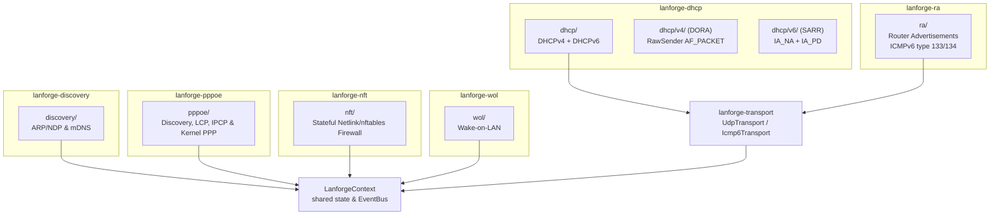
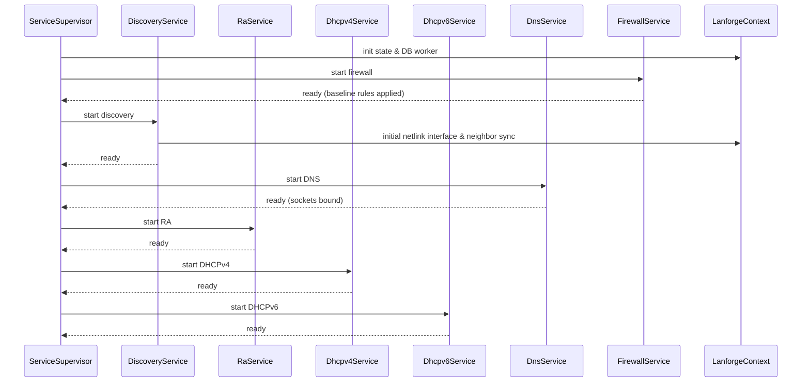
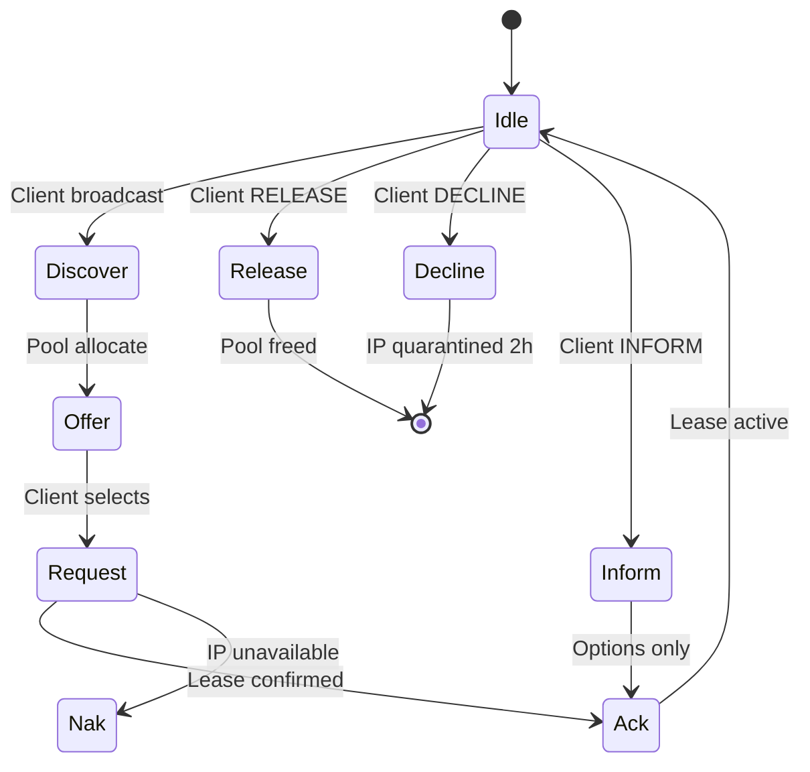
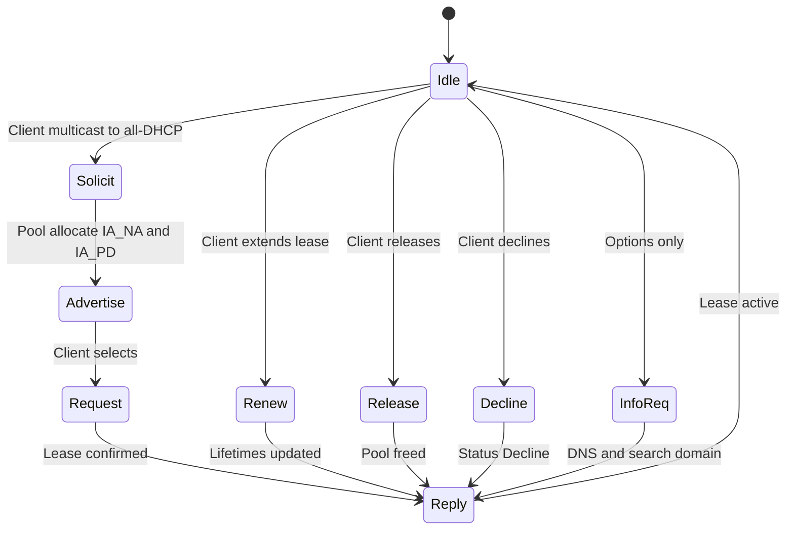
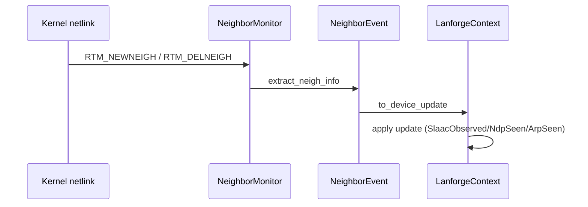

# Lanforge Networking Architecture (`lanforge-dhcp`, `lanforge-ra`, `lanforge-discovery`, `lanforge-wol`, `lanforge-nft`, `lanforge-pppoe`, `lanforge-transport`)

Low-level networking, address assignment, security, and WAN routing protocols for the Lanforge daemon.
Implements DHCPv4, DHCPv6, RA, Discovery (ARP/NDP/mDNS), WoL, PPPoE WAN client, and Netlink/nftables firewall — all integrating with `lanforge-core` via `LanforgeContext`, `EventBus`, and `DeviceUpdate` events.

---

## Overview

The networking engine of Lanforge is modularized into specialized crates. It manages every aspect of LAN and WAN lifecycle: IP address assignment (DHCPv4/v6), router advertisement broadcasting (RA/ICMPv6), neighbor discovery (NDP/ARP), mDNS hostname probing, Wake-on-LAN, WAN PPPoE sessions, and zero-downtime firewalling. All background services run cooperatively as `AsyncService` under central supervision.

### Crate Breakdown

| Crate | Purpose |
| :--- | :--- |
| `lanforge-transport` | Foundation: Dual-stack Y-architecture transports (`UdpTransport`, `DualTcpListener`, `Icmp6Transport`), lock-free rate limiting, atomic metrics, and rootless simulation handles (`InertHandle`). |
| `lanforge-dhcp` | DHCPv4 (L2 raw socket DORA state machine) and DHCPv6 (`IA_NA`/`IA_PD` SARR state machine) servers. |
| `lanforge-ra` | ICMPv6 Router Advertisement daemon, RDNSS/DNSSL options, and dynamic WAN prefix absorption. |
| `lanforge-discovery` | Consolidated network discovery: Netlink neighbor tracking (ARP/NDP), active probing, and mDNS scraping. |
| `lanforge-wol` | Wake-on-LAN magic packet injection. |
| `lanforge-nft` | Stateful Netlink/nftables firewall engine with in-place zero-downtime ruleset reloads. |
| `lanforge-pppoe` | Async PPPoE client with PADI/PADR discovery, LCP/IPCP negotiation, kernel PPP interface binding, and LCP keepalives. |
| `lanforge-dns-wire` | Zero-allocation DNS wire parser and encoder for hot-path routing and mDNS. |

---

## Module Map



---

## Service Architecture

### Execution Model Split

| Service | Model | Reason |
| :--- | :--- | :--- |
| `Dhcpv4Service` | `SyncService` | Dedicated synchronous thread handling L2 raw socket packet reception and DORA responses. |
| `Dhcpv6Service` | `SyncService` | Dedicated synchronous thread handling raw UDPv6 socket packet processing and SARR responses. |
| `RaService` | `AsyncService` | Async ICMPv6 socket with immediate solicit responses and periodic multicast loop. |
| `DiscoveryService` | `AsyncService` | Unified Netlink route/neighbor listener + async active prober + mDNS listener. |
| `PppoeService` | `AsyncService` | Asynchronous discovery, LCP/IPCP state machine, and kernel PPP interface lifecycle. |
| `FirewallService` | `AsyncService` | Reactive event listener compiling and applying stateful Netlink/nftables rulesets in-place. |
| `DnsService` | `AsyncService` | Dual UDP/TCP event loop with zero-allocation wire triage, DoT/DoQ/DoH, and micro-adblocker. |

### Bootstrap Sequence



---

## DHCPv4 — DORA State Machine (RFC 2131)



### `IpPool` — Roaring Bitmap Allocation

| Step | Strategy |
| :--- | :--- |
| 1 | Check `LanforgeContext` for existing static/dynamic lease — return same IP |
| 2 | Try requested IP if free and in range |
| 3 | Random selection from `RoaringBitmap` of available IPs |
| 4 | If pool empty — garbage collect expired leases from context |
| 5 | If still empty — emergency recovery of DECLINE quarantine |

### `RawSender` — L2 Unicast Injection

When a DHCP client has an IP but the server's ARP table lacks the entry, RFC 2131 requires L2 unicast (not L3 UDP). `RawSender` manually assembles Ethernet + IPv4 + UDP headers with checksums via `pnet` `AF_PACKET` channel.

---

## DHCPv6 — SARR State Machine (RFC 8415)



### `Ipv6Pool` — Multi-Prefix Allocation

| Feature | Detail |
| :--- | :--- |
| **Fixed pools** | Bound to specific 64-bit prefix (e.g., `fd00::100`–`fd00::200`) |
| **Floating pools** | Suffix ranges that apply to any managed prefix (ULA or GUA) |
| **Deterministic** | Hash(DUID, IAID, index) for reproducible assignment |
| **Random fallback** | When deterministic slots are taken |
| **Multi-prefix** | Simultaneous ULA + GUA address assignment |
| **IA_PD** | Prefix delegation support for clients needing subnets |

### Key Differences from DHCPv4

- Uses **DUIDs** (not MACs) as primary client identifiers
- Supports **prefix delegation** (IA_PD)
- RECONFIGURE messages for lease renewal (RFC 8415 §18.16)
- Multi-prefix operation (ULA + GUA simultaneously)

---

## Router Advertisements (RFC 4861 + RFC 8106)

### RA Packet Structure

```text
[ ICMPv6 Header: Type=134, Code=0, Checksum ]
[ RA Fixed Fields: HopLimit, M/O/Prf flags, RouterLifetime ]
[ Option 1: Source Link-Layer Address (MAC) ]
[ Option 5: MTU (if configured) ]
[ Option 3: Prefix Information (one per prefix) ]
[ Option 25: RDNSS (DNS servers) ]
[ Option 31: DNSSL (search domains) ]
```

### Timing Behavior

| Phase | Interval | Count |
| :--- | :--- | :--- |
| Startup burst | 16s (`MAX_INITIAL_RTR_ADVERT_INTERVAL`) | 3 RAs |
| Periodic multicast | `MinRtrAdvInterval`–`MaxRtrAdvInterval` (default 67–200s) | Continuous |
| RS-triggered unicast | Random delay 0–500ms | On-demand |
| Min delay between RAs | 3s (`MIN_DELAY_BETWEEN_RAS`) | Storm protection |

### Implemented RFCs

| RFC | Purpose |
| :--- | :--- |
| 4861 | Neighbor Discovery — Full RA/RS support |
| 8106 | RA Options for DNS (RDNSS + DNSSL) |
| 4191 | Default Router Preferences (Low/Medium/High) |
| 3775 | `AdvRouterAddr` flag in Prefix Information |
| 4443 | ICMPv6 checksum calculation |

### Prefix Change Handling

When the GUA prefix changes (via `PrefixChanged` bus event):
1. Update `Ipv6Pool` GUA prefix
2. Reserve static addresses for new prefix
3. Send RECONFIGURE (RENEW) to all clients with existing GUA leases
4. Trigger RA burst to advertise new prefix

---

## Neighbor Discovery Protocol (NDP/ARP)

### Event-Driven Model



### NeighborEvent Classification

| Neighbor State | IP Type | Prefix Match | `DeviceUpdate` Result |
| :--- | :--- | :--- | :--- |
| Active (`REACHABLE`, `STALE`, `DELAY`, `PROBE`) | GUA (`2000::/3`) | Matches `gua` | `SlaacObserved` |
| Active | ULA (`fd00::/8`) | Matches `ula` | `SlaacObserved` |
| Active | Link-Local (`fe80::/10`) | N/A | `NdpSeen` |
| Active | IPv4 | N/A | `ArpSeen` |
| Failed/Incomplete | Any | N/A | Filtered out |
| Delete | Any | N/A | `IpDeleted` |

### ARP Subnet Scan

Triggered by `NeighborScanRequested` bus event:
1. Get interface IPv4 address + prefix length
2. Generate all usable addresses (skip network/broadcast)
3. Probe each address with 10ms pacing
4. Publish `SubnetScanStarted` event for progress tracking

---

## mDNS Prober (RFC 6762)

### Design

Uses spawn-blocking `UdpSocket` listeners (non-async) because mDNS requires `SO_REUSEPORT` on port 5353 — the standard async `UdpSocket` cannot share this port with other processes.

### Query Types

| Query | Target | Purpose |
| :--- | :--- | :--- |
| Broadcast PTR | `_services._dns-sd._udp.local.` | Discover all services on LAN |
| Unicast PTR | `X.X.X.X.in-addr.arpa.` (IPv4 reverse) | Query hostname for specific IP |
| Unicast PTR | `x.x...x.ip6.arpa.` (IPv6 reverse) | Query hostname for specific IPv6 |

### Response Parsing

Extracts hostnames from:
- PTR records (name → hostname.local.)
- SRV records (target hostname)

Applies `DeviceUpdate::DhcpHostnameHint` to `LanforgeContext`. Skips update if device already has a hostname (avoids noise).

---

## Wake-on-LAN

### Magic Packet Format

```
[0xFF × 6] [MAC × 16] = 102 bytes total
```

### Redundant Delivery

| Target | Port | Condition |
| :--- | :--- | :--- |
| Directed broadcast (e.g., `192.168.1.255`) | 9 | If provided |
| Unicast (device last known IP) | 9 | If provided |

Uses `socket2` with `SO_BROADCAST` and `SO_BINDTODEVICE` (Linux-specific) for interface-bound sending.

---

## Device Identity Resolution

### `DeviceIdentity` — WAI ("Who am I?")

Merges packet-level hints (hostname via DHCP Option 12, vendor class via Option 60/77) with persistent device table state:

| hostname | vendor | Display Output |
| :--- | :--- | :--- |
| Some | Some | `"my-phone" (Android) [aa:bb:cc:dd:ee:ff]` |
| Some | None | `"my-phone" [aa:bb:cc:dd:ee:ff]` |
| None | Some | `(Apple) [aa:bb:cc:dd:ee:ff]` |
| None | None | `[aa:bb:cc:dd:ee:ff]` |

If the packet provides no hostname but the device table has one (from previous lease or CLI static config), the table's version is used — ensuring continuity across reboots.

---

## Interface Monitor

### `InterfaceState` Fields

| Field | Description |
| :--- | :--- |
| `v4` | IPv4 address + prefix length |
| `link_local` | `fe80::/10` address (required for RA/NDP) |
| `gua` | Global Unicast Address (`2000::/3`) with /64 mask |
| `ula` | Unique Local Address (`fd00::/8`) with /64 mask |
| `gua_preferred` / `gua_valid` | Lifetime timers from `IFA_CACHEINFO`

### Lifecycle

1. `initial_scan()` — `RTM_GETADDR` query on startup
2. `refresh_interface()` — updates state on netlink address events
3. Event loop — listens to `NewAddress`/`DelAddress` netlink messages
4. Publishes `DeviceUpdate::InterfaceIpsChanged` on every change
