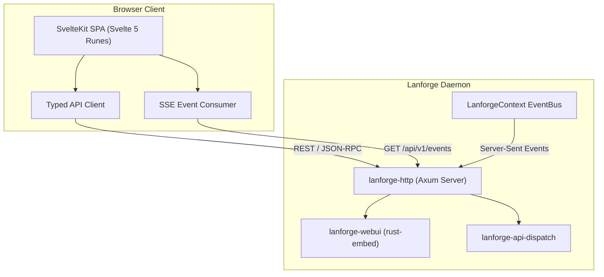

# Lanforge WebUI — Architecture & Interface Guide

Lanforge embeds a modern, responsive web dashboard built with **SvelteKit 2**, **Svelte 5 runes**, **shadcn-svelte**, and **Tailwind CSS v4**.

The WebUI compiles to an optimized static Single Page Application (SPA) bundle that is embedded directly into the daemon binary via the `lanforge-webui` crate and served out of memory by `lanforge-http` (`axum`).

---

## 1. Architecture & Tech Stack



### Core Technologies
- **Framework**: [SvelteKit](https://svelte.dev/) with Svelte 5 runes (`$state`, `$derived`, `$effect`, `$props`).
- **Component System**: [shadcn-svelte](https://shadcn-svelte.com/) with a refined, UniFi-inspired networking aesthetic.
- **Styling**: [Tailwind CSS v4](https://tailwindcss.com/) with dark/light mode tokens.
- **Icons**: [Lucide Svelte](https://lucide.dev/).
- **Charts & Data Visualization**: LayerChart / D3 for real-time traffic graphs and query analytics.
- **Embedded Asset Distribution**: `crates/webui/lanforge-webui` embeds the production static bundle using `rust-embed`.

---

## 2. Real-Time Communication & Data Layer

### 2.1 State & Client Hydration
Because the WebUI runs as an embedded client-side SPA (`adapter-static`), initial rendering and routing execute in the browser. Data is fetched upon view mount through a strongly typed API client (`web/src/lib/api/`).

### 2.2 Live Event Stream (SSE)
A global event listener consumes `GET /api/v1/events` using Server-Sent Events (SSE). The stream receives real-time updates directly from the daemon's broadcast `EventBus`:
- New device discoveries and IP allocations.
- Dynamic lease renewals and expirations.
- Netlink carrier changes and WAN interface reconnects.
- Firewall rule application acknowledgments.

### 2.3 Authentication & Session Security
- Authentication is handled via `POST /api/v1/auth/login`.
- Successful login issues an `HttpOnly`, `SameSite=Lax` session cookie and returns a signed JWT token.
- API requests include the session token in headers (`Authorization: Bearer <token>`) or the HTTP cookie.

---

## 3. Route Map & Management Modules

| Route | Module | Key Capabilities |
|:------|:-------|:-----------------|
| `/` | **Dashboard** | Router health, interface vitals, WAN/LAN status banners, and live bandwidth throughput. |
| `/network/devices` | **Device Inventory** | Connected device table, MAC OUI vendor resolution, whois detail dialogs, and static promotion. |
| `/network/hosts` | **Static Hosts** | Fixed IP reservations and manual host mappings. |
| `/network/pppoe` | **PPPoE WAN** | WAN session state, IPCP/IPv6CP negotiation, LCP echo keepalives, and hardware acceleration tabs. |
| `/network/ra` | **IPv6 Router Advertisements** | SLAAC prefixes, RDNSS/DNSSL settings, and unsolicited RA triggers. |
| `/network/traffic` | **Traffic & SQM** | Bufferbloat elimination with CAKE and fq_codel, hardware offload tuning (GRO/TSO), and rates. |
| `/dns/resolver` | **DNS Resolver** | Performance metrics, query type distribution, top domains/clients, and upstream server latency. |
| `/dns/log` | **DNS Query Log** | Real-time live query tail with instant search and client/domain filtering. |
| `/dns/cache` | **DNS Cache** | In-memory record cache inspection, TTL monitoring, and instant cache flushing. |
| `/dns/adblock` | **Adblock Engine** | 3-tier domain sinkholing, blocklist/allowlist management, source URLs, and temporary pause timers. |
| `/dns/rewrites` | **DNS Rewrites** | Custom local overrides, hardware-linked dynamic devices (`dev:`), and SRV service discovery (`srv:`). |
| `/dhcp/leases` | **DHCP Leases** | Active IPv4/IPv6 leases, lease extension/release modals, and static lease conversion. |
| `/dhcp/pools` | **DHCP Pools** | Dynamic address pool utilization visualizer. |
| `/dhcp/server` | **DHCP Options** | Network bootloader options (PXE Option 66/67) and raw DHCP option code definitions. |
| `/firewall` | **Firewall Orchestrator** | Stateful Netlink/nftables zones, inter-zone policy matrix, host rules, and unified port forwards / IPv6 pinholes. |
| `/tftp` | **TFTP Boot Server** | PXE bootloader file serving over UDP port 69 and transfer statistics. |
| `/system/database` | **Database Maintenance** | Embedded `redb` database stats, transactional backups, and retention pruning. |
| `/system/events` | **System Events** | Central audit log of all system transitions and hardware events. |
| `/system/users` | **User Accounts** | Router administrative accounts, password updates, and role-based permissions (`admin`, `operator`, `viewer`). |
| `/system/keys` | **API Tokens** | Token generation, scope assignment, and lifecycle management. |
| `/system/services` | **Service Control** | Supervision dashboard to view, start, stop, and restart background daemon services. |
| `/setup` | **Onboarding Wizard** | First-run setup sequence for LAN interface, addressing, and administrator credentials. |
| `/login` | **Authentication** | Secure login portal. |

---

## 4. Development & Build Workflow

```bash
# 1. Install Node dependencies
cd web
pnpm install

# 2. Run local development server with hot-module reloading
# Proxies API calls automatically to a running Lanforge daemon instance
pnpm dev

# 3. TypeScript type check and Svelte diagnostics
pnpm check

# 4. Compile the production static SPA bundle (outputs to web/build/)
pnpm build
```

When building the full release binary with `cargo build --release`, the compiled bundle in `web/build/` is embedded directly into the executable.
