# `lanforge-core` — Arquitetura da Biblioteca

Engine central de estado e orquestração do daemon Lanforge. Gerencia a identidade de dispositivos de rede, coordena mutações de estado via `DeviceUpdate`, e distribui eventos a todos os subsistemas através de um barramento broadcast.

---

## Visão Geral

`lanforge-core` é uma biblioteca **pura de lógica** — não realiza I/O de rede, disco, ou sistema diretamente. Sua responsabilidade é:

1. **Manter** o estado consistente de todos os dispositivos descobertos
2. **Resolver** conflitos de identidade (precedência: TOML > CLI > DHCP > mDNS)
3. **Broadcast** de mudanças via `EventBus` (tokio broadcast channel)
4. **Indexar** dados para consultas O(1) (DNS hot-path, IP lookup)

### Dependências

| Crate | Uso |
| :--- | :--- |
| `parking_lot` | `RwLock` para acesso concorrente ao estado |
| `tokio` | `sync::broadcast` para o `EventBus`, macros async |
| `serde` | Serialização/deserialização de todos os tipos públicos |
| `thiserror` | Definição de `CoreError` |
| `tracing` | Logs de debug internos (state mutations, GC) |

---

## Mapa de Módulos

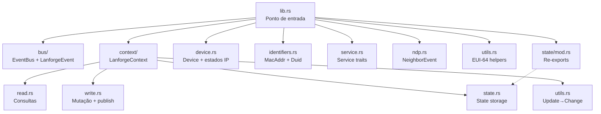

---

## Padrão Arquitetural: Reactor de Estado

O sistema segue um modelo de **Reator de Estado** onde todos os módulos externos (protocolos, CLI, API) interagem exclusivamente através de um ciclo fechado:

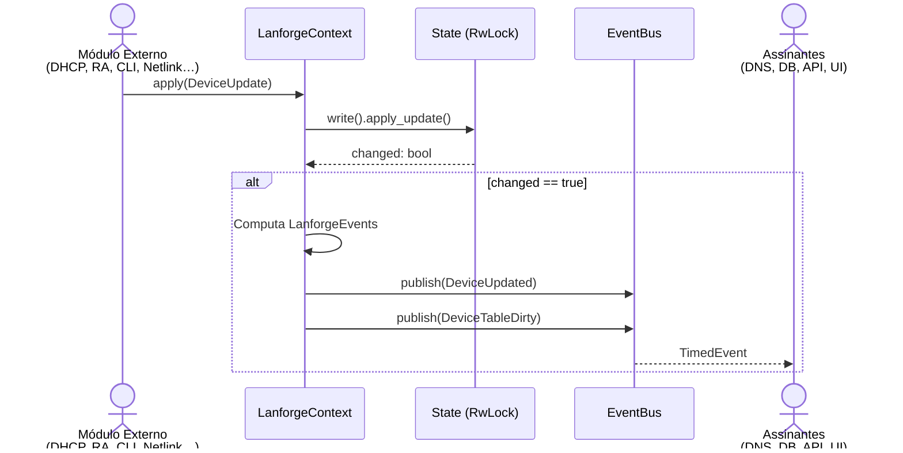

### Princípios de Design

| Princípio | Descrição |
| :--- | :--- |
| **Intenção Declarativa** | Nenhum módulo muta estado diretamente. Todo comando passa por `DeviceUpdate`. |
| **Fonte Única de Verdade** | `State` dentro de `LanforgeContext` é a única autoridade sobre dispositivos. |
| **Imutabilidade Local** | `Device` é guardado como `Arc<Device>`. Writes usam `Arc::make_mut` para clone-on-write. |
| **Eventual Consistency** | Assinantes do `EventBus` recebem notificações assíncronas; o estado já está aplicado. |

---

## Sistema de Tipos de Identificação

### `MacAddr` — Identificador Primário

```rust
pub struct MacAddr([u8; 6]);
```

O endereço MAC de 6 bytes é o **identificador universal** para todos os dispositivos. Todas as tabelas de lookup usam `MacAddr` como chave primária.

**Operações:**
- `parse("aa:bb:cc:dd:ee:ff")` → `Option<MacAddr>` — parsing colon-separated hex
- `from_slice(&[u8; 6])` → `Option<MacAddr>` — `const fn` para contextos estáticos
- `is_zero()` → `bool` — detecta `00:00:00:00:00:00`

### `Duid` — Identificador DHCPv6

```rust
pub struct Duid { bytes: Arc<[u8]> };
```

DHCPv6 usa DUIDs em vez de MACs. O tipo `Duid` encapsula bytes variáveis com suporte a extração de MAC para tipos **LL** e **LLT**:

```
DUID-LL:  [type=3][htype=1][MAC: 6 bytes]           → 10 bytes
DUID-LLT: [type=1][htype=1][time: 4][MAC: 6 bytes]  → 14 bytes
DUID-EN:  [type=2][enterprise: 4][identifier: var]  → MAC não extraível
```

**Operações:**
- `extract_mac()` → `Option<MacAddr>` — extrai MAC se LL/LLT
- `generate_ll_from_mac([u8; 6])` → `Duid` — gera DUID-LL a partir de MAC
- `duid_type()` → `&'static str` — identifica o tipo (LLT/EN/LL/UUID)

### Cache de Órfãos IPv6

Quando um lease DHCPv6 chega sem MAC resolvido, ele é armazenado em `orphaned_v6`:

```
HashMap<Ipv6Addr, (Duid, IAID, expires)>
```

A resolução acontece quando `DuidAssociated` ou um evento NDP correlaciona o IP ao MAC, promovendo o lease órfão para o dispositivo correto.

---

## O Dispositivo (`Device`)

`Device` é a estrutura central. Começa com apenas um MAC e acumula estado conforme eventos de rede ocorrem.

### Campos Principais

```rust
pub struct Device {
    pub mac: MacAddr,                  // Chave primária (imutável)
    pub hostname: Hostname,            // Nome com origem rastreável
    pub origin: Origin,                // Fonte da configuração
    pub managed_at: Option<SystemTime>,// Quando foi configurado manualmente
    pub v4: IPv4State,                 // Estado IPv4 (static/dynamic/none)
    pub v6: Vec<IPv6State>,            // Estados IPv6 (pode ter vários)
    pub v6_prefixes: Vec<V6PrefixLease>, // Prefixos delegados (IA_PD)
    pub seen_v4: Vec<Ipv4Addr>,        // IPs observados via ARP/netlink
    pub last_seen: SystemTime,         // Última atividade na rede
    pub duid: Option<Duid>,            // DUID DHCPv6
    pub dns_fallback: String,          // Nome DNS gerado do MAC
}
```

### Critério de "Worthiness"

Um dispositivo só entra na tabela principal se for **worthy** (digno). Isso evita entries fantasmas de sondas de rede breves:

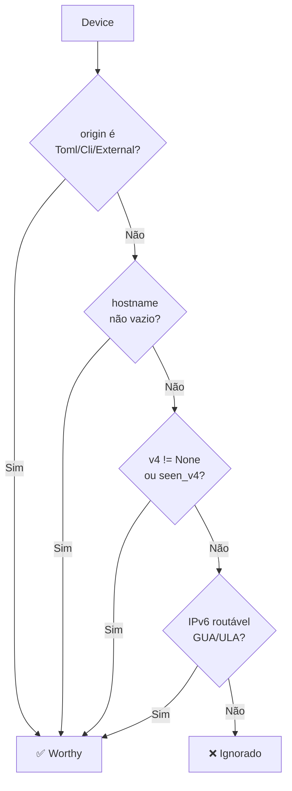

### Expiração e Coleta de Lixo

Dispositivos dinâmicos sem leases, prefixos, ou atividade por **7 dias** são removidos pelo `expire_stale()`. Leases expiram individualmente conforme seus timestamps.

### Prioridade de Endereços IPv6

O método `primary_v6()` seleciona o "melhor" endereço para exibição:

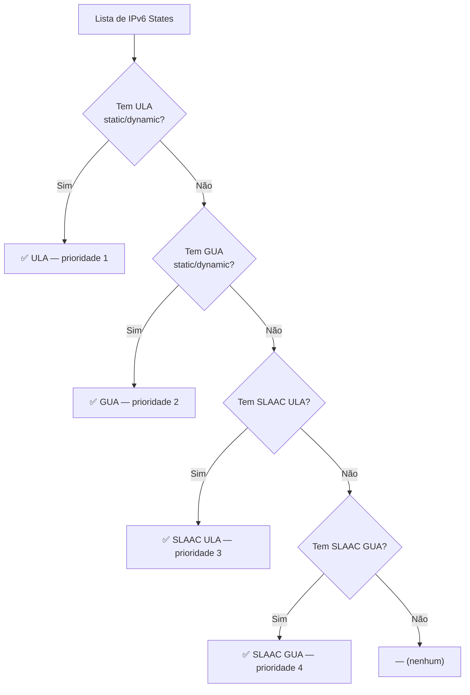

---

## Origem e Precedência

### `Origin` — Fonte da Configuração

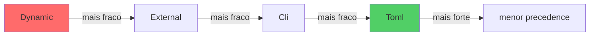

| Origin | Símbolo | Persistência | Descrição |
| :--- | :---: | :--- | :--- |
| `Dynamic` | `–` | Volátil | Descoberta automática (DHCP, ARP) |
| `External` | `ⓔ` | Persistente | Configuração via API HTTP |
| `Cli` | `·` | Persistente | Override via CLI |
| `Toml` | `★` | Persistente | Configuração estática no arquivo |

Dispositivos `Toml` **nunca** podem ser modificados via CLI — o sistema rejeita a operação com warning.

### `HostnameOrigin` — Hierarquia de Nomes

```rust
pub enum HostnameOrigin {
    None = 0,    // Sem nome
    Mdns = 1,    // Descoberta passiva multicast
    Dhcp = 2,    // Option 12 (v4) ou client hint (v6)
    Static = 3,  // Configuração manual
}
```

Hostname de origem **superior** substitui hostname de origem **inferior**, mas nunca o contrário. Isso evita que uma sondagem mDNS tardia sobrescreva um nome DHCP confiável.

---

## Estado de Rede

### `IPv4State`

```rust
pub enum IPv4State {
    Static(Ipv4Addr),      // Reserva manual
    Dynamic(V4Lease),      // Lease DHCPv4 ativo
    None,                  // Sem IPv4
}
```

### `IPv6State`

```rust
pub enum IPv6State {
    Static(Ipv6AddrOrSuffix),  // Reserva manual (pode ser só sufixo)
    Dynamic(V6Lease),          // Lease DHCPv6 IA_NA
    Slaac(Ipv6Addr),           // Autoconfigurado via RA
}
```

Um dispositivo pode ter **múltiplos** estados IPv6 simultaneamente — e.g., SLAAC + DHCPv6 + estático.

### `Ipv6AddrOrSuffix`

```rust
pub enum Ipv6AddrOrSuffix {
    Full(Ipv6Addr),    // Endereço 128-bit completo
    Suffix([u8; 8]),   // Interface ID (64 bits inferiores)
}
```

Suffixes são usados para reservas estáticas onde o prefixo global pode mudar (ex: quando o ISP troca o GUA). O sufixo se combina com o prefixo atual para gerar o endereço completo.

---

## Classificação de IPs

`IpClassification` categoriza endereços para ordenação e exibição:

| Classificação | Score | Range | Uso |
| :--- | :---: | :--- | :--- |
| `Ula` | 0 | `fc00::/7` | Endereço local estável (prioridade máxima) |
| `Ipv4` | 1 | — | IPv4 padrão |
| `Gua` | 2 | `2000::/3` | Endereço roteável globalmente |
| `LinkLocal` | 3 | `fe80::/10` | Link-local (não roteável) |
| `Loopback` | 4 | `127.0.0.1` / `::1` | Loopback |
| `Other` | 10 | — | Não classificado |

---

## O `State` — Armazenamento Central

`State` é a estrutura que guarda todos os dados. É protegida por `RwLock` dentro de `LanforgeContext`.

### Tabelas Internas

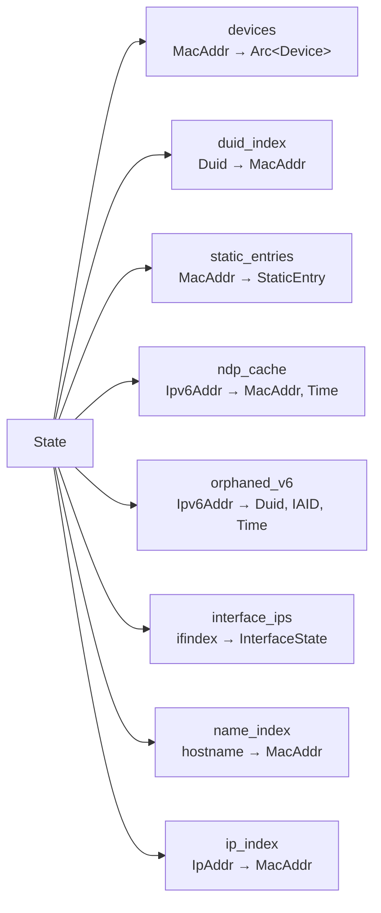

### Índices DNS (Hot-Path)

`name_index` e `ip_index` são reconstruídos sob demanda via `RebuildDnsIndices`. Garantem lookup O(1) para o servidor DNS sem iterar sobre todos os dispositivos.

**Regras de indexação:**
- Hostname lowercase → MAC
- `dns_fallback` → MAC
- IPv4 principal + `seen_v4` → MAC
- Todos os IPv6 ativos → MAC

---

## `DeviceUpdate` — Mutação por Intenção

Todos os 20+ variantes de `DeviceUpdate` são o **único** caminho para modificar estado. Cada variante dispatcha para um handler específico no `State::apply_update`.

### Categorias

| Categoria | Updates | Descrição |
| :--- | :--- | :--- |
| **Leases** | `V4LeaseGranted`, `V6LeaseGranted`, `V6PrefixAssigned`, `LeaseReleased` | DHCPv4, DHCPv6 IA_NA, IA_PD |
| **Vizinhança** | `NdpSeen`, `ArpSeen`, `SlaacObserved`, `SlaacSynced`, `SlaacCleared` | NDP, ARP, SLAAC |
| **Hostname** | `DhcpHostnameHint`, `MdnsHostnameHint` | Dicas de nome |
| **DUID** | `DuidAssociated` | Vinculação DUID→MAC |
| **CLI** | `CliHostUpdated`, `HostRemoved` | Gestão manual |
| **IP** | `IpDeleted`, `IpOffline` | Remoção de endereços |
| **Interface** | `InterfaceIpsChanged` | Mudança de configuração da interface |
| **Manutenção** | `PruneZombies`, `RebuildDnsIndices` | Limpeza e otimização |

### Flow de Aplicação

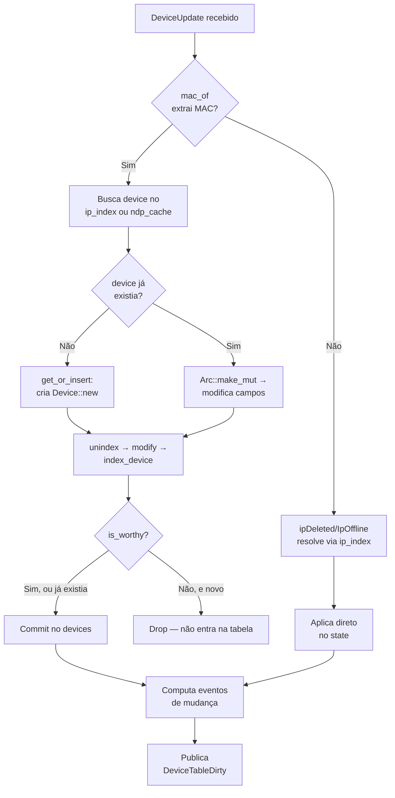

---

## `LanforgeContext` — Fachada Thread-Safe

`LanforgeContext` é o ponto de entrada público. Encapsula `Arc<LanforgeContextInner>` contendo:

```
LanforgeContext
├── Arc<EventBus>          // Barramento de eventos broadcast
├── RwLock<State>          // Estado dos dispositivos
├── target_ifindex         // Interface monitorada
├── running: AtomicBool    // Flag de shutdown
├── db_ready: AtomicBool   // DB inicializado
├── if_ready: AtomicBool   // Interfaces configuradas
├── dns_stats              // Estatísticas DNS (any type)
└── last_db_flush          // Último flush do DB
```

### API de Leitura (`read.rs`)

| Método | Lookup | Complexidade |
| :--- | :--- | :--- |
| `get_device(&mac)` | MAC → Device | O(1) |
| `get_by_hostname(name)` | Nome → Device | O(1) |
| `get_by_ip(&ip)` | IP → Device | O(1) |
| `get_by_duid(&duid)` | DUID → Device | O(1) |
| `get_mac_by_ip(ip)` | IP → MAC | O(1) |
| `all_devices()` | Todos | O(n) |
| `is_prefix_delegated(pfx)` | Verifica prefixo | O(n × m) |

### API de Escrita (`write.rs`)

| Método | Ação |
| :--- | :--- |
| `apply(&DeviceUpdate)` | **Método principal** — aplica + publica eventos |
| `allocate_v4_lease()` | Concede lease DHCPv4 |
| `grant_v6_lease()` | Concede lease DHCPv6 IA_NA |
| `delegate_v6_prefix()` | Delega prefixo IA_PD |
| `associate_duid()` | Vincula DUID a MAC (resolve órfãos) |
| `update_hostname()` | Atualiza nome via DHCP hint |
| `track_ndp_neighbor()` | Registra vizinho NDP |
| `track_arp_neighbor()` | Registra vizinho ARP |
| `observe_slaac()` | Registra endereço SLAAC |
| `sync_slaac()` | Sincroniza SLAAC completo |
| `add_static_device()` | Adiciona/atualiza reserva estática |
| `release_v4_lease()` | Libera lease DHCPv4 |
| `release_v6_lease()` | Libera lease DHCPv6 |
| `release_v6_prefix()` | Libera prefixo delegado |
| `remove_host()` | Remove dispositivo explicitamente |
| `delete_ip()` | Remove IP específico |
| `expire_stale()` | **GC** — expira leases e zumbis |
| `rebuild_dns_indices()` | Reconstrói caches DNS |

### Coordenação de Lifecycle

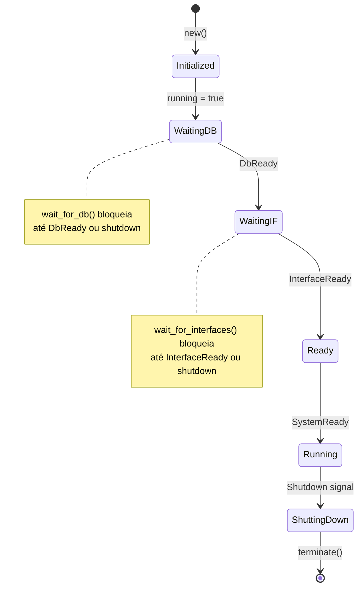

---

## `EventBus` — Barramento de Eventos

Implementado sobre `tokio::sync::broadcast` com capacidade de 256 eventos.

### Modelo de Publicação

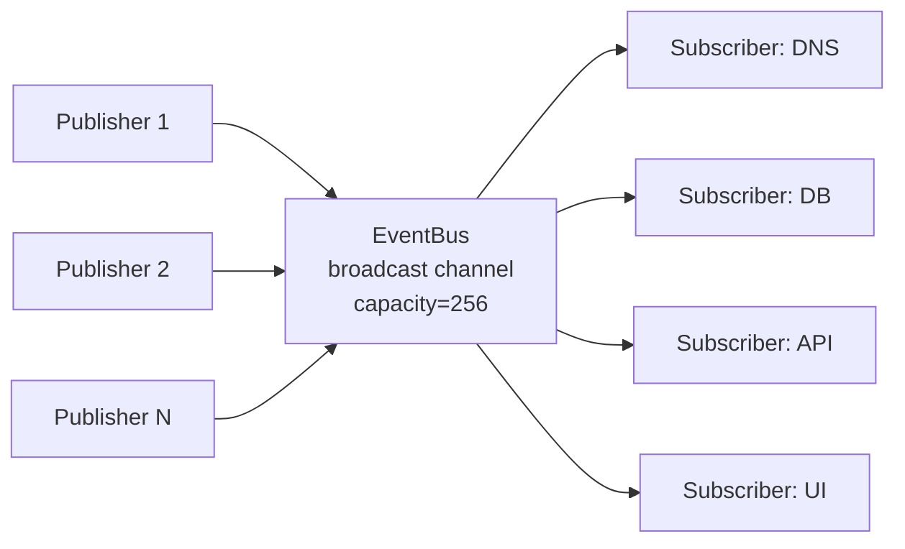

### Categorias de Eventos

| Categoria | Eventos |
| :--- | :--- |
| **Device Lifecycle** | `DeviceDiscovered`, `DeviceUpdated`, `DeviceExpired`, `DevicePurged` |
| **Infraestrutura** | `PrefixChanged`, `InterfaceUpdated`, `ScanRequested` |
| **Controle** | `Shutdown`, `ReloadConfig`, `DbVacuum`, `DbLogClean`, `DbPrune` |
| **Inicialização** | `StateReady`, `DbReady`, `InterfaceReady`, `ServiceReady`, `SystemReady` |
| **Diagnóstico** | `WolTriggered`, `LeaseRelease`, `LeaseRenew` |

### `TimedEvent`

Todos os eventos são encapsulados com metadata:

```rust
pub struct TimedEvent {
    pub event: LanforgeEvent,
    pub timestamp: SystemTime,
    pub module: Option<String>,
}
```

`is_loggable()` determina se o evento deve ser persistido no banco de dados histórico. Sinais internos (`StateReady`, `DbReady`) **não** são loggados.

---

## `DeviceChange` — Detalhes de Mudança

Dentro de `DeviceUpdated`, o `DeviceChange` especifica **o que** mudou:

| Change | Gatilho |
| :--- | :--- |
| `V4Assigned` | `V4LeaseGranted` |
| `V6Assigned` | `V6LeaseGranted` |
| `V6PrefixAssigned` | `V6PrefixAssigned` |
| `LeaseExpired` | `expire_stale()` removeu lease |
| `HostnameChanged` | DHCP/CLI/mDNS hint |
| `V4StaticChanged` | CLI modificou reserva |
| `V6SuffixChanged` | CLI modificou sufixo |
| `DuidAssociated` | DUID vinculado a MAC |
| `SlaacObserved` | NDP com endereço SLAAC |
| `SlaacSynced` | Sincronização completa SLAAC |
| `NdpActivity` | NDP sem SLAAC extraível |
| `ArpActivity` | ARP observado |
| `StatusChanged` | Device online/offline |
| `HostRemoved` | Device removido por inatividade |

---

## Sistema de Serviços

### Traits de Serviço

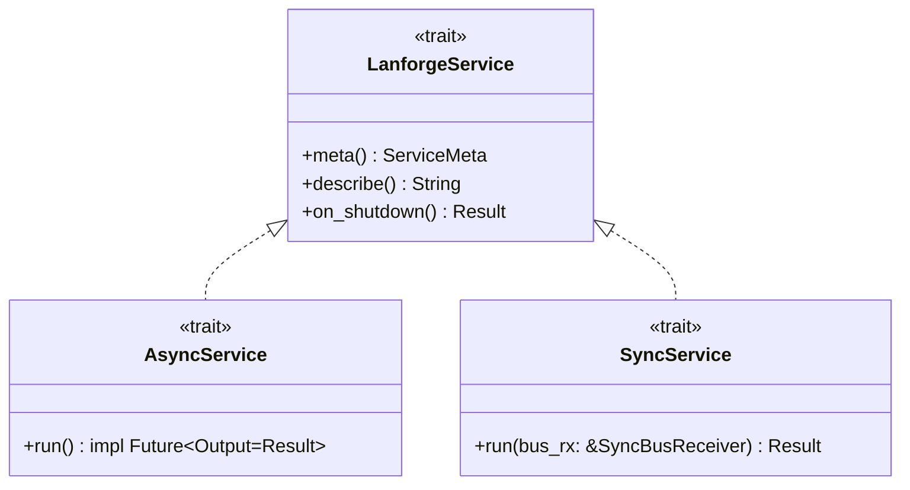

### `ServiceMeta` — Metadados de Supervisão

| Campo | Descrição | Exemplo |
| :--- | :--- | :--- |
| `id` | Identificador estável para tracking | `"dhcpv4"`, `"ra"` |
| `display_name` | Nome da thread (visível em htop) | `"DHCPv4 Server"` |
| `critical` | Se true, falha máxima encerra o processo | `true` para DB |
| `max_retries` | Máx reinícios (0 = ilimitado) | `3` |
| `base_backoff` | Backoff inicial (dobra por falha) | `1s` |
| `max_backoff` | Teto do backoff | `30s` |
| `stack_kb` | Stack da thread (sync services) | `256` |

### Estratégia de Backoff

```
Tentativa 0:  base_backoff
Tentativa 1:  base_backoff × 2
Tentativa 2:  base_backoff × 4
...
Tentativa N:  min(base × 2^N, max_backoff)
```

### `SyncBusReceiver`

Ponte entre o `EventBus` async e services síncronos:

```rust
pub struct SyncBusReceiver {
    rx: Receiver<TimedEvent>,  // std::sync::mpsc (bridged from tokio broadcast)
    ctx: LanforgeContext,
}
```

Oferece métodos de conveniência:
- `recv_timeout(d)` — receive bloqueante com timeout
- `try_recv_all()` — drain non-blocking de todos os pendentes
- `wait_for_interfaces()` — bloqueia até `InterfaceReady`
- `wait_for_db()` — bloqueia até `DbReady`

---

## NDP — Mapeamento de Eventos do Kernel

O módulo `ndp` traduz eventos `RTM_NEWNEIGH`/`RTM_DELNEIGH` do kernel Linux em `DeviceUpdate`s:

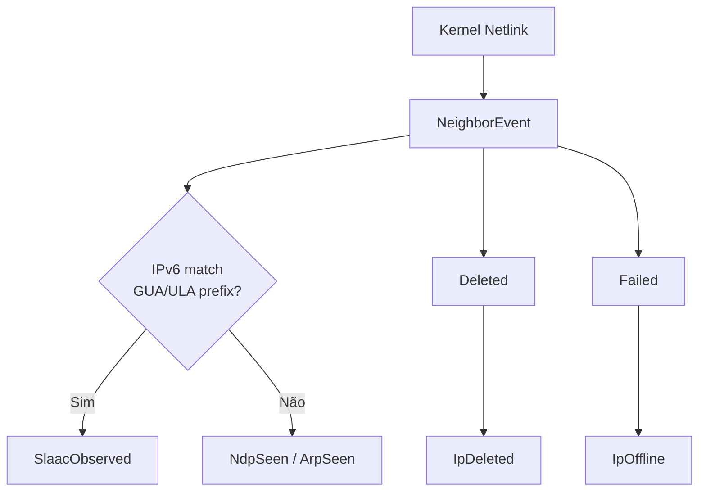

### Detecção SLAAC

Para eventos `Added` IPv6, o endereço é comparado contra os prefixos GUA/ULA atuais. Se corresponder a **qualquer** prefixo, é tratado como SLAAC — mesmo se usar Privacy Extensions (RFC 4941) ao invés de EUI-64 puro.

---

## Utilitários EUI-64

O módulo `utils` fornece funções para trabalhar com identificadores EUI-64 em endereços link-local:

```
MAC:  AA:BB:CC:DD:EE:FF
      ↓
EUI-64: (AA^0x02):BB:CC:FF:FE:DD:EE:FF
        ↑ U/L bit flipped   ↑ FF:FE marker
```

| Função | Uso |
| :--- | :--- |
| `ip_matches_prefix(ip, prefix)` | Verifica se IP pertence a um /64 |
| `mac_from_eui64_link_local(ip)` | Extrai MAC de `fe80::` com padrão EUI-64 |
| `is_slaac_iid(ip, mac)` | Valida se o suffix de um IPv6 corresponde ao MAC |

---

## Garbage Collection (`expire_stale`)

Executado periodicamente, aplica estas regras:

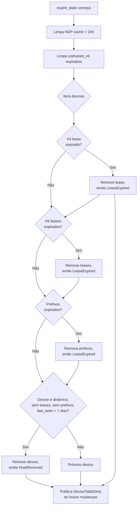

---

## Performance Considerations

### Clone-on-Write via `Arc<Device>`

```rust
let mut dev = Arc::make_mut(&mut dev_arc);  // Clona se ref_count > 1
dev.hostname = Hostname { ... };             // Modifica sem lock extra
```

Isso permite leitura compartilhada (via `Arc::clone`) sem copiar o dispositivo inteiro, enquanto writes só clonam quando necessário.

### Índices DNS

Reconstruídos sob demanda (`RebuildDnsIndices`), não incrementalmente. Isso garante que não haja "ghost entries" de leases expirados — o índice é sempre um snapshot consistente do estado atual.

### Debounce Implícito

`DeviceTableDirty` é publicado a **cada** mudança. O `db_worker` (em `lanforge-db`) implementa debounce externamente. A `lanforge-core` apenas sinaliza que o estado mudou.

---

## Thread Safety

```
LanforgeContext: Clone (Arc interno)
├── RwLock<State>: Read lock = múltiplos leitores
│                  Write lock = exclusivo
├── EventBus: Clone, Send, Sync (tokio broadcast)
└── Atomics: running, db_ready, if_ready (lock-free)
```

Todos os tipos públicos são `Send + Sync`. `Device` e `State` são `Clone` mas `Device` não é `Copy` (contém `String`/`Vec`).

---

## Fluxo de Dados Completo

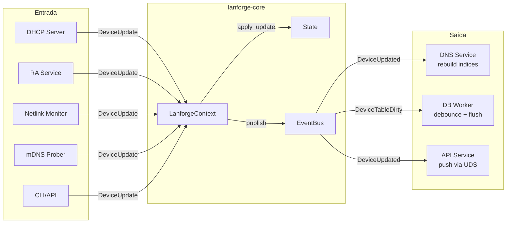

---

## Resumo dos Contratos Públicos

| Tipo | Contrato |
| :--- | :--- |
| `MacAddr` | 6 bytes, parsing `xx:xx:xx:xx:xx:xx`, `const fn` disponível |
| `Duid` | Bytes arbitrários, extração MAC para LL/LLT, serialização colon-hex |
| `Device` | Imutável fora do contexto, `Arc` compartilhável, `is_worthy()` guarda a tabela |
| `DeviceUpdate` | Único caminho de mutação, 20+ variantes, todas dispatcham para handlers |
| `LanforgeContext` | Thread-safe, Clone, `apply()` atômico + broadcast |
| `EventBus` | Multi-producer/multi-consumer, lossy se buffer cheio (256), `is_loggable()` |
| `State` | Não usar diretamente — acessar via `LanforgeContext`. Contém todas as tabelas. |
| `LanforgeService` | Trait base para serviços supervisionados, com `meta()` e `on_shutdown()` |
| `AsyncService` | Para services com Tokio (`run() -> impl Future`) |
| `SyncService` | Para services blocking (`run() -> Result` com `SyncBusReceiver`) |
