# `lanforge-db` — Library Architecture

Persistence layer for the Lanforge daemon. Implements SQLite storage for network state, event history, and debounce strategies to protect SD cards in embedded systems.

---

## Overview

`lanforge-db` provides two independent persistence mechanisms:

1. **`LeaseDb`** — Database for devices and leases (survives reboots)
2. **`LogDb`** — Transient event log database (24h retention, optimized for ramdisk)

The library is **synchronous** — `DbWorker` runs on a dedicated thread, receiving events via `SyncBusReceiver`.

### Dependencies

| Crate | Usage |
| :--- | :--- |
| `rusqlite` (+ bundled) | Statically compiled SQLite driver |
| `rusqlite_migration` | Versioned schema migrations |
| `lanforge-core` | Types `Device`, `State`, `LanforgeContext`, `EventBus` |
| `serde` / `serde_json` | Event serialization for `LogDb` |
| `tracing` | I/O operation logging |
| `thiserror` | `LeaseDbError` |

---

## Module Map

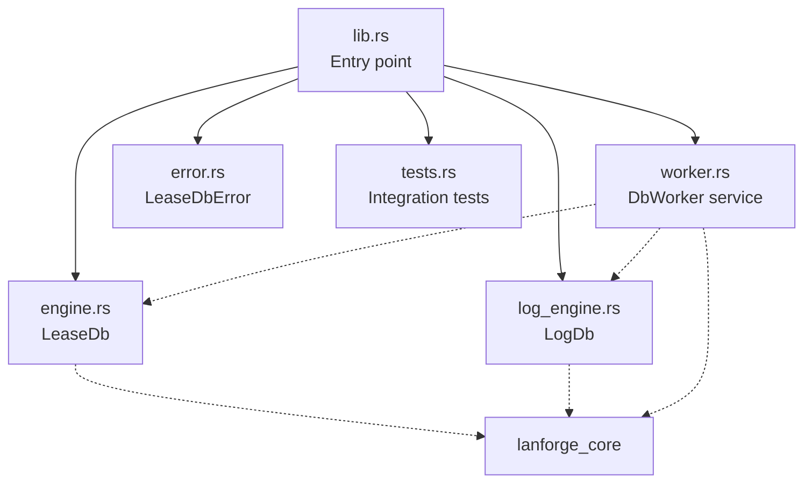

---

## Persistence Architecture

The system implements a **Persistence Worker** pattern — a synchronous thread that consumes events from the `EventBus` and translates them into SQLite operations:

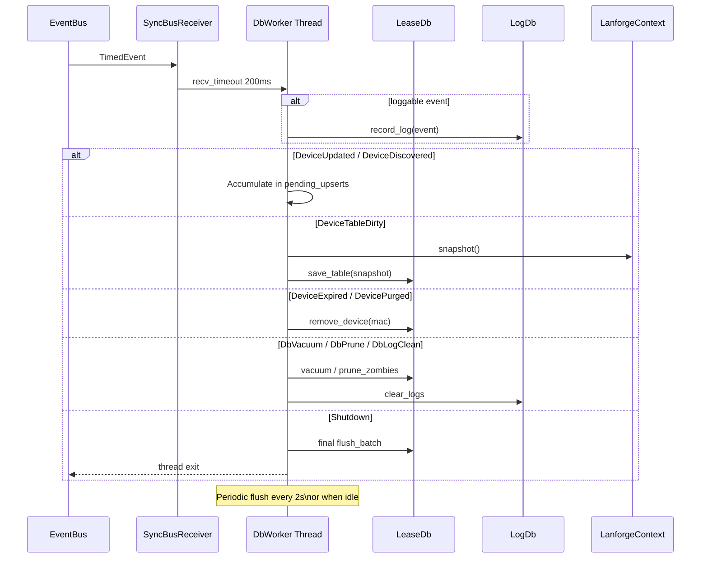

---

## `LeaseDb` — Lease Engine

### Database Schema

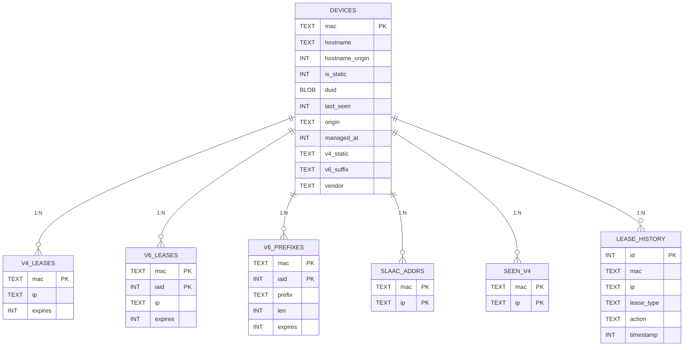

### SQLite Configuration

| PRAGMA | Value | Rationale |
| :--- | :--- | :--- |
| `journal_mode` | `WAL` | Writes don't block reads; reduces SD card wear |
| `synchronous` | `NORMAL` | Safe for SD cards; crash-safe in WAL mode |
| `foreign_keys` | `ON` | Automatic CASCADE on deletes |

### Migrations

The system uses `rusqlite_migration` with 3 migrations:

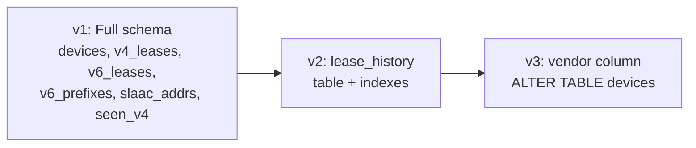

**Migration v1** — Full drop & recreate to clean up legacy schemas:
- `devices`: Core table with all identity fields
- `v4_leases`: DHCPv4 leases (1 per MAC)
- `v6_leases`: DHCPv6 IA_NA leases (multiple per MAC via IAID)
- `v6_prefixes`: Delegated IA_PD prefixes (multiple per MAC via IAID)
- `slaac_addrs`: SLAAC-configured addresses (multiple per MAC)
- `seen_v4`: IPv4 addresses observed via ARP/netlink (multiple per MAC)

**Migration v2** — Lease history for auditing:
- Indexes on `mac` and `timestamp` for fast queries

**Migration v3** — `vendor` column for manufacturer identification (reserved).

---

## Save Operations

### `save_table` — Full Snapshot

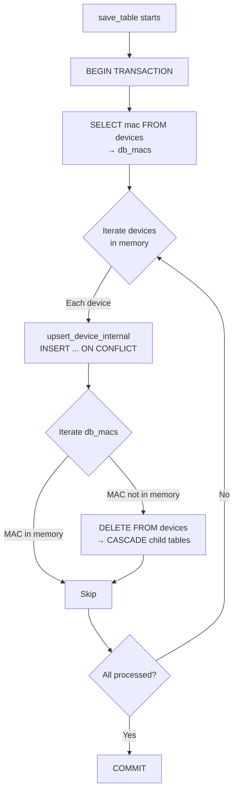

### `upsert_device_internal` — Write Pattern

Each device follows a **clear-then-insert** pattern for child tables:

```sql
-- 1. Device: UPSERT (INSERT ... ON CONFLICT DO UPDATE)
INSERT INTO devices (...) VALUES (...)
  ON CONFLICT(mac) DO UPDATE SET ...

-- 2. Child tables: DELETE + INSERT
DELETE FROM v4_leases WHERE mac = ?
INSERT INTO v4_leases (mac, ip, expires) VALUES (?, ?, ?)

DELETE FROM v6_leases WHERE mac = ?
INSERT INTO v6_leases (mac, iaid, ip, expires) VALUES (?, ?, ?, ?)

DELETE FROM v6_prefixes WHERE mac = ?
INSERT INTO v6_prefixes (mac, iaid, prefix, len, expires) VALUES (...)

DELETE FROM slaac_addrs WHERE mac = ?
INSERT INTO slaac_addrs (mac, ip) VALUES (?, ?)

DELETE FROM seen_v4 WHERE mac = ?
INSERT INTO seen_v4 (mac, ip) VALUES (?, ?)
```

**Why DELETE + INSERT?** Simplifies diff logic. If a lease expired and was removed from the `Device`, the DELETE guarantees the row is removed from the DB — no need to compare timestamps individually.

### Device ↔ DB Mapping

| `Device` Field | Table | Column(s) | Notes |
| :--- | :--- | :--- | :--- |
| `mac` | `devices` | `mac` (PK) | String `"aa:bb:cc:dd:ee:ff"` |
| `hostname.name` | `devices` | `hostname` | |
| `hostname.origin` | `devices` | `hostname_origin` | Enum int (0-3) |
| `origin` | `devices` | `origin` | String `"dynamic"`, `"toml"`, `"cli"` |
| `is_static()` | `devices` | `is_static` | Bool derived from `Origin` |
| `managed_at` | `devices` | `managed_at` | Unix timestamp |
| `duid` | `devices` | `duid` (BLOB) | Raw DUID bytes |
| `v4` Static | `devices` | `v4_static` | IP string |
| `v4` Dynamic | `v4_leases` | `ip`, `expires` | |
| `v6` Static | `devices` | `v6_suffix` | First suffix found |
| `v6` Dynamic | `v6_leases` | `iaid`, `ip`, `expires` | |
| `v6` Slaac | `slaac_addrs` | `ip` | All SLAAC entries |
| `v6_prefixes` | `v6_prefixes` | `iaid`, `prefix`, `len`, `expires` | |
| `seen_v4` | `seen_v4` | `ip` | All observed IPs |

### Timestamp Encoding

All `SystemTime` values are converted to `i64` (Unix epoch seconds):

```rust
fn system_time_to_unix(t: SystemTime) -> i64 {
    t.duration_since(UNIX_EPOCH)
        .map(|d| d.as_secs().cast_signed())
        .unwrap_or(0)  // Pre-epoch → 0
}

fn unix_to_system_time(unix: i64) -> SystemTime {
    if unix > 0 {
        UNIX_EPOCH + Duration::from_secs(unix.cast_unsigned())
    } else {
        UNIX_EPOCH  // 0 or negative → epoch
    }
}
```

---

## Load Operations

### `load_table` — State Reconstruction

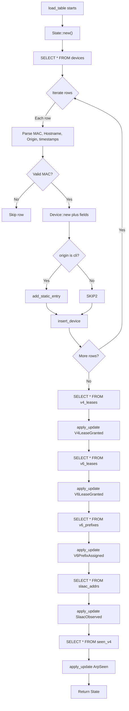

**Tolerance to invalid data:** The load silently skips rows with invalid MACs or malformed IPs — essential for handling migrations or partial corruption without failing.

---

## `LogDb` — Transient Log Engine

### Ramdisk Design

`LogDb` is designed to operate on **tmpfs** (ramdisk), prioritizing performance over durability:

| PRAGMA | Value | Rationale |
| :--- | :--- | :--- |
| `journal_mode` | `WAL` | Minimal write amplification |
| `synchronous` | `OFF` | Volatile data — loss is acceptable |

### Schema

```sql
CREATE TABLE system_logs (
    id         INTEGER PRIMARY KEY AUTOINCREMENT,
    timestamp  INTEGER NOT NULL,
    module     TEXT,
    event_json TEXT NOT NULL
);
CREATE INDEX idx_logs_timestamp ON system_logs(timestamp);
```

### Auto-Pruning

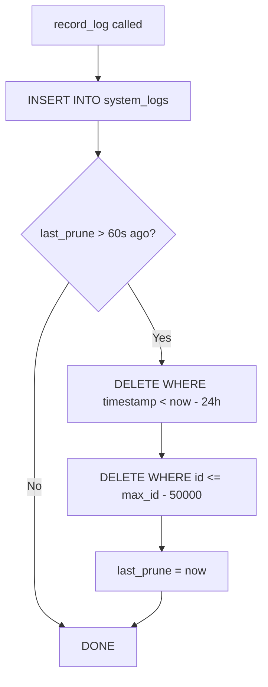

**Two layers of protection:**
1. **Time window:** Keeps only the last 24 hours of logs
2. **Safety cap:** Maximum 50,000 entries (prevents OOM on small ramdisks)

### `LeaseAction` — Lease Event Types

```rust
pub enum LeaseAction {
    Assigned,   // New lease created
    Renewed,    // Existing lease renewed
    Released,   // Lease explicitly released
    Expired,    // Natural expiration
}
```

---

## `DbWorker` — Persistence Service

`DbWorker` is a `SyncService` that runs on a dedicated thread, coordinating `LeaseDb`, `LogDb`, and the `EventBus`.

### Lifecycle

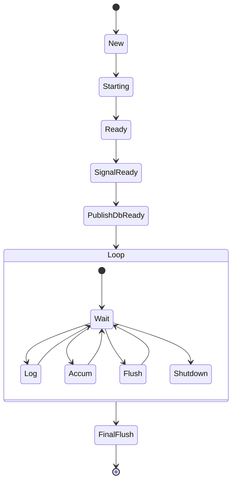

### Event Dispatch

| Event | Action | Immediate Flush? |
| :--- | :--- | :---: |
| `DeviceUpdated { mac }` | Accumulate in `pending_upserts[mac]` | ❌ |
| `DeviceDiscovered { mac }` | Accumulate in `pending_upserts[mac]` | ❌ |
| `DeviceExpired { mac }` | `db.remove_device(mac)` | ✅ |
| `DevicePurged { mac }` | `db.remove_device(mac)` | ✅ |
| `DeviceTableDirty` | `db.save_table(snapshot)` (full sync) | ✅ |
| `DbVacuum` | `db.vacuum()` | ✅ |
| `DbPrune` | `db.prune_zombies()` | ✅ |
| `DbLogClean` | `log_db.clear_logs()` | ✅ |
| `Shutdown` | Break loop | ✅ (final flush) |

### Batch Upsert Strategy

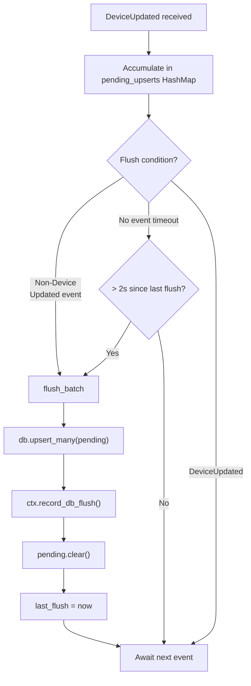

**Why batch?** Reduces SQLite transactions from N (one per device) to 1 (all at once), lowering SD card wear and total latency.

### Implicit Debounce

The worker implements **trailing edge debounce** through the batch mechanism:

| Parameter | Value | Purpose |
| :--- | :--- | :--- |
| `recv_timeout` | 200ms | Channel polling — responsiveness |
| Batch flush | 2s | Groups rapid changes |
| `DeviceTableDirty` full sync | Immediate | Safety net for consistency |

During a "boot storm" with 50 devices changing in sequence, only 1-2 writes occur instead of 50 individual writes.

---

## `LeaseDbError` — Error Hierarchy

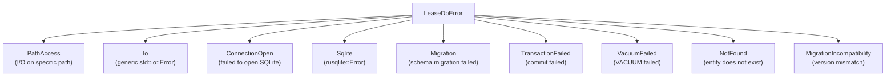

| Variant | When | Recoverable? |
| :--- | :--- | :---: |
| `PathAccess` | Directory doesn't exist, no permissions | ❌ |
| `Io` | Generic I/O error | Depends |
| `ConnectionOpen` | SQLite won't open / corrupted | ❌ |
| `Sqlite` | SQL execution error | ✅ (retry) |
| `Migration` | Schema migration failed | ❌ |
| `TransactionFailed` | Commit failed | ✅ (retry) |
| `VacuumFailed` | VACUUM failed | ✅ (retry) |
| `NotFound` | Query returned no results | ✅ |
| `MigrationIncompatibility` | Version mismatch | ❌ |

---

## Maintenance Operations

### `prune_zombies` — Ghost Entry Cleanup

 Removes `dynamic` devices that **never** had:
- A hostname
- An active V4 or V6 lease
- A delegated V6 prefix
- A SLAAC address
- An observed IP (seen_v4)

```sql
DELETE FROM devices
WHERE origin = 'dynamic'
  AND hostname = ''
  AND mac NOT IN (SELECT mac FROM v4_leases)
  AND mac NOT IN (SELECT mac FROM v6_leases)
  AND mac NOT IN (SELECT mac FROM v6_prefixes)
  AND mac NOT IN (SELECT mac FROM slaac_addrs)
  AND mac NOT IN (SELECT mac FROM seen_v4)
```

**When called:** Via `DbPrune` event (manual or scheduler periodic).

### `vacuum` — SQLite File Optimization

Runs `VACUUM` to reorganize the DB file and reclaim space from deleted entries.

**When called:** Via `DbVacuum` event. Ideal to run periodically (weekly) during low-traffic windows.

### `remove_device` — CASCADE Deletion

```rust
pub fn remove_device(&self, mac: MacAddr) -> Result<(), LeaseDbError>
```

Deletes the device and **automatically** all child entries via `ON DELETE CASCADE`:
- `v4_leases`
- `v6_leases`
- `v6_prefixes`
- `slaac_addrs`
- `seen_v4`

---

## Integration with `lanforge-core`

### Bootstrap Hydration Flow

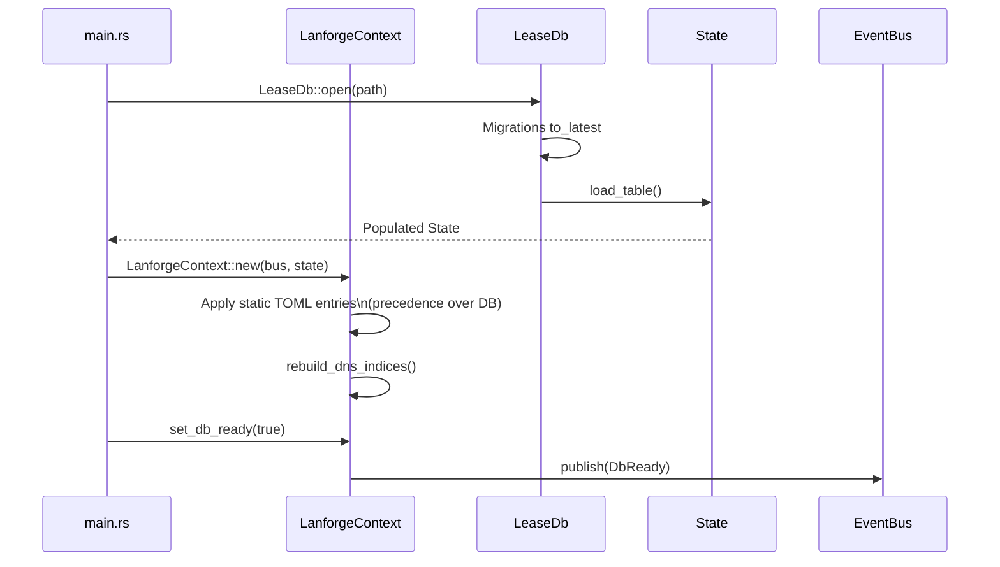

### Lease History Recording

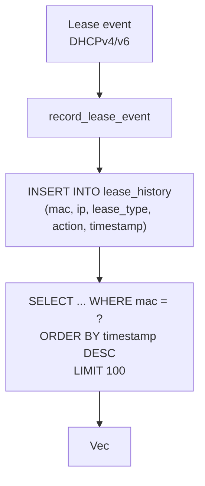

---

## Performance Considerations

### SD Card Wear Protection

| Strategy | Implementation |
| :--- | :--- |
| WAL mode | Writes are append-only in the WAL file, not overwriting the main DB |
| Synchronous=NORMAL | Checkpoint only every 1000 WAL pages |
| Batch upserts | 1 transaction for N devices (instead of N transactions) |
| 2s Debounce | Waits for state stabilization before writing |
| LogDb on tmpfs | Volatile logs never touch the SD card |

### Estimated Throughput

| Operation | Cost | Typical Latency (RPi4 + SD) |
| :--- | :--- | :--- |
| `upsert_many(50 devices)` | 1 transaction with ~300 statements | ~50-100ms |
| `remove_device` | 1 DELETE + 5 CASCADEs | <5ms |
| `save_table(100 devices)` | Full snapshot, ~500 statements | ~100-200ms |
| `record_log` | 1 INSERT | <1ms (WAL + synchronous=OFF) |
| `vacuum` | Full file rewrite | 1-5s (proportional to size) |

### Memory Footprint

| Component | Estimated RAM |
| :--- | :--- |
| `LeaseDb` (connection) | ~2-4 MB (SQLite + WAL buffers) |
| `LogDb` (ramdisk) | Variable (max ~50K events × ~200B = ~10MB) |
| `pending_upserts` | Proportional to active devices (~1KB/device) |

---

## Test Contract

The crate contains **13 tests** covering:

| Category | Tests |
| :--- | :--- |
| **Round-trip** | `create_and_load_empty`, `save_and_load_roundtrip`, `save_overwrites_previous` |
| **Specific types** | `handles_slaac_multiple_addrs`, `handles_duid_persistence`, `handles_v6_lease` |
| **Resilience** | `skips_invalid_database_records_gracefully` |
| **Cascade** | `test_remove_device_cascades` |
| **Worker integration** | `db_worker_persists_on_dirty_event` (async) |
| **Persistence** | `test_seen_v4_persistence`, `test_slaac_persistence_integration`, `test_worthy_filtering_db_integration`, `test_persistence_of_various_updates` |

All tests use `LeaseDb::open_in_memory()` — no disk access.

---

## Public Contracts Summary

| Type | Contract |
| :--- | :--- |
| `LeaseDb` | Synchronous SQLite engine. `open(path)`, `save_table()`, `load_table()`, `upsert_device()`, `remove_device()`, `vacuum()`, `prune_zombies()`, `record_lease_event()`, `get_lease_history()` |
| `LogDb` | Volatile log engine. `open(path)`, `record_log()`, `get_history()`, `clear_logs()` |
| `DbWorker` | `SyncService` coordinating persistence. Consumes `SyncBusReceiver`, batch upserts with 2s debounce, publishes `DbReady` on startup |
| `LeaseDbError` | 9 variants covering I/O, SQLite, migrations, transactions, vacuum |
| `LeaseAction` | 4 variants: `Assigned`, `Renewed`, `Released`, `Expired` |
| `LeaseHistoryEntry` | Lease event record: IP, type, action, timestamp |
