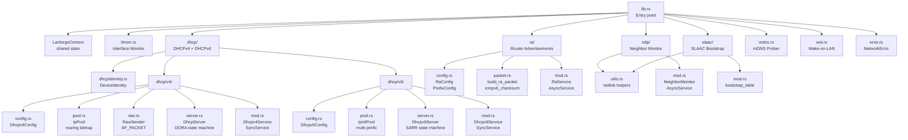
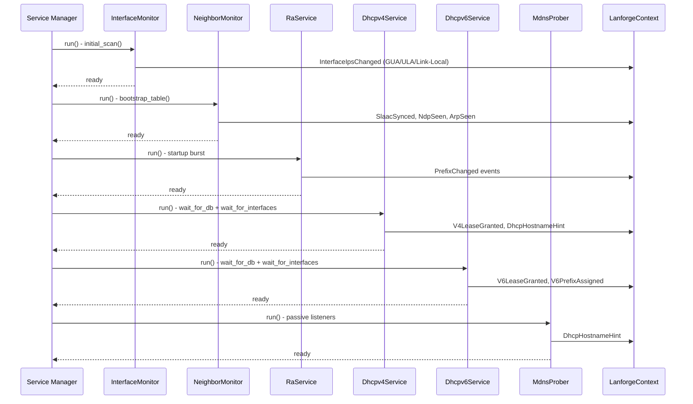
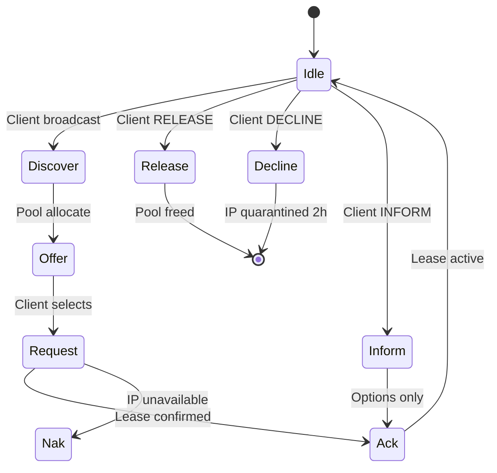
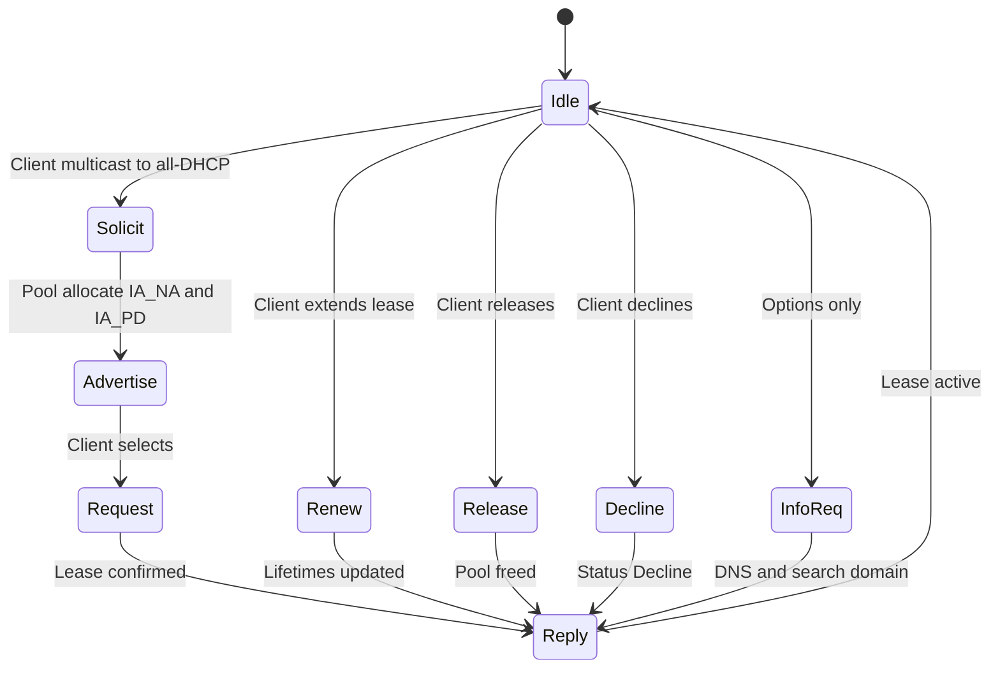
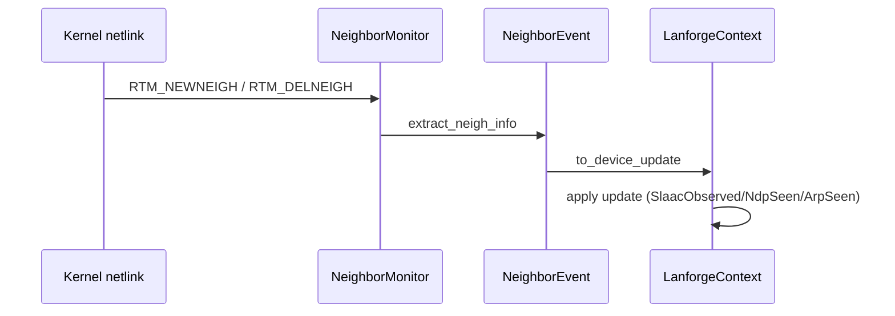

# `lanforge-network` — Library Architecture

Low-level networking and address assignment protocols for the Lanforge daemon.
Implements DHCPv4, DHCPv6, RA, SLAAC, NDP, mDNS, WoL, and interface monitoring — all integrating with `lanforge-core` via `LanforgeContext`, `EventBus`, and `DeviceUpdate` events.

---

## Overview

This crate is the networking engine of Lanforge. It manages every aspect of LAN client lifecycle: IP address assignment (DHCPv4/v6), router advertisement broadcasting (RA/ICMPv6), neighbor discovery (NDP/ARP), mDNS hostname probing, and Wake-on-LAN. All services run either as `SyncService` (blocking I/O for DHCP) or `AsyncService` (async for RA, NDP, mDNS, ifmon).

### Dependencies

| Crate | Usage |
| :--- | :--- |
| `dhcproto` | DHCPv4/v6 message encoding/decoding |
| `pnet` | `AF_PACKET` raw socket channel for L2 packet injection |
| `rtnetlink` | Netlink RTNL for interface queries, neighbor events |
| `roaring` | Efficient IPv4 address pool tracking (`RoaringBitmap`) |
| `socket2` | Low-level socket configuration (`SO_BINDTODEVICE`, raw ICMPv6) |
| `hickory-proto` | mDNS message types (via `Message`, `Query`, `RData`) |
| `lanforge-core` | `LanforgeContext`, `EventBus`, `DeviceUpdate`, service traits |
| `tokio` | Async runtime, `AsyncFd`, `select!`, `spawn_blocking` |
| `tracing` | Diagnostic logging |
| `thiserror` | `NetworkError` |

---

## Module Map



---

## Service Architecture

### Execution Model Split

| Service | Model | Reason |
| :--- | :--- | :--- |
| `Dhcpv4Service` | `SyncService` | Blocking UDP with 200ms timeout — simpler than async raw sockets |
| `Dhcpv6Service` | `SyncService` | Same reasoning as DHCPv4 |
| `RaService` | `AsyncService` | Raw ICMPv6 socket via `AsyncFd` for tokio readiness |
| `InterfaceMonitor` | `AsyncService` | Netlink broadcast + async refresh |
| `NeighborMonitor` | `AsyncService` | Netlink neighbor events + async subnet scans |
| `MdnsProber` | `AsyncService` | Spawn-blocking UDP listeners (port 5353 `SO_REUSEPORT`) |

### Bootstrap Sequence



---

## DHCPv4 — DORA State Machine (RFC 2131)



### `IpPool` — Roaring Bitmap Allocation

| Step | Strategy |
| :--- | :--- |
| 1 | Check `LanforgeContext` for existing static/dynamic lease — return same IP |
| 2 | Try requested IP if free and in range |
| 3 | Random selection from `RoaringBitmap` of available IPs |
| 4 | If pool empty — garbage collect expired leases from context |
| 5 | If still empty — emergency recovery of DECLINE quarantine |

### `RawSender` — L2 Unicast Injection

When a DHCP client has an IP but the server's ARP table lacks the entry, RFC 2131 requires L2 unicast (not L3 UDP). `RawSender` manually assembles Ethernet + IPv4 + UDP headers with checksums via `pnet` `AF_PACKET` channel.

---

## DHCPv6 — SARR State Machine (RFC 8415)



### `Ipv6Pool` — Multi-Prefix Allocation

| Feature | Detail |
| :--- | :--- |
| **Fixed pools** | Bound to specific 64-bit prefix (e.g., `fd00::100`–`fd00::200`) |
| **Floating pools** | Suffix ranges that apply to any managed prefix (ULA or GUA) |
| **Deterministic** | Hash(DUID, IAID, index) for reproducible assignment |
| **Random fallback** | When deterministic slots are taken |
| **Multi-prefix** | Simultaneous ULA + GUA address assignment |
| **IA_PD** | Prefix delegation support for clients needing subnets |

### Key Differences from DHCPv4

- Uses **DUIDs** (not MACs) as primary client identifiers
- Supports **prefix delegation** (IA_PD)
- RECONFIGURE messages for lease renewal (RFC 8415 §18.16)
- Multi-prefix operation (ULA + GUA simultaneously)

---

## Router Advertisements (RFC 4861 + RFC 8106)

### RA Packet Structure

```text
[ ICMPv6 Header: Type=134, Code=0, Checksum ]
[ RA Fixed Fields: HopLimit, M/O/Prf flags, RouterLifetime ]
[ Option 1: Source Link-Layer Address (MAC) ]
[ Option 5: MTU (if configured) ]
[ Option 3: Prefix Information (one per prefix, SLAAC) ]
[ Option 25: RDNSS (DNS servers) ]
[ Option 31: DNSSL (search domains) ]
```

### Timing Behavior

| Phase | Interval | Count |
| :--- | :--- | :--- |
| Startup burst | 16s (`MAX_INITIAL_RTR_ADVERT_INTERVAL`) | 3 RAs |
| Periodic multicast | `MinRtrAdvInterval`–`MaxRtrAdvInterval` (default 67–200s) | Continuous |
| RS-triggered unicast | Random delay 0–500ms | On-demand |
| Min delay between RAs | 3s (`MIN_DELAY_BETWEEN_RAS`) | Storm protection |

### Implemented RFCs

| RFC | Purpose |
| :--- | :--- |
| 4861 | Neighbor Discovery — Full RA/RS support |
| 8106 | RA Options for DNS (RDNSS + DNSSL) |
| 4191 | Default Router Preferences (Low/Medium/High) |
| 3775 | `AdvRouterAddr` flag in Prefix Information |
| 4443 | ICMPv6 checksum calculation |

### Prefix Change Handling

When the GUA prefix changes (via `PrefixChanged` bus event):
1. Update `Ipv6Pool` GUA prefix
2. Reserve static addresses for new prefix
3. Send RECONFIGURE (RENEW) to all clients with existing GUA leases
4. Trigger RA burst to advertise new prefix

---

## Neighbor Discovery Protocol (NDP/ARP)

### Event-Driven Model



### NeighborEvent Classification

| Neighbor State | IP Type | Prefix Match | `DeviceUpdate` Result |
| :--- | :--- | :--- | :--- |
| Active (`REACHABLE`, `STALE`, `DELAY`, `PROBE`) | GUA (`2000::/3`) | Matches `gua` | `SlaacObserved` |
| Active | ULA (`fd00::/8`) | Matches `ula` | `SlaacObserved` |
| Active | Link-Local (`fe80::/10`) | N/A | `NdpSeen` |
| Active | IPv4 | N/A | `ArpSeen` |
| Failed/Incomplete | Any | N/A | Filtered out |
| Delete | Any | N/A | `IpDeleted` |

### ARP Subnet Scan

Triggered by `NeighborScanRequested` bus event:
1. Get interface IPv4 address + prefix length
2. Generate all usable addresses (skip network/broadcast)
3. Probe each address with 10ms pacing
4. Publish `SubnetScanStarted` event for progress tracking

---

## SLAAC Bootstrap

### `bootstrap_table()` — Full Neighbor Dump

| When | Reason |
| :--- | :--- |
| Daemon startup | Initial state synchronization |
| GUA prefix change (RA) | Clients generate new addresses |
| Periodic fallback | Consistency guarantee against drift |

Groups SLAAC addresses by MAC for bulk `SlaacSynced` updates, applies individual `NdpSeen`, `ArpSeen`, `IpDeleted` updates immediately.

---

## mDNS Prober (RFC 6762)

### Design

Uses spawn-blocking `UdpSocket` listeners (non-async) because mDNS requires `SO_REUSEPORT` on port 5353 — the standard async `UdpSocket` cannot share this port with other processes.

### Query Types

| Query | Target | Purpose |
| :--- | :--- | :--- |
| Broadcast PTR | `_services._dns-sd._udp.local.` | Discover all services on LAN |
| Unicast PTR | `X.X.X.X.in-addr.arpa.` (IPv4 reverse) | Query hostname for specific IP |
| Unicast PTR | `x.x...x.ip6.arpa.` (IPv6 reverse) | Query hostname for specific IPv6 |

### Response Parsing

Extracts hostnames from:
- PTR records (name → hostname.local.)
- SRV records (target hostname)

Applies `DeviceUpdate::DhcpHostnameHint` to `LanforgeContext`. Skips update if device already has a hostname (avoids noise).

---

## Wake-on-LAN

### Magic Packet Format

```
[0xFF × 6] [MAC × 16] = 102 bytes total
```

### Redundant Delivery

| Target | Port | Condition |
| :--- | :--- | :--- |
| Directed broadcast (e.g., `192.168.1.255`) | 9 | If provided |
| Unicast (device last known IP) | 9 | If provided |

Uses `socket2` with `SO_BROADCAST` and `SO_BINDTODEVICE` (Linux-specific) for interface-bound sending.

---

## Device Identity Resolution

### `DeviceIdentity` — WTFAI ("Who am I?")

Merges packet-level hints (hostname via DHCP Option 12, vendor class via Option 60/77) with persistent device table state:

| hostname | vendor | Display Output |
| :--- | :--- | :--- |
| Some | Some | `"my-phone" (Android) [aa:bb:cc:dd:ee:ff]` |
| Some | None | `"my-phone" [aa:bb:cc:dd:ee:ff]` |
| None | Some | `(Apple) [aa:bb:cc:dd:ee:ff]` |
| None | None | `[aa:bb:cc:dd:ee:ff]` |

If the packet provides no hostname but the device table has one (from previous lease or CLI static config), the table's version is used — ensuring continuity across reboots.

---

## Interface Monitor

### `InterfaceState` Fields

| Field | Description |
| :--- | :--- |
| `v4` | IPv4 address + prefix length |
| `link_local` | `fe80::/10` address (required for RA/NDP) |
| `gua` | Global Unicast Address (`2000::/3`) with /64 mask |
| `ula` | Unique Local Address (`fd00::/8`) with /64 mask |
| `gua_preferred` / `gua_valid` | Lifetime timers from `IFA_CACHEINFO`

### Lifecycle

1. `initial_scan()` — `RTM_GETADDR` query on startup
2. `refresh_interface()` — updates state on netlink address events
3. Event loop — listens to `NewAddress`/`DelAddress` netlink messages
4. Publishes `DeviceUpdate::InterfaceIpsChanged` on every change

---

## Statistics & Test Contract

The crate contains **65 unit tests + 3 doctests** covering:

| Category | Tests |
| :--- | :--- |
| **DHCPv4 pool** | Range allocation, sticky leases, requested IP, reserved/declined skip, quarantine cleanup, exhaustion recovery (7 tests) |
| **DHCPv4 server** | Invalid packet, DORA cycle, different server ignored, contested IP NAK, release, decline, inform, forcerenew (10 tests) |
| **DHCPv6 pool** | CIDR expansion, dynamic ranged, multi-prefix, opaque random, requested IP, sticky, static reservation, release, reconnect, random fill (12 tests) |
| **DHCPv6 server** | Pool empty, NotOnLink, NoBinding, decline/blacklist, lifetime capping, information request, IA_PD, reconfigure (9 tests) |
| **NDP** | `extract_neigh_info` (valid, incomplete, failed, delete, missing), `to_device_update` (GUA→SlaacObserved, link-local→NdpSeen), EUI-64 MAC extraction, prefix matching, IPv4 subnet iteration (14 tests) |
| **RA config** | Max interval bounds, router lifetime validation (3 tests) |
| **RA packet** | Checksum, odd-length payload, config validation, prefix masking, DNS wire encoding, packet structure, MTU option, empty DNS omission, multiple prefixes (9 tests) |
| **RA state** | Rate limiting, startup intervals (2 tests) |
| **Identity** | Display formatting (4 variants) (1 test) |

---

## Public Contracts Summary

| Type | Contract |
| :--- | :--- |
| `NetworkError` | 9 variants: `Io`, `Netlink`, `Config`, `Socket`, `RawSocket`, `Generic`, `InterfaceNotFound`, `InvalidMac`, `NoLinkLocal`, `Mdns` |
| `InterfaceMonitor` | `new(handle, messages, ifindex, ctx)`, `refresh_interface()`, `initial_scan()`. Implements `LanforgeService` + `AsyncService` |
| `Dhcpv4Service` | `new(cfg, ctx)`. Implements `LanforgeService` + `SyncService` (blocking UDP, 200ms timeout) |
| `Dhcpv4Config` | 13 fields: iface, server_id, range_start/end, lease_time, router, dns, subnet_mask, domain_name, search_domains, port |
| `DhcpServer` | `new(cfg, ctx)`, `handle_packet(data, device) → HandleResult`, `last_assignment_for()`, `build_forcerenew(mac, ip)` |
| `HandleResult` (v4) | `Reply { packet, broadcast, dest_ip, giaddr, hostname }`, `Release { ip }`, `Ignore` |
| `IpPool` | `new(start, end)`, `allocate(ctx, mac, requested)`, `release(ip)`, `mark_declined(ip)`, `cleanup_quarantine(now)`, `reserve_statics(ips)`, `is_in_range(ip)` |
| `RawSender` | `new(iface)`, `send_dhcp(payload, src_ip, dst_ip, dst_mac)`. Manual Ethernet + IPv4 + UDP header assembly via `AF_PACKET` |
| `Dhcpv6Service` | `new(cfg, ctx)`. Implements `LanforgeService` + `SyncService`. Handles `PrefixChanged`, `LeaseRenew`, `LeaseRelease` bus events |
| `Dhcpv6Config` | 9 fields: enabled, iface, lease_time, ula_prefix, ula_prefix_len, port, pools, dns_servers, search_domains |
| `Dhcpv6Server` | `new(cfg, pool, server_duid, ndp_poke_sock, ctx)`, `handle_packet(msg, peer_ip, mac, resp_vec) → HandleResult`, `build_reconfigure(duid, msg_type)` |
| `HandleResult` (v6) | `Reply(bytes, dest_ip, learned_duid, opt_mac, AssignedIAs)`, `Ignore` |
| `Ipv6Pool` | `new(pools, ula_prefix, ula_prefix_len)`, `set_gua_prefix(prefix)`, `allocate(duid, iaid)`, `allocate_prefix(duid, iaid)`, `reserve_statics(ips)`, `construct_addr(prefix, suffix)`, `lookup(duid, iaid)`, `lookup_prefix(duid, iaid)`, `release(duid, iaid)`, `is_on_link(duid, iaid)` |
| `PoolRange` | `Fixed { prefix, start_u128, end_u128 }`, `Floating { start_suffix, end_suffix }` |
| `AssignedIAs` | `na: Vec<u32>` (IA_NA identifiers), `pd: Vec<u32>` (IA_PD identifiers) |
| `RaService` | `new(cfg, ctx)`. Implements `LanforgeService` + `AsyncService`. Raw ICMPv6 socket via `AsyncFd` |
| `RaState` | `new()`, `next_interval()`, `can_multicast_now()`, `can_unicast_now()`, `record_multicast()`, `record_unicast()` |
| `RaConfig` | 13 fields: iface, managed, other_config, hop_limit, priority, max_interval, min_interval, router_lifetime, mtu, prefixes, rdnss, dnssl. `validate()` enforces RFC 4861 bounds |
| `PrefixConfig` | `ula(prefix)`, `gua_dynamic()`. Fields: source, prefix_len, on_link, autonomous, router_addr, valid_lifetime, preferred_lifetime |
| `PrefixLifetime` | `Secs(u32)`, `Infinity`. `as_u32()` → raw packet value |
| `RouterPriority` | `Low`, `Medium`, `High`. `bits()` → RFC 4191 priority bits |
| `RdnssConfig` | `new(servers)`, `with_lifetime(servers, secs)` |
| `build_ra_packet(cfg, mac, gua_prefix)` | Returns `Vec<u8>` with full ICMPv6 RA packet + checksum |
| `icmpv6_checksum(src, dst, payload)` | RFC 4443 §2.3 — IPv6 pseudo-header checksum |
| `encode_dns_wire(domains)` | RFC 1035 §3.1 DNS wire format for DNSSL |
| `NeighborMonitor` | `new(handle, messages, ifindex, ctx)`, `spawn_subnet_scan()`. Implements `LanforgeService` + `AsyncService` |
| `bootstrap_table(ctx, prefix, handle, gua, ula, ifindex)` | Full neighbor dump → `SlaacSynced`, `NdpSeen`, `ArpSeen`, `IpDeleted` |
| `MdnsProber` | `new(ctx)`, `trigger_scan()`, `probe_ip(ip)`. Implements `LanforgeService` (non-critical) + `AsyncService` |
| `send_wol_magic_packet(mac, iface, directed_broadcast, unicast_ip)` | Sends 102-byte magic packet to broadcast + unicast targets |
| `DeviceIdentity` | `new(mac, hostname, vendor)`, `resolve(mac, pkt_hostname, pkt_vendor, device)`. Implements `Display` |
| `lookup_mac_for_ipv6(handle, ip)` | Query kernel NDP table for MAC address |
| `get_ipv6_neighbors(handle, prefix, ifindex)` | Dump all IPv6 neighbors, filtered by prefix |
| `get_ipv4_neighbors(handle, ifindex)` | Dump all IPv4 neighbors (ARP table) |
| `probe_neighbor(handle, ifindex, ip, mac)` | Trigger NDP/ARP probe |
| `parse_neighbor_msg(msg)` | Parse netlink neighbor message → `NeighborEvent` |
| `extract_neigh_info(msg)` | Extract `NeighborEvent` from netlink broadcast |
| `get_ipv4_subnet_iterable(ip, prefix_len)` | Iterator over all usable IPv4s in a CIDR subnet (zero-allocation) |
